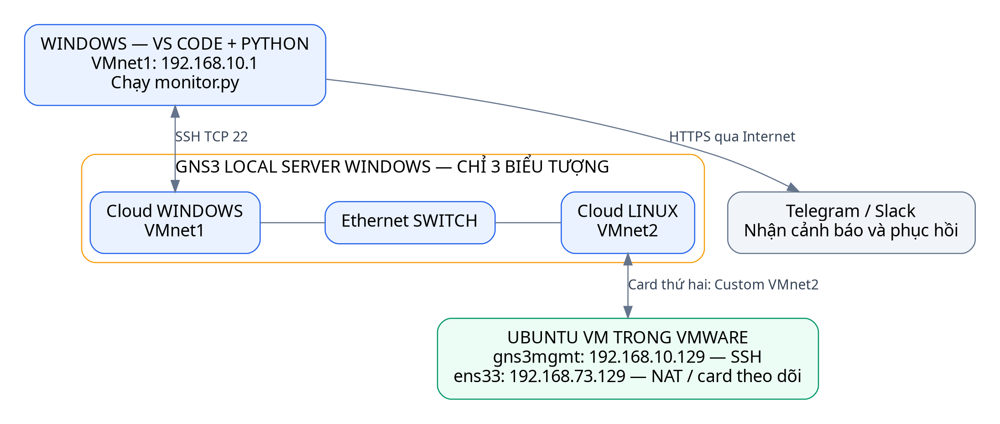

# Làm mô hình GNS3 đơn giản và chạy giám sát

> Với trường hợp Windows đã bắt được SYN-ACK nhưng không hoàn tất kết nối qua
> Cloud/loopback, dùng [hướng dẫn TAP/UDP](WINDOWS_TAP_GNS3.md). Phương án này
> vẫn buộc cả hai chiều SSH đi qua switch GNS3, giữ IP Linux .10.129.

Bạn đã có Windows, GNS3, VMware và Ubuntu. Chúng ta chỉ dùng **2 Cloud + 1
Ethernet switch**, nối Windows sang Linux bằng SSH. Chưa cần router, VPCS,
GNS3 VM, SNMP hay card mạng thử thứ ba.

Cloud là đầu nối tới card mạng thật của Windows; switch nối hai đầu đó.
Linux vẫn chạy trong VMware. Mở project GNS3 không tự tạo hoặc bật Linux.

## Bước 1 — Cập nhật code trong VS Code trên Windows

Mở Terminal → PowerShell, chạy từng dòng, không chép dấu PS ...> hoặc số thứ tự:

~~~powershell
cd D:\QTM_NC\telegram\qtmnc
git fetch origin
git merge --ff-only origin/main
~~~

Nếu chưa có dự án, dùng git clone https://github.com/tunato2807-del/qtmnc.git
rồi mở thư mục qtmnc trong VS Code. Không clone chồng thư mục đang có.

Bạn chỉ cần quan tâm:

| File | Dùng để làm gì |
|---|---|
| monitor.py | Đọc luồng chương trình chính |
| .env.simple | IP, tài khoản và token của bạn; được tạo ở bước 5 |
| setup_windows.cmd | Cài và nhập cấu hình một lần |
| run_windows.cmd | Chạy mỗi khi muốn giám sát |

Thư mục device_monitor là phần xử lý chi tiết có sẵn. Bạn chưa cần sửa nó.

## Bước 2 — Thêm một card mạng cho Linux trong VMware

**Nếu đã có gns3mgmt 192.168.10.129 từ mô hình trước**, giữ nó và chuyển sang
bước 3. Card/mạng thử của mô hình trước có thể để nguyên, bản này không dùng.

1. Shut Down Ubuntu.
2. VMware → Edit → Virtual Network Editor → Change Settings.
3. Giữ nguyên VMnet8 NAT đang dùng.
4. Đặt VMnet1 và thêm VMnet2 theo bảng:

| Mạng VMware | Loại | Subnet | Host adapter Windows | DHCP |
|---|---|---|---|---|
| VMnet1 | Host-only | 192.168.10.0/24 | 192.168.10.1 | Tắt |
| VMnet2 | Host-only | 192.168.20.0/24 | 192.168.20.1 | Tắt |

Bật "Connect a host virtual adapter to this network" cho cả hai, rồi Apply.
Nếu VMnet2 đang thuộc lab khác, dùng mô hình trước hoặc chọn VMnet trống và thay
mapping tương ứng; không ghi đè mạng lab đang sử dụng.

5. Ubuntu → Edit virtual machine settings:
   - Card thứ nhất: giữ NAT, thường là ens33.
   - Add → Network Adapter → Custom: VMnet2.
   - Hai card bật Connected / Connect at power on.
6. Khởi động Ubuntu.

Đường quản trị sẽ là Windows VMnet1 → GNS3 → VMnet2 → Linux.
GNS3 nối hai mạng Ethernet, nên NIC2 Linux sẽ dùng IP **192.168.10.129**.
Windows VMnet2 vẫn để .20.1; không đổi thành .10.x và không tạo Network Bridge.

## Bước 3 — Kéo ba biểu tượng trong GNS3

Đóng project GNS3 cũ (File → Close project) trước khi chạy lab mới, để tránh
hai đường nối trùng VMnet.

1. File → New blank project → tên QTMNC_SIMPLE.
2. Kéo **2 Cloud** từ danh sách thiết bị. Khi hỏi server, chọn **Local server /
   Run on local computer**, tức máy Windows đang chạy GNS3.
3. Đổi tên Cloud thứ nhất WINDOWS, Cloud thứ hai LINUX.
4. Kéo **1 Ethernet switch**, đặt tên SWITCH.
5. Chuột phải WINDOWS → Configure → Ethernet interfaces:
   bật Show special Ethernet interfaces nếu có, chọn
   **VMware Network Adapter VMnet1** → Add → OK.
6. Với LINUX, làm tương tự nhưng chọn **VMware Network Adapter VMnet2**.
7. Bấm Add a link, nối đúng hai dây:

~~~text
WINDOWS (VMnet1) ─── SWITCH Ethernet0
LINUX   (VMnet2) ─── SWITCH Ethernet1
~~~

8. Bấm nút xanh Start all nodes. Giữ Ubuntu đang chạy trong VMware.

Không chọn Wi-Fi, Radmin VPN hoặc VMnet8 thay cho hai adapter trong bảng.
Nếu không thấy VMnet, kiểm tra local server và Npcap, rồi mở lại GNS3 sau khi
tạo VMnet. Cloud chạy trong GNS3 VM sẽ không thấy card Windows.

Có sẵn mẫu lab/gns3/QTMNC_SIMPLE.gns3 nếu muốn mở bằng File → Open Project.
Hãy sao chép mẫu sang Documents trước khi mở và vẫn kiểm tra mapping hai Cloud.
Cách kéo thả ở trên giúp bạn dễ hiểu mô hình hơn.

## Bước 4 — Cài SSH và đặt IP Linux

Trên **console Ubuntu trong VMware**:

~~~bash
sudo apt update
sudo apt install -y openssh-server python3
sudo systemctl enable --now ssh
ip -br addr
ip -br link
~~~

ens33 là card NAT cũ 192.168.73.129. Card mới có thể tên ens37/ens38.
Đối chiếu MAC trong VMware settings để chọn đúng card mới, không chọn ens33.

Trên **Terminal Windows**, chuyển hai file hỗ trợ qua IP NAT hiện tại:

~~~powershell
scp .\lab\linux\configure_network.py .\lab\linux\labctl.py tuanto@192.168.73.129:~/
~~~

Nếu IP NAT đã đổi, thay .73.129 bằng IP thấy trong ip -br addr.
Lần đầu SSH hỏi khóa: lấy fingerprint từ console Linux bằng lệnh ở bước 5,
đối chiếu trước khi chấp nhận.

Trở lại **console Ubuntu**, ví dụ card mới đúng là ens37:

~~~bash
sudo python3 ~/configure_network.py --management-iface ens37
sudo netplan try --timeout 60
~~~

Kiểm tra, Enter xác nhận rồi:

~~~bash
sudo reboot
~~~

Sau reboot, chạy ip -br addr. Cần có:

~~~text
ens33       ... 192.168.73.129/24
gns3mgmt    ... 192.168.10.129/24
~~~

Tool chỉ thêm cấu hình NIC quản trị theo MAC, không thay card NAT/default route.
Nếu báo khai báo trùng NIC, xem cấu hình netplan/NetworkManager cũ của card mới,
sao lưu rồi xử lý đúng profile đó; không xóa toàn bộ cấu hình mạng.

Trên **Windows**, khi GNS3 đã Start:

~~~powershell
Test-NetConnection 192.168.10.129 -Port 22
~~~

TcpTestSucceeded: True là đi tiếp được. Nếu False, kiểm tra đúng VMnet của hai
Cloud, NIC2 VMnet2, IP Linux và dịch vụ ssh. Nếu Ubuntu có UFW đang bật, cho phép
TCP22 từ 192.168.10.1 tới 192.168.10.129; không tắt toàn bộ firewall.

## Bước 5 — Nhập cấu hình và chạy

Ở **Windows**, trong thư mục dự án:

~~~powershell
.\setup_windows.cmd --configure
~~~

Chọn mặc định IP 192.168.10.129, tài khoản tuanto và card theo dõi ens33.
Nhập mật khẩu Linux; khi gõ không có ký tự hiện lên là bình thường.
Chọn telegram, nhập token và chat ID. Bot phải được nhắn /start trước khi nhận tin.
Bạn đã có token/chat ID ở file cũ thì wizard tự lấy lại; Enter để giữ.
Có thể chọn slack/both nếu đã có Slack Incoming Webhook của workspace.

Nếu hỏi fingerprint, trên **console Linux** chạy:

~~~bash
ssh-keygen -lf /etc/ssh/ssh_host_ed25519_key.pub
~~~

Dán chuỗi SHA256 hoặc cả dòng kết quả vào wizard Windows, sau khi kiểm tra cùng
loại khóa. Không lấy fingerprint chỉ từ dòng Windows đang yêu cầu xác nhận.

Sau khi setup thành công, trên Windows:

~~~powershell
.\run_windows.cmd --test
.\run_windows.cmd
~~~

--test gửi tin thử thật tới kênh cấu hình. Lệnh thứ hai mở bảng giám sát.
Sau này chỉ cần run_windows.cmd hoặc F5. Ctrl+C dừng.
Không cần cài Python, dependency của dự án hoặc SNMP agent trên Ubuntu.

Bản hiện tại dùng lại kết nối SSH và chạy một lệnh thu thập gộp mỗi lượt.
Nếu VM có CPU cao hoặc xuất hiện SSHException/TimeoutError, làm theo
[hướng dẫn CPU/SSH](docs/SSH_CPU_TROUBLESHOOTING.md). File .env.simple cũ vẫn giữ
giá trị riêng của bạn; cập nhật Git không tự thay timeout của file này.

## Bước 6 — Hiểu và thử cảnh báo

Chương trình đọc CPU/RAM/nhiệt độ/interface, so với ngưỡng rồi gửi tin khi đổi
trạng thái. Đọc xong mỗi vòng sẽ chờ 5 giây; mạng chậm có thể tăng độ trễ.
Ngưỡng mặc định: CPU >75%, RAM >65%, nhiệt độ >65°C.
Chỉ phục hồi khi lần lượt <=70%, <=60%, <=60°C để tránh nhấp nháy cảnh báo.

**Thử mất kết nối:** trong GNS3, chuột phải một dây Cloud–SWITCH → Delete.
Chờ cảnh báo mất SSH, rồi Add a link để nối lại đúng hai port cũ → nhận phục hồi.
Cách này cũng chứng minh SSH thực sự qua GNS3; không phụ thuộc switch tích hợp
có hỗ trợ nút Stop hay không. Nếu SSH .10.129 vẫn được khi tháo dây quản trị,
kiểm tra project cũ còn chạy, đường nối khác hoặc Windows Bridge.

**Thử CPU:** trên Ubuntu, khi NAT còn hoạt động:

~~~bash
sudo apt install -y stress-ng
stress-ng --cpu 0 --timeout 30s
~~~

Tải tự dừng sau 30 giây. Chờ cảnh báo rồi phục hồi. Nếu máy ảo thiếu tài nguyên
hoặc host đang bận, chỉ số/độ trễ có thể khác.

**Thử interface:** ta đang theo dõi ens33, trong khi SSH đi qua gns3mgmt.
VMware → Ubuntu Settings → card **thứ nhất NAT** → bỏ Connected khoảng 15 giây
rồi bật lại. Giữ card thứ hai VMnet2 luôn Connected.
Windows vẫn đọc được ens33 DOWN/UP qua đường GNS3; Internet của Ubuntu tạm ngắt
trong ca này. Nếu tên card NAT khác ens33, chỉnh MONITOR_IFACE trong .env.simple.
Chỉ tháo dây GNS3 chưa chắc làm carrier VMware đổi DOWN.

**Nhiệt độ:** VM thường không có cảm biến CPU vật lý. Hiện KHÔNG XÁC ĐỊNH là đúng,
không phải 0°C. Nếu muốn bỏ chỉ số này trong buổi demo đầu, sửa .env.simple thành
MONITOR_TEMP_ENABLED='false', lưu rồi chạy lại; ghi rõ chưa đo nhiệt độ trong báo cáo.

**Thử RAM:** trên Ubuntu chạy một bài thử có giới hạn:

~~~bash
python3 ~/labctl.py ram --target 75 --seconds 45
~~~

Chờ RAM vượt 65% và nhận tin. Sau khi dừng, chỉ có tin phục hồi nếu RAM <=60%.
Tool giới hạn theo RAM khả dụng, không bảo đảm đạt chính xác 75%.

**Nếu cần demo nhiệt độ trên VM:** trong .env.simple trên Windows, giữ
MONITOR_TEMP_ENABLED='true' và đổi TEMP_SOURCE='demo'. Trên Ubuntu:

~~~bash
sudo python3 ~/labctl.py temperature --celsius 75 --seconds 30
~~~

Chạy lại monitor Windows. Nhiệt độ demo 75°C vượt ngưỡng, sau 30 giây về nền40°C.
Bảng, tin cảnh báo và phục hồi đều ghi MÔ PHỎNG. Muốn đo thật, đổi lại
TEMP_SOURCE='auto'; không dùng demo để kết luận đo được nhiệt vật lý của host.

## Đọc code theo bốn bước

Mở monitor.py, đọc các chú thích 1–4:

1. Đọc .env.simple và chọn nơi nhận tin.
2. Chuẩn bị kết nối SSH và bảng hiển thị.
3. Đọc chỉ số, so ngưỡng, tạo cảnh báo khi trạng thái thay đổi.
4. Hiển thị và gửi tin; chờ rồi lặp lại.

Thư mục device_monitor giữ chi tiết đã kiểm thử, gồm xác minh SSH, tính CPU/RAM,
chống gửi lặp và giữ tin khi mất Internet. Bạn có thể học từng phần sau khi demo
cơ bản đã chạy được.

Đây là bản dùng SSH, phù hợp hướng đề tài "qua SNMP/SSH". Nếu giảng viên yêu cầu
**cả hai giao thức**, dùng [bản SNMP/hybrid mở rộng](docs/GNS3_LAB.md).
Phần VMware/GNS3 trên Windows cần kiểm tra thực tế theo các bước trên.
