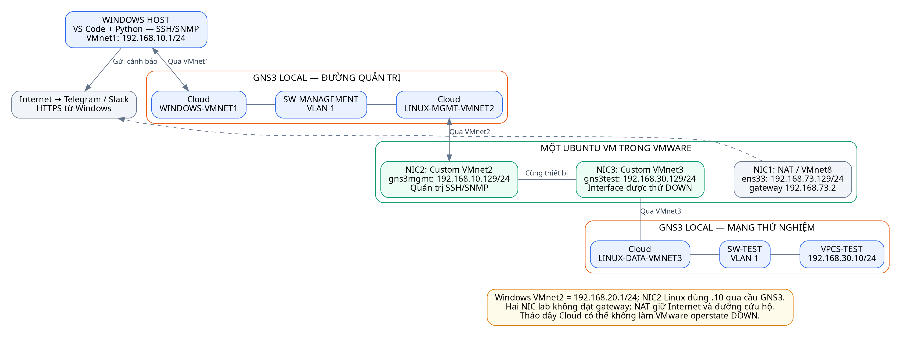

# GNS3 Device Monitor — Python, SSH/SNMP, Telegram/Slack

Đề tài: **Hệ thống giám sát trạng thái thiết bị và gửi cảnh báo qua Telegram/Slack**.
Windows chạy Python trong VS Code, đi qua mạng GNS3 để giám sát CPU, RAM, nhiệt
độ và trạng thái interface của Linux VMware. Chọn SSH, SNMP hoặc hybrid; nhận
cảnh báo khi lỗi và khi phục hồi, chu kỳ profile GNS3 mặc định 5 giây.

**Bắt đầu tại [hướng dẫn GNS3 từng bước trên Windows](docs/GNS3_LAB.md).**
Hướng dẫn gồm Virtual Network Editor, thêm NIC VMware, chọn local server,
mapping Cloud, nối switch/VPCS, đặt IP Linux, SSH, SNMP và thử cảnh báo.

## Tải và cập nhật trong Terminal VS Code

Tải lần đầu:

~~~powershell
git clone https://github.com/tunato2807-del/qtmnc.git
cd qtmnc
code .
~~~

Nếu đã có dự án tại đường dẫn cũ:

~~~powershell
cd D:\QTM_NC\telegram\qtmnc
git fetch origin
git merge --ff-only origin/main
~~~

Không thêm số "1." trước lệnh. Cần Git và Python 3.10+ trên Windows.
Nếu có thay đổi cục bộ, giữ lại và xử lý trước khi merge; không reset --hard.

## Lab được thiết kế

| Đường | Thành phần |
|---|---|
| Quản trị | Windows VMnet1 .10.1 → Cloud → SW-MANAGEMENT → Cloud VMnet2 → Linux gns3mgmt .10.129 |
| Interface thử | Linux gns3test .30.129 → Cloud VMnet3 → SW-TEST → VPCS .30.10 |
| NAT dự phòng | Linux ens33 .73.129 → VMnet8, gateway .73.2 |

Subnet đầy đủ lần lượt là 192.168.10.0/24, 192.168.30.0/24, 192.168.73.0/24.
Windows VMnet2 dùng 192.168.20.1 để không tạo đường .10 trực tiếp bỏ qua GNS3.
Ba Cloud, hai Ethernet switch và một VPCS chạy trên **GNS3 local server Windows**;
Ubuntu vẫn chạy bên ngoài trong VMware. Không cần image router hoặc GNS3 VM.

## Cài và chạy sau khi đã nối mạng

~~~powershell
.\setup_windows.cmd --configure
.\.venv\Scripts\python.exe -m device_monitor --env-file .env.gns3 --test-notifications
.\run_windows.cmd
~~~

Wizard tạo .venv, cài thư viện, hỏi giao thức/kênh cảnh báo, lưu secret vào
.env.gns3 và kiểm tra SSH nếu có. Đích mặc định 192.168.10.129, user tuanto,
interface gns3test. Lấy fingerprint từ console Linux để xác minh host key.
Có thể dán toàn dòng ssh-keygen; password nhập ở ô mật khẩu, không nhập vào ô
chọn phương thức xác thực. Secret không hiện ký tự khi gõ và không được commit.

F5 trong VS Code chạy cùng profile. Bản cũ dùng .env vẫn có thể chạy:
python monitor_ssh.py --env-file .env. Không tự chép secret cũ vào profile mới.

Các lệnh riêng:

~~~powershell
.\.venv\Scripts\python.exe -m device_monitor --env-file .env.gns3 --check-config
.\.venv\Scripts\python.exe -m device_monitor --env-file .env.gns3 --once
.\.venv\Scripts\python.exe -m device_monitor --env-file .env.gns3 --display table
~~~

--check-config không kết nối thiết bị hoặc gửi tin. --test-notifications gửi
tin TEST thật qua các kênh cấu hình. --once lấy một mẫu và thử gửi tin đến hạn.
--display log dành cho log gọn; auto dùng bảng Rich cập nhật tại chỗ khi có TTY.
Ctrl+C dừng an toàn, tin chưa gửi vẫn còn trên đĩa.

## Đủ bốn chỉ số, hai giao thức, hai kênh

| Chức năng | Thực hiện |
|---|---|
| CPU/RAM | CPU từ chênh lệch /proc/stat, RAM từ MemAvailable |
| Nhiệt độ | Cảm biến Linux thật hoặc demo có nhãn; thiếu dữ liệu là UNKNOWN |
| Interface | SSH đọc operstate; SNMP đọc IF-MIB theo ifName/ifIndex |
| SNMP Linux | Net-SNMP extend JSON cho CPU/RAM/nhiệt; agent read-only riêng |
| Hybrid | SSH ưu tiên tài nguyên, SNMP ưu tiên interface; dự phòng và báo mất từng dịch vụ |
| Telegram/Slack | Chọn một hoặc cả hai, xác nhận thành công theo API |
| Chống spam | Chỉ báo chuyển trạng thái; hysteresis khi phục hồi |
| Retry | SQLite outbox bền vững, backoff, xử lý 429, giữ tin qua restart |
| Giao diện | Số làm tròn, nguồn dữ liệu, trạng thái/ngưỡng, hàng đợi từng kênh |
| Lab | Project GNS3 mẫu, netplan theo MAC, công cụ tạo CPU/RAM/DOWN/nhiệt demo có hạn |

Ngưỡng: CPU >75%, RAM >65%, nhiệt độ >65°C; margin=5 nên phục hồi lần lượt
<=70%, <=60%, <=60°C. Mạng polling cho cảnh báo **gần thời gian thực**, không
bảo đảm thời hạn cứng. VM thường không có nhiệt độ CPU vật lý: auto báo UNKNOWN;
demo luôn ghi MÔ PHỎNG trên bảng và tin nhắn. Không trình bày demo thành số đo thật.

SNMPv2c được chọn rõ cho lab tách biệt. Chương trình hỗ trợ v3 authPriv SHA/AES
khi agent đã có user tương ứng; installer lab chỉ cấp cấu hình v2c read-only.
Thiết bị hãng khác dùng SNMP_PROFILE=custom và OID đã đối chiếu MIB.

## Cấu trúc và tài liệu

~~~text
device_monitor/       CLI, collectors, engine, SQLite, notification, Rich UI
examples/gns3.env      profile mẫu, không có secret
lab/gns3/             project GNS3 có sẵn
lab/linux/            cấu hình NIC, agent SNMP, công cụ tạo tải thử
tools/                sinh project GNS3
docs/GNS3_LAB.md       hướng dẫn triển khai từng bước
docs/ARCHITECTURE.md   thiết kế, nguồn chỉ số, quy tắc và giới hạn
docs/TEST_PLAN.md      kịch bản nghiệm thu và bằng chứng cần chụp
docs/diagrams/         Word/PDF, PNG/SVG và nguồn Mermaid/Graphviz
tests/                unit test và tích hợp giao thức loopback
~~~

- [Hướng dẫn GNS3 chi tiết](docs/GNS3_LAB.md)
- [Thiết kế hệ thống](docs/ARCHITECTURE.md)
- [Kiểm thử và kịch bản demo](docs/TEST_PLAN.md)
- [8 sơ đồ cho báo cáo, Word và PDF](docs/diagrams/README.md)
- [Tham khảo cấu hình nâng cao của bản trước](docs/legacy/README_CLASSIC.md)

Các hướng dẫn WINDOWS_TO_LINUX.md / LINUX_VM_TO_WINDOWS.md mô tả đường NAT
trực tiếp của bản trước; dùng GNS3_LAB.md cho quy trình mới.

## Kiểm thử và giới hạn

~~~powershell
.\.venv\Scripts\python.exe -m unittest discover -s tests -v
.\.venv\Scripts\python.exe -m pip check
~~~

requirements-tested.txt ghi phiên bản đã kiểm thử. Bộ test dùng mock và dịch vụ
loopback; có SNMPv2c/v3 GET/GETNEXT thật. Không gửi Telegram/Slack thật và không
truy cập máy của bạn. Project được kiểm tra theo schema GNS3, nhưng VMware,
Npcap, firewall và mapping Cloud cần nghiệm thu trên Windows thực tế.

Một tiến trình/một state file; không lưu lịch sử toàn bộ số đo để vẽ biểu đồ.
Outbox gửi theo cơ chế at least once nên có thể trùng tin khi phản hồi bị mất.
Windows ngủ/tắt có thể dừng cả GNS3 và VM. Chi tiết trong ARCHITECTURE.md.
