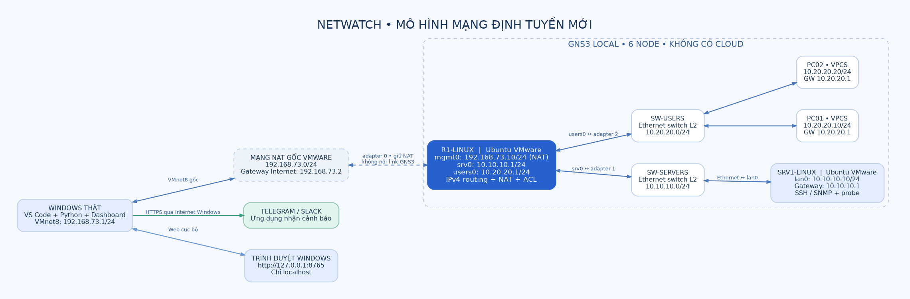
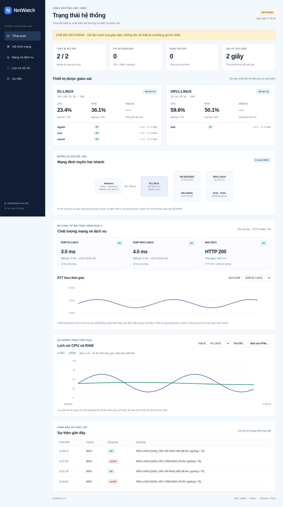

# NetWatch — giám sát mạng định tuyến GNS3

Bản **làm lại từ đầu** cho đồ án: Python trên Windows giám sát CPU, RAM, nhiệt độ và trạng thái cổng của **router Linux R1 + máy chủ Linux SRV1**, lưu lịch sử và gửi cảnh báo Telegram/Slack.

**Tải và mở bằng VS Code:** xem [hướng dẫn từng lần bấm](docs/00_TAI_BANG_VSCODE.md). File [NETWATCH_XEM_NGAY.gns3](lab/gns3/NETWATCH_XEM_NGAY.gns3) mở được ngay để xem sơ đồ, không chứa VM hoặc đường dẫn VMX giả. Chạy `open_gns3_lab.cmd` để tạo/mở topology Ubuntu thật sau khi chọn hai VMX trên máy bạn.

**Bổ sung từ Buổi 5:** đo RTT/mất gói, giám sát HTTP 200/chậm>3s, CSV tự ghi, iperf3 theo yêu cầu và báo cáo HTML/PDF. [Bảng đối chiếu cả 10 lab và cách thực hiện](docs/05_BUOI_5.md). Profile `start_buoi5.cmd` dùng 5s/CPU85%/RAM90%; profile đồ án vẫn 15s/75%/65%.



Mô hình dùng đúng tài nguyên bạn có: **hai full clone Ubuntu VMware, hai Ethernet switch tích hợp và hai VPCS**. R1 thực hiện IPv4 routing, NAT và luật chặn cổng quản trị từ mạng Users. Windows đi tới SRV1 qua R1 và switch GNS3. Có **0 node Cloud**, không cần TAP, router Cisco hoặc GNS3 VM.

## Bắt đầu trên Windows

Mở PowerShell tại `D:\QTM_NC\telegram\qtmnc`, chạy từng dòng, không chép ký hiệu `PS>` hoặc số thứ tự:

```powershell
git pull --ff-only origin main
.\setup.cmd
.\start.cmd --demo
```

Mở **http://127.0.0.1:8765** để xem giao diện minh họa. Chế độ demo không SSH và không gửi tin. Để triển khai thật, làm tuần tự **[Hướng dẫn GNS3 từng bước](docs/01_GNS3.md)** → **[Cấu hình giám sát](docs/02_SU_DUNG.md)** → **[Kịch bản nghiệm thu](docs/03_NGHIEM_THU.md)**.

Nếu tải gói ZIP: giải nén vào **thư mục mới**, bỏ dòng `git pull`, rồi chạy `setup.cmd` và `start.cmd --demo`. Không chép ZIP đè lên dự án cũ.



## Địa chỉ trong thiết kế mới

| Thành phần | Địa chỉ | Vai trò |
|---|---|---|
| Windows / VMnet8 | `192.168.73.1/24` | Chạy VS Code, Python, dashboard; gửi tin qua Internet của Windows |
| R1 `mgmt0` | `192.168.73.10/24` | Card NAT gốc VMware; nhận kết nối từ Windows |
| R1 `srv0` | `10.10.10.1/24` | Gateway mạng Servers |
| SRV1 `lan0` | `10.10.10.10/24` | Thiết bị giám sát qua mạng GNS3 |
| R1 `users0` | `10.20.20.1/24` | Gateway mạng Users |
| PC01 / PC02 | `10.20.20.10/24`, `10.20.20.20/24` | VPCS thử ping và định tuyến |

VMnet8 giữ subnet hiện có `192.168.73.0/24`, gateway NAT VMware `192.168.73.2`. IP `.10` phải chưa sử dụng và nằm ngoài pool DHCP. Dải VMnet nội bộ GNS3 phải khác các mạng `10.10.10.0/24`, `10.20.20.0/24` để tránh đường đi tắt.

## Có gì trong bản mới

- **Giám sát:** SSH giữ kết nối, một probe Python/chu kỳ; SNMPv2c tùy chọn qua Net-SNMP extend của cùng probe.
- **Cảnh báo:** Ngưỡng, vùng phục hồi, UNKNOWN, mất kết nối, gộp thay đổi theo thiết bị/chu kỳ; hàng đợi SQLite thử lại khi gửi lỗi.
- **Dashboard:** Hai thiết bị, CPU/RAM/nhiệt độ, nhiều interface, Rx/Tx Mbps, biểu đồ, sự kiện, CSV; chỉ mở trên localhost.
- **Chất lượng mạng/dịch vụ:** RTT, packet loss, HTTP status/thời gian nhận header, cảnh báo/phục hồi và lịch sử; tải HTML độc lập rồi in PDF.
- **Lab:** `create_lab.cmd` tạo `.gns3` sau khi chọn **hai VMX thật**; `lab/provision.py` cấu hình clone có backup và bản xem trước.
- **Báo cáo:** [Bản Word](docs/report/Bao_cao_NetWatch.docx), [PDF](docs/report/Bao_cao_NetWatch.pdf), sơ đồ và bảng liên hệ bảy tài liệu môn học.
- **Thuyết trình:** [PowerPoint 22 slide](docs/presentation/NetWatch_22_slide.pptx), chữ tối thiểu 20 pt và [dàn ý chi tiết](docs/presentation/Dan_y_22_slide.md).

Secret nhập bằng `configure.cmd` và chỉ lưu trong `.env.netwatch`, được Git bỏ qua. File host key, dữ liệu SQLite và project sinh theo máy cũng được bỏ qua. Không sử dụng cấu hình, database hoặc môi trường ảo của ứng dụng cũ.

Phép đo ICMP chạy mỗi 60s; dịch vụ HTTP chỉ bật khi bạn chạy web mẫu và chọn profile Buổi 5. iperf3 không tự chạy định kỳ hoặc tải đường mạng liên tục.

## Kiểm thử phần mềm

```bash
python -m venv .venv-test
.venv-test/bin/python -m pip install -r requirements-dev.txt
.venv-test/bin/python -m unittest discover -v
```

Trên Windows dùng `.venv-test\Scripts\python.exe`. Test giao thức dùng SSH/SNMP loopback và dữ liệu giả có kiểm soát; **không thay cho nghiệm thu GNS3/VMware trên máy bạn**. Xem [phạm vi xác minh](docs/VALIDATION.md).

## Chuyển từ dự án cũ

Đóng các tiến trình monitor/helper cũ, dùng `setup.cmd` tạo `.venv-netwatch` riêng. Các lệnh `run_windows.cmd`, `run_tap_windows.cmd` và mô hình Cloud cũ đã được bỏ khỏi bản đang dùng. Không cần xóa Ubuntu gốc, token cũ hoặc adapter Windows để cài bản mới. Lịch sử Git tại commit `961ac0b` giữ phiên bản trước để tham khảo/phục hồi.
