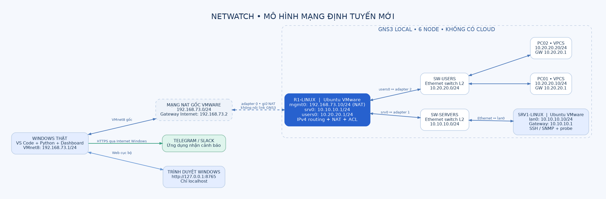

# Dựng mô hình GNS3 mới, từng bước

Mục tiêu: **Windows → R1 router Linux → SW-SERVERS → SRV1 Linux**. Nhánh thứ hai **R1 → SW-USERS → PC01, PC02** chứng minh định tuyến liên mạng. Windows không phải node GNS3; card NAT của R1 nối với Windows bằng VMware. Không dùng Cloud.

Để **chỉ mở xem sơ đồ ngay**: mở `lab/gns3/NETWATCH_XEM_NGAY.gns3` hoặc chạy `open_gns3_preview.cmd`. Bản này chỉ có hình vẽ, không khởi động thiết bị. Để tạo/mở **lab chạy thật** sau khi chuẩn bị clone, dùng `open_gns3_lab.cmd`; công cụ tự tìm VMX theo tên nếu duy nhất hoặc hỏi chọn hai file một lần. [Hướng dẫn VS Code](00_TAI_BANG_VSCODE.md).



## 1. Chuẩn bị và hiểu đúng các cửa sổ

| Nơi thao tác | Làm gì |
|---|---|
| VMware Workstation | Sao chép Ubuntu, cấp RAM/card mạng và mở console Ubuntu |
| GNS3 2.2.x local server | Nối router, server, switch, VPCS; khởi động topology |
| Console Ubuntu trong VMware | Lệnh `sudo`, `ip`, `netplan`, cài probe và tài khoản |
| PowerShell trên Windows | Lệnh `Test-NetConnection`, tuyến Windows, chạy Python/dashboard |
| VS Code trên Windows | Mở thư mục dự án và sửa `inventory.json` |

GNS3 VM không cần cho thiết kế này. Cần VMware Workstation có `vmrun` và chức năng **Clone**. Mỗi clone có thể dùng 1 vCPU, 1–2 GB RAM khi tắt giao diện desktop; đây là cấu hình khởi đầu, điều chỉnh theo tài nguyên máy thật. Không chạy đồng thời nhiều bản Ubuntu desktop cũ khi đo tải nền.

Trước khi làm: lưu file đang mở; đóng monitor/helper cũ; tắt project GNS3 cũ. Giữ Ubuntu gốc để dự phòng. Các bước xóa/đổi cấu hình mạng dưới đây **chỉ áp dụng hai full clone mới**.

## 2. Kiểm tra VMnet8 đang có

**VMware:** `Edit → Virtual Network Editor → Change Settings` nếu có → chọn **VMnet8**.

- Type: **NAT**.
- Subnet IP: `192.168.73.0`, mask `255.255.255.0`.
- NAT Settings: ghi lại gateway; thiết kế này dùng `192.168.73.2`.
- Host adapter: bật; Windows đang dùng `192.168.73.1/24`.
- DHCP Settings: kiểm tra `.10` nằm ngoài Start–End; ví dụ pool `.128–.254` thì `.10` nằm ngoài.

**Subnet IP là địa chỉ mạng**, kết thúc `.0` khi dùng /24; không nhập `.10`, `.129` hoặc IP của Ubuntu vào ô này. Không nhấn Restore Defaults vì có thể phá mạng khác. Nếu VMnet8 không phải `.73.0/24`, dừng tại đây để điều chỉnh nhất quán thiết kế; đừng đổi mạng đang dùng chỉ để chạy lệnh.

**PowerShell Windows — chỉ đọc:**

```powershell
Get-NetIPAddress -InterfaceAlias "VMware Network Adapter VMnet8" -AddressFamily IPv4
Test-NetConnection 192.168.73.10 -Port 22
```

Lần này `.10` có thể chưa tồn tại nên Test fail là bình thường. Ping không phản hồi **không đủ** kết luận IP rảnh; kiểm tra thêm VM đang có, DHCP lease và cấu hình tĩnh đã dùng. Dành riêng `.10` cho R1.

## 3. Tạo hai FULL CLONE từ Ubuntu

**VMware Workstation:**

1. Chọn Ubuntu gốc → trong Ubuntu chọn **Power Off** để tắt hẳn; không Suspend.
2. Menu **VM → Manage → Clone** → **Next**.
3. Chọn **The current state in the virtual machine** → **Next**.
4. Chọn **Create a full clone** → **Next**.
5. Name: **R1-LINUX**; Location ví dụ `D:\VMs\NetWatch\R1-LINUX` → **Finish**.
6. Lặp lại từ Ubuntu gốc để tạo **SRV1-LINUX**, thư mục `D:\VMs\NetWatch\SRV1-LINUX`.
7. Mỗi clone → **Edit virtual machine settings** → chỉnh RAM/vCPU phù hợp. Lúc chuẩn bị, giữ **một Network Adapter = NAT**; nếu clone có card thứ hai từ lab cũ, Remove **trên clone**.
8. Khởi động lần lượt từng clone; nếu VMware hỏi “moved or copied”, chọn **I copied it** để tạo MAC riêng.

Không chọn linked clone. Hai VM phải có hai file `.vmx`, ổ đĩa và MAC riêng. GNS3 sẽ khởi động chính hai clone này, không khởi động thêm Ubuntu cùng tên ở ngoài project.

## 4. Cài công cụ trên từng clone khi còn NAT

**Console Ubuntu của R1 rồi SRV1**, làm giống nhau:

```bash
ip -br addr
ip route
```

Phải có IPv4 `.73.x` và default route. Nếu clone còn cấu hình mạng cũ và chưa có IP, dùng khối khôi phục NAT dưới đây **chỉ khi clone hiện có đúng một card NAT**:

```bash
sudo mkdir -p /root/netwatch-before-bootstrap
sudo cp -a /etc/netplan/. /root/netwatch-before-bootstrap/
sudo rm -f /etc/netplan/*.yaml
sudo tee /etc/netplan/90-bootstrap.yaml >/dev/null <<'EOF'
network:
  version: 2
  renderer: networkd
  ethernets:
    bootstrap:
      match:
        name: "en*"
      dhcp4: true
      optional: true
EOF
sudo chmod 600 /etc/netplan/90-bootstrap.yaml
sudo systemctl enable --now systemd-networkd
sudo netplan generate
sudo netplan apply
ip -br addr
ip route
```

Khi có Internet, trên **mỗi clone**:

```bash
sudo apt update
sudo apt install -y python3 openssh-server git nftables
git clone https://github.com/tunato2807-del/qtmnc.git ~/netwatch-lab
cd ~/netwatch-lab
```

Nếu thư mục này đã tồn tại do clone dữ liệu cũ: kiểm tra đây là checkout dự án mới trước; dùng thư mục khác hoặc `git pull --ff-only` khi không có thay đổi cục bộ. Không chạy script provision của dự án cũ.

Tùy chọn giảm tải desktop trên **clone**:

```bash
sudo systemctl set-default multi-user.target
sudo poweroff
```

Lần bật sau hiện console chữ, đăng nhập bình thường. Khôi phục desktop bằng `sudo systemctl set-default graphical.target` rồi reboot khi cần. Wi-Fi/Internet Windows vẫn hoạt động độc lập.

## 5. Gắn đúng card mạng trước khi tạo GNS3

**Hai clone đã tắt hoàn toàn. Trong VMware:**

**R1-LINUX → Edit virtual machine settings:**

1. Chọn **Network Adapter** đầu tiên → **NAT**, bật **Connect at power on**.
2. **Add → Network Adapter → Finish** → chọn **Custom: Specific virtual network**, tạm chọn **VMnet1**. GNS3 sẽ thay bằng VMnet riêng khi Start.
3. Thêm một **Network Adapter** nữa tương tự; R1 có **3 card**.
4. Với từng card, **Advanced → MAC Address**: ghi lại MAC để đối chiếu Linux sau lần bật bằng GNS3.

**SRV1-LINUX → Edit virtual machine settings:**

1. Có đúng **một card**, chuyển từ NAT sang **Custom: Specific virtual network → VMnet1** tạm thời.
2. Bật **Connect at power on**, ghi MAC ở **Advanced**.
3. **OK**. Để VM tắt; sẽ bật bằng GNS3.

Các card Custom đặt tạm VMnet1 để GNS3 buộc cấp VMnet riêng lúc Start. Không bật các clone trước khi mở project. Không cố nối tất cả vào VMnet8. Card đầu R1 được giữ NAT vì `use_any_adapter=false`. Nếu VMnet1 chưa tồn tại, thêm một mạng host-only VMnet1 trong Virtual Network Editor; không cần cấp IP lab cho host adapter này.

## 6. Chuẩn bị GNS3 local và VMware networks

**GNS3:** `Edit → Preferences`.

1. **Server → Local server**: bật local server; chọn server Windows hiện tại, không chọn chạy node trên GNS3 VM.
2. **VMware**: kiểm tra đường dẫn **vmrun**, dùng nút Browse chọn file `vmrun.exe` thực tế trong thư mục VMware Workstation nếu chưa có.
3. Tab **Network** của VMware: chọn một dải **ba VMnet trống liên tiếp**, ví dụ Start `4`, End `6` nếu chưa có VM dùng VMnet4/5/6. Không dùng 0, 1, 8. Bấm **Configure** và chấp nhận quyền admin của Windows. Không bấm Reset.
4. **Apply → OK**. Nếu giao diện phiên bản khác, tìm nút Configure thuộc phần VMware Network; không phải tạo Cloud.

Kiểm tra **VMware Virtual Network Editor** sau Configure: có tối thiểu ba VMnet host-only riêng cho GNS3, **DHCP tắt**, host virtual adapter bật để GNS3 nhìn thấy. Subnet của các VMnet này không trùng hai mạng lab `10.10.10.0/24`, `10.20.20.0/24` hoặc VMnet8. Ví dụ dùng `172.30.4.0/24`, `.5.0/24`, `.6.0/24` nếu chưa dùng ở nơi khác.

Tên VMnet là đường nối bên dưới; IP thực của router/server sẽ đặt trong Ubuntu. GNS3 sẽ chọn VMnet cho từng card Custom; bạn không cần đoán VMnet nào sẽ thành `srv0`.

Nếu GNS3 không tìm thấy `gns3vmnet`/`vmrun`, hoàn thiện thành phần VMware của bộ cài GNS3 trước. Nếu uBridge báo không mở adapter với WinPcap quá cũ, kiểm tra/cài Npcap chính thức ở chế độ tương thích WinPcap và khởi động lại. Các bước này sửa tích hợp VMware, không thêm TAP vào mô hình.

## 7. Tạo file .gns3 từ VMX trên máy bạn

**PowerShell Windows**, tại thư mục code:

```powershell
cd D:\QTM_NC\telegram\qtmnc
.\setup.cmd
.\create_lab.cmd
```

1. Hộp thoại đầu: chọn `R1-LINUX.vmx` trong thư mục clone R1 → **Open**.
2. Hộp thoại thứ hai: chọn `SRV1-LINUX.vmx` → **Open**.
3. Công cụ kiểm tra NAT/Custom và tạo `lab\generated\NETWATCH_ROUTED\NETWATCH_ROUTED.gns3`.
4. **GNS3 → File → Open** → chọn file vừa tạo.
5. Thấy đúng **6 node**: R1-LINUX, SRV1-LINUX, SW-SERVERS, SW-USERS, PC01, PC02. Các link có sẵn.

Nếu hộp chọn file không xuất hiện, nhập đường dẫn theo lời nhắc; hoặc:

```powershell
.\create_lab.cmd --router-vmx "D:\VMs\NetWatch\R1-LINUX\R1-LINUX.vmx" --server-vmx "D:\VMs\NetWatch\SRV1-LINUX\SRV1-LINUX.vmx"
```

Nếu đã có project, mở lại file đó; không tạo đè. Muốn tạo bản khác, thêm `--output "D:\GNS3\NetWatch-lab2"`.

**Cổng đã nối:**

| Node/cổng GNS3 | Kết nối | Cổng Linux sau provision |
|---|---|---|
| R1 adapter 0 | **Không nối link GNS3**, giữ NAT VMware | `mgmt0` |
| R1 adapter 1 | SW-SERVERS Ethernet0 | `srv0` |
| SW-SERVERS Ethernet1 | SRV1 adapter 0 | `lan0` |
| R1 adapter 2 | SW-USERS Ethernet0 | `users0` |
| SW-USERS Ethernet1 | PC01 | Ethernet VPCS |
| SW-USERS Ethernet2 | PC02 | Ethernet VPCS |

Chuột phải R1 → **Configure → Network**: phải có 3 adapters, **Allow GNS3 to use any configured VMware adapter** không bật. SRV1 có 1 adapter. Đừng nối cổng NAT của R1 vào switch; nếu hiện “adapter reserved”, bạn đã chọn nhầm adapter0.

## 8. Khởi động rồi cấu hình R1 tại console VMware

GNS3 bấm tam giác xanh **Start all nodes**. Mở VMware để vào console hai clone. Trong **R1 Ubuntu**:

```bash
ip -br link
cd ~/netwatch-lab
```

Đối chiếu MAC với **VMware → VM Settings → từng Network Adapter → Advanced**. Không suy luận từ số `ens33/ens37/ens38`: tên có thể khác. Ví dụ nếu thứ tự MAC cho thấy NAT=`ens33`, Servers=`ens37`, Users=`ens38`, xem kế hoạch:

```bash
sudo python3 lab/provision.py router --management-iface ens33 --server-iface ens37 --user-iface ens38
```

Đúng ba MAC mới áp dụng trên clone:

```bash
sudo python3 lab/provision.py router --management-iface ens33 --server-iface ens37 --user-iface ens38 --apply --cloned-vm
```

Script backup cấu hình, tạo tài khoản **monitor** nếu chưa có (nhập mật khẩu khi được hỏi), tạo host key riêng cho clone, cài probe, netplan, forwarding và luật nftables riêng. Khi `netplan try` hỏi giữ cấu hình, kiểm tra không có lỗi rồi nhấn **Enter** trong 120 giây. Sau đó:

```bash
sudo reboot
```

VM có thể cần Start lại từ GNS3 sau reboot tùy tích hợp. Sau khi lên, tại R1:

```bash
ip -br addr
ip route
sysctl net.ipv4.ip_forward
sudo nft list table inet netwatch_router
systemctl is-active ssh
sudo -u monitor /usr/bin/python3 /opt/netwatch/probe.py --interfaces mgmt0 srv0 users0
```

Kỳ vọng: `mgmt0=192.168.73.10/24`, `srv0=10.10.10.1/24`, `users0=10.20.20.1/24`; default via `.73.2`, forwarding `1`, SSH active, probe trả một dòng JSON.

## 9. Cấu hình SRV1

**Console Ubuntu SRV1**, dùng tên interface thực của card duy nhất, ví dụ `ens33`:

```bash
ip -br link
cd ~/netwatch-lab
sudo python3 lab/provision.py server --server-iface ens33
sudo python3 lab/provision.py server --server-iface ens33 --apply --cloned-vm
```

Đặt mật khẩu `monitor` riêng của server nếu được hỏi. Nhấn **Enter** tại netplan try rồi `sudo reboot`. Kiểm tra:

```bash
ip -br addr
ip route
ping -c 4 10.10.10.1
systemctl is-active ssh
sudo -u monitor /usr/bin/python3 /opt/netwatch/probe.py --interfaces lan0
```

Kỳ vọng `lan0=10.10.10.10/24`, default via `10.10.10.1`; ping R1 được. Thiếu IP thì sửa bước này trước khi thử Windows.

## 10. Cấu hình PC01 và PC02

**Trong GNS3**, chuột phải **PC01 → Console**, nhập tại cửa sổ VPCS:

```text
ip 10.20.20.10/24 10.20.20.1
save
ping 10.20.20.1
ping 10.10.10.10
```

PC02 tương tự, đổi địa chỉ thành `10.20.20.20/24`. PC ping được SRV1 chứng minh định tuyến hai mạng LAN; ping không kiểm tra được CPU/RAM hoặc xác thực SSH.

## 11. Thêm tuyến trên Windows rồi thử SSH

Mở **Start → gõ PowerShell → Run as administrator**, rồi:

```powershell
cd D:\QTM_NC\telegram\qtmnc
powershell.exe -NoProfile -ExecutionPolicy Bypass -File .\tools\windows_routes.ps1
powershell.exe -NoProfile -ExecutionPolicy Bypass -File .\tools\windows_routes.ps1 -Apply
Test-NetConnection 192.168.73.10 -Port 22
Find-NetRoute -RemoteIPAddress 10.10.10.10
Test-NetConnection 10.10.10.10 -Port 22 -InformationLevel Detailed
tracert -d 10.10.10.10
```

`Find-NetRoute` tới server phải chọn **VMnet8**, next hop **192.168.73.10**, source **192.168.73.1**. TCP 22 cần `True`. Tracert có thể không hiện đủ hop nếu ICMP bị lọc; đối chiếu packet capture trong GNS3 và bảng route.

Tuyến dùng ActiveStore để dễ hoàn tác; **chạy lại -Apply sau mỗi lần Windows reboot**. Gỡ đúng hai tuyến lab khi cần bằng `-Remove`. Không thêm route qua Wi-Fi, không bật weak-host hoặc đặt ARP tĩnh.

## 12. Chụp bằng chứng đường đi qua GNS3

Chuột phải link **SW-SERVERS ↔ SRV1 → Start capture → Wireshark**, nhập filter `tcp.port == 22`. Từ Windows thực hiện SSH hoặc chạy NetWatch. Phải thấy lưu lượng giữa `192.168.73.1` và `10.10.10.10` trên link này, bao gồm handshake đầy đủ SYN → SYN/ACK → ACK.

Để nghiệm thu đường định tuyến: dừng thu thập, dừng R1 trong GNS3 rồi kiểm tra TCP22 của server sẽ fail; bật R1 lại, kiểm tra phục hồi. Không thay đổi route để đi tắt tới server. Chỉ triển khai dashboard thật sau khi đường này hoạt động.

## 13. Nếu cấu hình nhầm

Script có backup ở `/root/netwatch-backups/<thời điểm>/` trên mỗi clone; dùng console VMware để chạy `sudo sh /root/netwatch-backups/<thời điểm>/restore.sh` với thư mục thực tế. Kiểm tra lại default target và trạng thái dịch vụ; restore file không tái tạo mọi trạng thái tiến trình trước đó. Ubuntu gốc không được chỉnh nên vẫn là bản dự phòng.

Nếu VMnet có subnet nhập `.129`: sửa **Subnet IP** thành địa chỉ mạng `.0/24` tương ứng; IP host đặt trong Windows, IP guest đặt trong Ubuntu. Không đưa địa chỉ host vào ô subnet.
