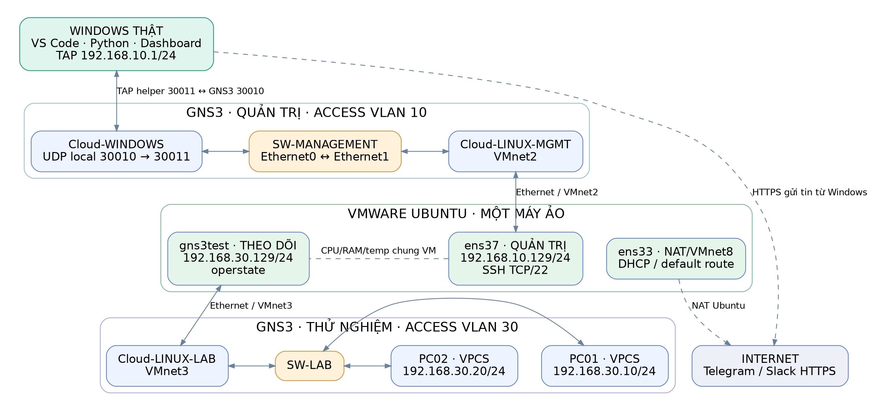
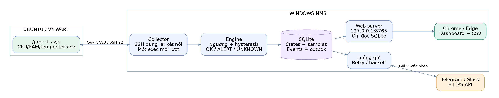
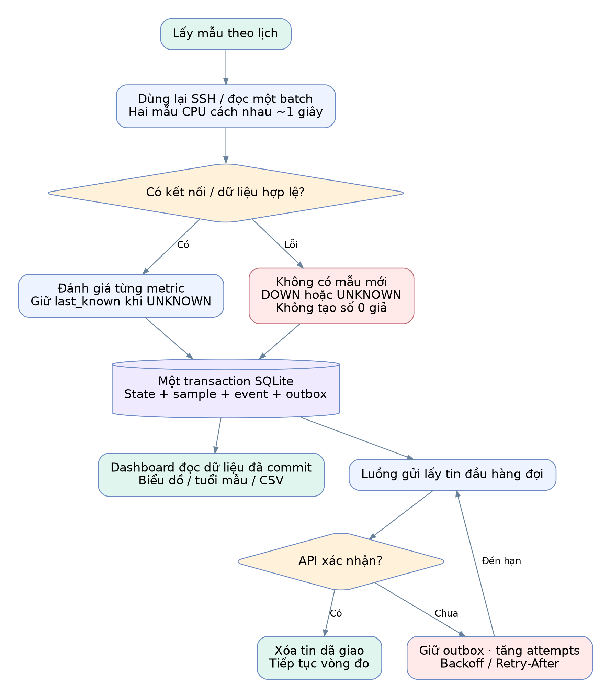
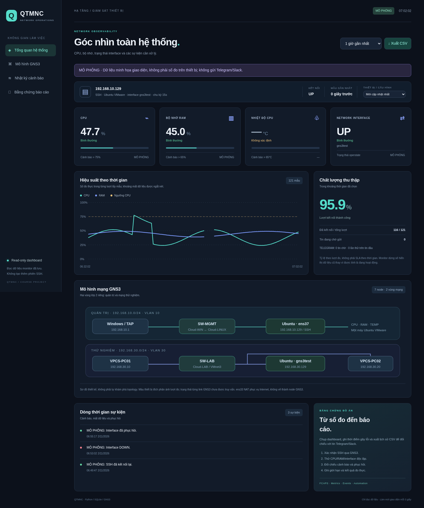

# Chương 1. Tổng quan và yêu cầu đồ án

## 1.1. Tên đề tài và bài toán

Hệ thống giám sát trạng thái thiết bị và gửi cảnh báo qua Telegram/Slack: Python
định kỳ kiểm tra CPU, RAM, nhiệt độ, trạng thái interface qua SSH/SNMP; trực quan
hóa số liệu trên dashboard web. Môi trường thực hành gồm máy thật Windows, VS
Code, GNS3 và một máy ảo Ubuntu chạy trong VMware Workstation.

Bài toán đặt ra là phát hiện sớm tài nguyên quá tải hoặc kết nối bất thường,
phân biệt mất thiết bị với mất một chỉ số, và chuyển kết quả thành cảnh báo mà
người quản trị có thể theo dõi. Đồ án bổ sung lịch sử và xuất CSV để việc đánh
giá có bằng chứng thay vì chỉ quan sát một giá trị tức thời.

Mô hình thực hiện theo hướng quản trị tập trung. Windows là trạm NMS; Ubuntu
là thiết bị được đo. VPCS là máy thử kết nối, không được xem là agent cung cấp
CPU/RAM. VPN hoặc SDN không bắt buộc theo xác nhận của người thực hiện; các chủ
đề này được đối chiếu lý thuyết và đưa vào hướng phát triển, không ghi là đã làm.

## 1.2. Mục tiêu

- Thu thập CPU/RAM/nhiệt độ/interface đúng nguồn và đúng ý nghĩa.
- Gửi cảnh báo lỗi/phục hồi theo chuyển trạng thái, có khoảng đệm để giảm lặp.
- Giữ khả năng lấy mẫu khi dịch vụ gửi tin lỗi; lưu tin chờ gửi lại.
- Có dashboard web dễ đọc, lịch sử thời gian và nhật ký sự kiện.
- Có mô hình GNS3 tách vùng quản trị và thử nghiệm để trình diễn các lỗi độc lập.
- Có quy trình cấu hình, kiểm thử, thu bằng chứng và phục hồi dễ lặp lại.

## 1.3. Yêu cầu chức năng và tiêu chí hoàn thành

| Mã | Yêu cầu | Tiêu chí kiểm chứng |
|---|---|---|
| F01 | SSH tới Ubuntu qua GNS3 | Test-NetConnection dùng nguồn TAP .10.1; tháo dây quản trị làm mất kết nối |
| F02 | Đọc CPU/RAM/interface | Có giá trị hợp lệ, nguồn SSH và thời điểm lấy mẫu |
| F03 | Xử lý thiếu cảm biến | Nhiệt độ UNKNOWN; không tự đặt 0°C |
| F04 | Cảnh báo/phục hồi | Nhận tin khi vượt ngưỡng và khi đạt miền phục hồi |
| F05 | Retry gửi tin | Mất Internet vẫn có lịch sử; outbox giữ tin tới khi API xác nhận |
| F06 | Dashboard web | Bốn chỉ số, trạng thái mới/cũ, biểu đồ, sự kiện và CSV |
| F07 | Mạng thử độc lập | gns3test DOWN nhưng SSH qua ens37 vẫn đọc được |
| F08 | Bảo vệ secret | Không có token/mật khẩu trong Git, JSON API hoặc ảnh báo cáo |

## 1.4. Phạm vi và giới hạn đề tài

Mỗi tiến trình monitor theo dõi một thiết bị cấu hình. Dashboard đọc các cấu
hình từng được ghi trong cùng SQLite, nhưng đồ án chính chỉ nghiệm thu một
Ubuntu VM. SSH là chế độ triển khai chính; SNMP/hybrid là collector mở rộng đã
có trong mã và cần agent tương ứng để kiểm chứng trên thiết bị thật.

Đồ án không tuyên bố đã làm Ryu/OpenFlow, VPN, Wi-Fi vật lý, SIEM, IDS/IPS,
auto-block IP, tính cước hoặc dự báo AI. Các tính năng ngoài phạm vi được phân
tích để xác định giới hạn, không dùng hình thiết kế thay cho bằng chứng vận hành.

## 1.5. Điều kiện khả thi và cách tổ chức hồ sơ

Máy ảo đã được quan sát có 2 vCPU và khoảng 4 GB RAM được cấp. Tải nền từng ở
mức 55–60% khi monitor dừng, vì vậy thiết kế giữ một Ubuntu VM và dùng VPCS
nhẹ cho máy thử thay vì thêm nhiều máy ảo đầy đủ. Cấu hình máy vật lý và các
ứng dụng chạy đồng thời cần được ghi khi đo; số vCPU không tự chứng minh VM
có đủ tài nguyên ở mọi thời điểm.

Hồ sơ chia thành ba phần: mã có thể chạy, hướng dẫn triển khai theo môi trường
và báo cáo có bằng chứng. Người chấm có thể xem file topology, chạy chế độ demo
giao diện rồi đối chiếu các ca thật trong bảng nghiệm thu. Cách tổ chức này giúp
phân biệt lỗi cấu hình lab với lỗi logic phần mềm và giúp lặp lại quá trình đánh giá.

Các điều kiện được giả định khi chạy chính thức gồm SSH đang hoạt động, host
key đã xác minh, TAP/UDP và GNS3 cùng chạy, Windows có Internet để gửi tin.
Nếu một điều kiện thiếu, hệ thống phải thể hiện lỗi hoặc dữ liệu cũ, không tự
tạo giá trị bình thường. Hướng dẫn chi tiết được giữ riêng để báo cáo vẫn tập
trung vào quyết định thiết kế và kết quả kiểm chứng.

# Chương 2. Cơ sở lý thuyết và tài liệu nguồn

## 2.1. Mô hình quản trị tập trung và FCAPS

TL2, trang PDF 5–6, trình bày FCAPS và mô hình tập trung. Đồ án tập trung vào
Fault Management (mất SSH, lỗi interface, thiếu chỉ số) và Performance Management
(CPU/RAM/nhiệt độ, lịch sử). Cấu hình dotenv, known_hosts và lưu cấu hình mạng
hỗ trợ một phần Configuration/Security Management. Accounting/tính cước chưa
được triển khai.

Ưu điểm của NMS tập trung là cấu hình và trạng thái được quan sát tại một nơi.
Hạn chế là Windows ngủ/tắt có thể làm cả monitor và Ubuntu VM cùng dừng. Vì
vậy dashboard phải thể hiện mẫu đã cũ thay vì tiếp tục hiển thị trạng thái xanh.

## 2.2. Polling, metrics và events

Theo TL6, trang PDF 5–8, polling chủ động lấy số liệu nhưng có độ trễ và chi
phí truy vấn. Đồ án dùng polling gần thời gian thực, không dùng streaming
telemetry. Profile thử nghiệm chọn chờ 15 giây sau mỗi lượt đọc để phù hợp VM
từng quá tải; có thể đo lại trước khi giảm chu kỳ xuống 5 giây.

TL6, trang PDF 17–20, phân biệt metrics, events và logs. Trong đồ án, metrics
là CPU/RAM/nhiệt độ/interface; events là chuyển trạng thái; log vận hành xuất
ở Terminal. Chưa có hệ thống thu syslog tập trung hoặc distributed tracing,
nên không tuyên bố hoàn thành toàn bộ MELT.

## 2.3. SSH, SNMP và tự động hóa Python

Paramiko là thư viện SSH được đối chiếu với TL4, trang PDF 8. SSH bảo vệ phiên
quản trị, xác minh host key rồi xác thực tài khoản. Collector đọc /proc và /sys
ở Ubuntu, không yêu cầu đăng nhập root để thu CPU/RAM/interface.

SNMP hỏi agent bằng OID; chế độ linux-extend dùng JSON từ probe và IF-MIB cho
interface. SNMPv2c chỉ dùng trong lab cô lập; SNMPv3 authPriv là lựa chọn có xác
thực/mã hóa. Hybrid ưu tiên SSH cho tài nguyên và SNMP cho interface, đồng thời
hiển thị dịch vụ nào bị mất. Muốn kết luận hybrid hoạt động thật phải cài agent
và thu bằng chứng riêng.

## 2.4. Dashboard và ý nghĩa tỷ lệ thành công

TL6, trang PDF 26, nêu dashboard cho sức khỏe, tài nguyên và tình trạng sự cố.
Dashboard đồ án thể hiện phần đã đo được: tài nguyên Ubuntu, kết nối collector,
thời điểm mẫu, lịch sử, sự kiện và hàng đợi gửi tin.

Tỷ lệ kết nối theo lượt = số mẫu có kết nối UP / tổng số lượt ghi nhận × 100%.
Đây là thống kê thu thập theo mẫu. Nó khác công thức SLA thời gian trong TL6,
trang PDF 29: Availability = (Tổng thời gian − Downtime) / Tổng thời gian × 100%.
Khi monitor dừng, khoảng không quan sát không được tự suy ra là thời gian UP.

## 2.5. Đối chiếu bảy tài liệu môn học

| Nguồn | Kiến thức sử dụng | Phần chưa triển khai |
|---|---|---|
| TL1: Chương 1, tr.13–15, 20–22, 27 | Quản trị, Python, trực quan hóa, Git/kiểm thử | Chưa tự đo throughput, jitter, packet loss |
| TL2: Chương 2, tr.5–6, 9–10 | FCAPS, NMS tập trung, phân biệt lớp 2/lớp 3 | Không có SDN controller hoặc routing liên VLAN |
| TL3: Chương 3, tr.23, 31 | Tham khảo phân đoạn mạng, quản trị mã hóa | Không thử WPA3/EAP/WIPS hoặc sóng Wi-Fi |
| TL4: Chương 4, tr.3, 6–8, 14, 28, 32–33 | Paramiko, JSON, ngoại lệ, API và xác minh | REST dashboard không phải API controller SDN |
| TL5: VPN VS CLOUD, tr.4, 15–18, 21, 55 | Quy hoạch CIDR, phương án truy cập từ xa | Không tạo VPN hoặc cloud VPC/VNet thật |
| TL6: Chương 5, tr.2, 5–8, 17–26, 28–31 | Metrics/events, ngưỡng, dashboard, báo cáo | Chưa có AI, tracing hoặc SLA theo thời gian |
| TL7: Chương 6, tr.6–9, 16, 18–19, 27 | Secret, host key, chỉ đọc, kiểm thử/khôi phục | Không tự khóa tài khoản hoặc điều khiển firewall |

Nguồn gồm 265 trang PDF. Số trang tham chiếu là trang của file, không phải số
slide in ở chân trang. Bài tập trong tài liệu được dùng làm tham khảo kiến thức,
không tự chuyển thành yêu cầu triển khai bắt buộc của đồ án.

# Chương 3. Thiết kế mô hình mạng GNS3

## 3.1. Nguyên tắc thiết kế

Giữ đường quản trị đã dùng: Windows TAP → Cloud-WINDOWS UDP → SW-MANAGEMENT →
Cloud-LINUX-MGMT/VMnet2 → Ubuntu ens37. Thêm card gns3test/VMnet3 và vùng thử
nghiệm riêng để ngắt interface được theo dõi mà vẫn giữ phiên quản trị.

Mô hình gồm 7 node GNS3: 3 Cloud, 2 Ethernet switch và 2 VPCS. Ubuntu chạy
riêng trong VMware. Hai Cloud phía Linux là hai card của cùng một VM, không
phải hai máy chủ. Windows chạy Python, web và gửi tin; GNS3 chuyển tiếp frame.



## 3.2. Quy hoạch địa chỉ và kết nối

| Thiết bị/card | Địa chỉ | Kết nối | Chức năng |
|---|---|---|---|
| Windows TAP | 192.168.10.1/24 | Helper UDP localhost | Nguồn SSH qua GNS3 |
| Cloud-WINDOWS | UDP local 30010 / remote 30011 | SW-MANAGEMENT Ethernet0 | Đưa frame từ Windows vào GNS3 |
| Cloud-LINUX-MGMT | VMnet2 | SW-MANAGEMENT Ethernet1 | Tới ens37 của Ubuntu |
| Ubuntu ens37 | 192.168.10.129/24 | Custom VMnet2 | Quản trị SSH TCP/22 |
| Ubuntu gns3test | 192.168.30.129/24 | Custom VMnet3 | Interface theo dõi |
| Cloud-LINUX-LAB | VMnet3 | SW-LAB Ethernet0 | Nối vùng thử tới Ubuntu |
| PC01 | 192.168.30.10/24 | SW-LAB Ethernet1 | Ping thử |
| PC02 | 192.168.30.20/24 | SW-LAB Ethernet2 | Ping thử |
| Ubuntu ens33 | DHCP mạng VMnet8 | NAT | Internet và cài gói |

Host adapter VMnet2 trên Windows giữ .20.1 như lab trước để không tạo đường
trực tiếp tới .10.129. Card guest ens37 vẫn dùng .10.129 qua miền Ethernet
được nối bằng GNS3. Tên VMnet hoặc subnet DHCP của VMware không tự định tuyến
giữa các mạng; cần cấu hình IP tĩnh và tắt DHCP trên vùng lab.

## 3.3. Phân đoạn lớp 2 và những điều không suy diễn

SW-MANAGEMENT dùng port access VLAN 10; SW-LAB dùng port access VLAN 30. Hai
switch không nối với nhau; mô hình không có trunk hay router liên VLAN. Đây
là hai miền lớp 2 tách rời, không phải firewall kiểm tra sâu hoặc Zero Trust
đầy đủ. Dashboard không gán mọi thiết bị là online từ một sơ đồ thiết kế.

VPCS không có agent số liệu. Ping PC01–PC02–Ubuntu chỉ kiểm tra đường thử.
Ubuntu có nhiều card nhưng IP forwarding không được bật bởi cấu hình đồ án.

## 3.4. Vai trò TAP và Cloud

TAP/UDP là công cụ hỗ trợ kết nối máy Windows vào GNS3 đã được dùng trong lab.
Nó không đo CPU/RAM, không đánh giá ngưỡng và không gửi Telegram. Cloud GNS3
là cầu nối adapter; không tương đương tài nguyên điện toán đám mây AWS/Azure.

Mọi kết nối quản trị dùng MONITOR_HOST=.10.129. Đường .73.x NAT hoặc .30.x từ
Windows không được dùng làm bằng chứng SSH đã đi xuyên switch quản trị GNS3.

## 3.5. Phân biệt các kiểu sự cố mạng

| Kích thích | Đường SSH | Chỉ số interface | Ý nghĩa |
|---|---|---|---|
| VMware ngắt Connected card VMnet3 | Còn qua ens37 | gns3test có thể DOWN | Thử trạng thái NIC mà vẫn quản trị |
| Xóa dây SW-LAB trong GNS3 | Còn | Có thể vẫn UP | Ping PC thất bại nhưng carrier VMware chưa chắc đổi |
| Xóa dây SW-MANAGEMENT | Mất | Không có mẫu mới | Thử mất đường thu thập |
| Tắt Wi-Fi Windows, giữ mạng lab | Còn nếu TAP/GNS3 còn | Vẫn lấy được | Thử outbox gửi tin khi mất Internet |

Kết luận interface UP chỉ nói trạng thái interface được đọc, không bảo đảm
mọi đường mạng phía sau đều thông. Đây là giới hạn cần nêu khi bảo vệ đồ án.

# Chương 4. Thiết kế phần mềm và dữ liệu

## 4.1. Kiến trúc chức năng



| Thành phần | Trách nhiệm |
|---|---|
| monitor.py | Luồng dễ học: cấu hình → collector → đánh giá → hiển thị/lặp |
| collectors/ssh.py | Kết nối SSH có kiểm tra host key; một lệnh gộp mỗi lượt |
| collectors/snmp.py, hybrid.py | Thu OID/IF-MIB, chọn nguồn và hiển thị lỗi dịch vụ |
| engine.py | OK/ALERT/UNKNOWN; hysteresis |
| storage.py | Transaction trạng thái, lịch sử, sự kiện và outbox |
| notifications.py | Gửi HTTPS, đọc xác nhận, retry/backoff |
| ui.py | Bảng Terminal trên Windows |
| dashboard.py và web/ | HTTP localhost, API chỉ đọc và giao diện trình duyệt |

Dashboard là một tiến trình riêng đọc số liệu đã commit. Việc mở thêm tab hoặc
đổi khoảng biểu đồ không tạo collector, không mở thêm SSH và không gửi thêm tin.
Đây là cách tránh tăng tải trên Ubuntu khi bổ sung giao diện.

## 4.2. Cách đo CPU và RAM

CPU được tính từ chênh lệch hai lần đọc dòng tổng cpu trong /proc/stat cách nhau
khoảng một giây. Tám bộ đếm đầu gồm user/nice/system/idle/iowait/irq/softirq/steal;
không cộng lại guest time vốn đã có trong user/nice. CPU% = 100 × (1 − Δ(idle +
iowait) / Δtotal). Nếu bộ đếm reset, định dạng sai hoặc không tiến triển thì
UNKNOWN, không tạo số 0 giả.

RAM% = 100 × (MemTotal − MemAvailable) / MemTotal. Nếu kernel không có
MemAvailable, collector dùng các trường dự phòng đã định nghĩa. RAM cache còn
thu hồi được không bị coi toàn bộ là RAM đã hết.

Nhiệt độ auto chỉ lấy cảm biến CPU phù hợp. Máy ảo có thể không cung cấp cảm
biến. Interface đọc /sys/class/net/gns3test/operstate. Nguồn demo nhiệt độ luôn
gắn nhãn MÔ PHỎNG và không được sử dụng như bằng chứng đo nhiệt độ phần cứng.

## 4.3. Giảm chi phí giám sát

Một phép đo trước đây trên VM 2 vCPU cho thấy khi dừng monitor, 7 mẫu CPU bận là
99, 80, 57, 55, 60, 56, 59% (trung bình 66,6%); khi bật monitor là 99, 100, 99,
100, 100, 100, 100% (trung bình 99,7%). Dòng đầu vmstat đã được loại vì là trung
bình từ khi khởi động. Đây là hai lần đo ngắn, cho thấy chi phí quan sát cần được
xem xét, không đủ để quy toàn bộ tải cho một tiến trình duy nhất.

Mã cập nhật giữ kết nối SSH đã xác thực, gộp 3–4 lệnh thành một exec channel mỗi
lượt và đóng kênh sau đọc. Khi I/O lỗi, collector bỏ kết nối để lượt sau tạo
lại. Kiểm tra host key được giữ ở mọi kết nối mới. Chưa có số đo CPU sau sửa
trên VM của người dùng; cần bổ sung kết quả đối chứng khi nghiệm thu.

## 4.4. Trạng thái, ngưỡng và chống lặp

| Chỉ số | Phát cảnh báo | Phục hồi sau cảnh báo |
|---|---|---|
| CPU | >75% | ≤70% |
| RAM | >65% | ≤60% |
| Nhiệt độ | >65°C | ≤60°C |
| Interface | DOWN/lowerlayerdown/notpresent | UP |

Khoảng đệm 5 điểm giúp tránh đổi trạng thái liên tục gần ngưỡng. UNKNOWN giữ
last_known để mẫu tiếp theo áp dụng đúng điều kiện phục hồi. Không đọc được CPU
không đồng nghĩa CPU bình thường, và thiếu cảm biến không đồng nghĩa mất SSH.



## 4.5. SQLite, lịch sử và tính nhất quán

| Bảng | Dữ liệu | Chính sách |
|---|---|---|
| states | Trạng thái hiện tại và last_known theo device_key | Cập nhật cùng transaction |
| outbox | Kênh, nội dung tin, attempts, next_attempt | Giữ tới khi giao thành công; không xóa theo tuổi lịch sử |
| samples | recorded_at, payload chỉ số/nguồn/lỗi/trạng thái | Tối đa 5000 mẫu/thiết bị, tối đa 24 giờ |
| events | recorded_at, severity, message | Tối đa 1000 sự kiện/thiết bị, tối đa 24 giờ |

Một lượt observe lưu state, sample, event và tin outbox trong cùng transaction.
Nếu ghi outbox thất bại, các phần còn lại rollback. Nhờ đó biểu đồ không hiển
thị một sự kiện đã commit trong khi trạng thái hoặc tin tương ứng chưa được lưu.

## 4.6. Giao tin và độ trễ

Luồng gửi tách khỏi vòng đọc. Telegram cần HTTP thành công và ok=true; Slack
cần nội dung xác nhận ok. Lỗi được giữ lại và thử theo backoff 2, 4, 8… tối đa
300 giây; phản hồi 429 được tôn trọng thời gian retry-after.

Cam kết giao là at-least-once: API đã nhận nhưng phản hồi thất lạc có thể làm
tin lặp. Độ trễ cảnh báo gồm chờ lượt đo, thời gian đọc, đánh giá, mạng và API;
không có cam kết mọi tin tới trong đúng 5 hoặc 15 giây.

## 4.7. API và bảo vệ dashboard

| Endpoint | Chức năng |
|---|---|
| GET / | Giao diện dashboard |
| GET /api/snapshot?minutes=60 | Mẫu mới nhất, lịch sử, sự kiện, thống kê, queue |
| GET /api/export.csv?minutes=60 | Xuất mẫu lịch sử với timestamp UTC |

Server chỉ bind 127.0.0.1, không có chức năng thay đổi cấu hình thiết bị. POST
bị từ chối. Host/Origin được kiểm tra; đường dẫn file không nằm trong allowlist
bị từ chối. API không trả mật khẩu, token, webhook hoặc nội dung tin outbox.
Trang dùng textContent cho dữ liệu sự kiện và không tải thư viện từ CDN.

Nếu triển khai cho nhiều người qua LAN/Internet, cần bổ sung đăng nhập, TLS,
phân quyền và lớp triển khai phù hợp; bản localhost hiện tại chưa có các phần đó.

# Chương 5. Triển khai và giao diện dashboard

## 5.1. Điều kiện triển khai

Windows cần Python 3.10+, VS Code, VMware Workstation và GNS3 local server.
Ubuntu cần SSH hoạt động, ens33 NAT có Internet và ens37 .10.129 để quản trị.
Thêm card thứ ba VMnet3 và đặt tên gns3test bằng Netplan match theo MAC.

File QTMNC_COURSE.gns3 chứa topology; nó không tự tạo Ubuntu VM, adapter Windows
hoặc driver TAP. Các phần phụ thuộc môi trường được cấu hình theo hướng dẫn
COURSE_LAB.md, gồm từng thao tác bấm VMware/GNS3 và lệnh trên đúng hệ điều hành.

## 5.2. Trình tự thực hiện

1. Cập nhật kho mã, giữ nguyên .env.simple và secret cục bộ.
2. Thêm VMnet3 host-only, thêm card Ubuntu và Netplan gns3test .30.129.
3. Sao chép project GNS3 ra Documents; đóng project cũ trước khi mở project mới.
4. Kiểm tra Cloud quản trị VMnet2, Cloud lab VMnet3 và UDP 30010/30011.
5. Chạy cầu nối TAP trong PowerShell quản trị; giữ cửa sổ mở.
6. Cấu hình PC01 .30.10, PC02 .30.20; save và ping .30.129.
7. Xác nhận SSH .10.129 từ TAP .10.1; cấu hình MONITOR_IFACE=gns3test.
8. Chạy monitor và dashboard trong hai Terminal riêng, không mở thêm bản monitor trùng.

## 5.3. Chạy trên Windows

```powershell
cd D:\QTM_NC\telegram\qtmnc
.\run_windows.cmd
```

Terminal thứ hai:

```powershell
.\run_dashboard.cmd
```

Mở http://127.0.0.1:8765. Nếu muốn xem giao diện khi chưa có lab, dùng
run_dashboard.cmd --demo. Chế độ này không đọc thiết bị hoặc gửi tin, luôn có
nhãn MÔ PHỎNG và không ghi dữ liệu giả vào database thật.

## 5.4. Các vùng thông tin trên giao diện

| Vùng | Nội dung | Ý nghĩa vận hành |
|---|---|---|
| Thiết bị | Host, protocol, interface, tuổi mẫu | Xác định đúng đối tượng và độ mới |
| Bốn thẻ chỉ số | CPU/RAM/nhiệt độ/interface, nguồn và ngưỡng | Phát hiện số đo thiếu hoặc vượt ngưỡng |
| Biểu đồ | CPU/RAM theo thời gian, ngưỡng CPU | Thấy xu hướng và khoảng mất dữ liệu |
| Chất lượng thu thập | Tỷ lệ lượt kết nối, số mẫu, tin chờ | Đối chiếu collector và kênh gửi |
| Topology | Mô hình hai vùng thiết kế | Giải thích đường quản trị và vùng thử |
| Sự kiện | Cảnh báo, UNKNOWN, phục hồi | Dựng dòng thời gian xử lý |
| Xuất CSV | Cửa sổ lịch sử đang chọn | Đưa số liệu vào bảng/biểu đồ báo cáo |



## 5.5. Độ mới, mất dữ liệu và tính trung thực

Dashboard làm mới giao diện mỗi 3 giây nhưng monitor không lấy mẫu theo nhịp
này. Khi tuổi mẫu vượt max(30 giây, 3 × interval + timeout), giao diện hiện dữ
liệu cũ. Khi kết nối DOWN hoặc mẫu cũ, thẻ chỉ số hiển thị dấu gạch, không giữ
giá trị trước đó như số đo mới. Biểu đồ ngắt đoạn tại mẫu DOWN/thiếu giá trị.

Topology trên web là sơ đồ thiết kế, không phải cơ chế khám phá GNS3. Màu thiết
bị đích phản ánh dữ liệu collector; trạng thái từng link chưa được đọc từ API
GNS3. Nhãn này cần giữ khi chụp ảnh để tránh suy diễn có giám sát toàn bộ 7 node.

## 5.6. Bảng xử lý lỗi thường gặp

| Hiện tượng | Điểm kiểm tra | Hướng xử lý |
|---|---|---|
| Windows chọn Wi-Fi khi thử .10.129 | InterfaceAlias và SourceAddress | Khôi phục cầu nối và IP TAP .10.1; giữ GNS3 chạy |
| Ping được, TCP/22 lỗi | ss -lntp và trạng thái SSH/UFW trong Ubuntu | Kiểm tra listener và quy tắc có liên quan; không nhập lệnh Linux vào PowerShell |
| Interface UNKNOWN | ip -br addr và MONITOR_IFACE | Thêm đúng card VMnet3, kiểm tra tên gns3test sau Netplan |
| Dashboard chưa có dữ liệu | Runner monitor, state file | Chạy bản monitor mới trước; dùng cùng đường dẫn SQLite |
| Dashboard báo dữ liệu cũ | Tuổi mẫu và cửa sổ monitor | Kiểm tra monitor có dừng hoặc đang timeout; không đọc mẫu cũ như mẫu mới |
| Tin chưa tới, queue tăng | Internet Windows và kênh nhận | Phân biệt lỗi gửi API với lỗi SSH; giữ outbox để retry |
| CPU cao khi bật monitor | Vmstat tắt/bật, số phiên monitor | Dùng bản batch SSH, tránh chạy trùng monitor; ghi số đo sau sửa |

Khi xuất CSV, các cột nguồn đi kèm CPU/RAM/nhiệt độ/interface giữ được nhãn
DEMO nếu một chỉ số là mô phỏng. Cột dashboard_demo cho biết toàn bộ giao diện
đang ở chế độ demo hay không. Hai khái niệm này cần phân biệt vì monitor thật
vẫn có thể được cấu hình demo riêng cho nhiệt độ.

## 5.7. Kiểm tra cấu hình trước buổi trình diễn

Xác nhận mỗi lệnh được chạy đúng nơi: PowerShell trên Windows dùng runner,
Test-NetConnection và Git; Terminal Ubuntu dùng ip, ss, netplan và bài tạo tải.
Giữ một bản monitor duy nhất, một dashboard và một cầu nối. Chạy một ca tại một
thời điểm để dễ gắn sự kiện với nguyên nhân; ghi cấu hình interval/timeout
cùng kết quả để người đọc hiểu khoảng lấy mẫu.

# Chương 6. Kiểm thử và đánh giá

## 6.1. Phương pháp kiểm chứng

Tách kiểm thử mã trong môi trường phát triển khỏi nghiệm thu Windows–VMware–
GNS3 thực tế. Bộ test dùng mock và loopback, không gọi Telegram/Slack thật.
Ảnh demo chỉ chứng minh bố cục, không chứng minh kết nối tới Ubuntu của người
dùng. Báo cáo kết quả thật phải có thời điểm, cấu hình, ảnh và tin tương ứng.

## 6.2. Kết quả kiểm thử phát triển

| Hạng mục | Kết quả đã kiểm tra | Phạm vi |
|---|---|---|
| Python unittest | 141 tests, OK | Logic collector/state/outbox, dashboard, topology và hồi quy |
| SSH loopback | Hai lượt chỉ xác thực một lần; mỗi lượt một exec | Giao thức SSH thật trong fixture Linux |
| Mất một file metric | Chỉ số đó UNKNOWN, chỉ số khác còn | Shell/collector trong fixture SSH |
| SQLite | State/history/outbox rollback cùng nhau; retention không xóa tin chờ | Database tạm, không dùng secret người dùng |
| HTTP dashboard | GET, CSV, POST từ chối, chặn Host/Origin sai và đường dẫn lạ | Server localhost thật |
| Trình duyệt | Chromium desktop 1600 px và mobile 390 px | Giao diện, CSV, dữ liệu cũ, mất kết nối, XSS dạng text |
| JavaScript | Kiểm tra cú pháp, không có page error trong ca thử | Mã web cục bộ |
| Project GNS3 | Hợp lệ theo schema chính thức revision 9 | Cấu trúc file, chưa thay thế mở GUI Windows thật |

Schema tham chiếu kho GNS3/gns3-server, commit
9c6a0c7be42629fd0c72fab1e3376c34f7dd1681, docs/gns3_file.json. Các test socket
được chạy trong môi trường cho phép loopback. Kết quả không chứng minh đã đo
được nhiệt độ vật lý hoặc đã bật SNMP agent thật trên Ubuntu của người dùng.

## 6.3. Bằng chứng đã có từ quá trình làm việc

- Windows từng kết nối TCP/22 .10.129 thành công, nguồn Local Area Connection
  .10.1, sau khi cầu nối TAP được chạy.
- SSH Ubuntu đã được thấy LISTEN tại 0.0.0.0:22 và [::]:22; UFW lúc kiểm tra inactive.
- Người dùng đã nhận tin Telegram CPU 100%, metric UNKNOWN, mất SSH và phục hồi.
- Vmstat trên Ubuntu 2 vCPU xác nhận tải cao thật; số liệu trước sửa được trình
  bày ở mục 4.3, không được dùng như kết quả CPU sau tối ưu.

Đây là bằng chứng từ trao đổi trước, chưa phải bộ nghiệm thu mô hình 7 node
và dashboard mới. Người thực hiện cần chèn ảnh gốc và thời điểm khi hoàn thiện
bản Word, đồng thời đo lại các ca bên dưới trên cấu hình đang dùng.

## 6.4. Ma trận nghiệm thu trên máy người dùng

| Mã | Tình huống | Mong đợi | Kết quả thực tế / bằng chứng |
|---|---|---|---|
| AT01 | SSH qua GNS3 | Nguồn .10.1, TCP/22 True; tháo dây quản trị thì lỗi | Chưa điền — cần ảnh và thời điểm |
| AT02 | Bình thường 3–5 lượt | CPU/RAM có nguồn, iface UP, mẫu mới | Chưa điền |
| AT03 | CPU tăng có hạn | >75 cảnh báo; ≤70 phục hồi | Chưa điền |
| AT04 | RAM tăng có hạn | >65 cảnh báo; ≤60 phục hồi | Chưa điền |
| AT05 | Ngắt VMnet3 Connected | gns3test DOWN; SSH còn; nối lại UP | Chưa điền |
| AT06 | Ngắt SW-MANAGEMENT | Mất SSH; chart gap; nối lại phục hồi | Chưa điền |
| AT07 | Tắt Internet Windows | Thu thập còn; outbox tăng; có Internet gửi lại | Chưa điền |
| AT08 | Dừng monitor, giữ web | Sau thời hạn: dữ liệu cũ, không giả UP | Chưa điền |
| AT09 | VM không cảm biến | Temp UNKNOWN, CPU/RAM vẫn có | Chưa điền |
| AT10 | Xuất CSV | Khớp thời điểm và giá trị hiển thị, có UTC | Chưa điền |
| AT11 | Đối chiếu CPU sau sửa | Đo tắt/bật cùng điều kiện, loại dòng đầu vmstat | Chưa điền |
| AT12 | Host key sai | Từ chối kết nối, không tự tin khóa mới | Chưa điền |

Không tự điền “Đạt” vào các ca chưa chạy. Nếu thực tế không đạt, ghi rõ hiện
tượng, cấu hình và bước khắc phục; đây cũng là dữ liệu đánh giá đồ án.

## 6.5. Mẫu ghi thời gian và độ trễ

| Ca | Thời điểm gây lỗi | Mẫu đầu phát hiện | Tin nhận | Mẫu phục hồi | Tin phục hồi |
|---|---|---|---|---|---|
| CPU | Điền lúc thử | Điền từ CSV | Điền từ Telegram/Slack | Điền từ CSV | Điền từ ứng dụng |
| Interface | Điền lúc ngắt | Điền từ CSV | Điền từ ứng dụng | Điền lúc bật lại | Điền từ ứng dụng |
| Mất SSH | Điền lúc tháo dây | Điền sự kiện DOWN | Điền từ ứng dụng | Điền sự kiện UP | Điền từ ứng dụng |

Độ trễ phát hiện = thời điểm mẫu đầu phát hiện − thời điểm gây lỗi. Độ trễ giao
tin = thời điểm tin nhận − thời điểm mẫu phát hiện. Ghi múi giờ hoặc chuyển các
mốc về UTC khi đối chiếu CSV. Không lấy giờ ảnh demo làm thời điểm đo thật.

## 6.6. Kịch bản trình diễn 8–10 phút

1. Giới thiệu một Ubuntu VM, ba card và 7 node GNS3; nêu các vai trò.
2. Chứng minh nguồn TAP .10.1 và SSH .10.129; mở dashboard thật.
3. Giải thích CPU/RAM, nhiệt độ UNKNOWN và tuổi mẫu.
4. Tạo tải CPU có thời hạn; đối chiếu cảnh báo và phục hồi.
5. Ngắt card thử VMnet3, giữ SSH để thấy interface DOWN/UP.
6. Tháo dây quản trị, giải thích khác biệt mất SSH và mất interface.
7. Xuất CSV; chỉ bảng nghiệm thu, trạng thái code test và giới hạn.

Nếu một bài thử chưa phục hồi, chờ hoặc giải thích trạng thái còn lại trước khi
chuyển ca; không tạo nhiều lỗi đồng thời khiến nguyên nhân khó xác định.

# Chương 7. Đánh giá, kết luận và hướng phát triển

## 7.1. Kết quả thiết kế và triển khai

Đồ án đã có mô hình 7 node tách quản trị/thử nghiệm, chương trình thu thập SSH
có tối ưu kết nối, đánh giá trạng thái, gửi Telegram/Slack có outbox, và dashboard
web dùng chung lịch sử. Dashboard bổ sung góc nhìn thời gian để giải thích tải
tăng, lỗi thu thập và phục hồi thay vì chỉ xem một số đo trên Terminal.

Phần mã đã được kiểm chứng bằng bộ test và browser cục bộ. Việc nghiệm thu
trên máy Windows/GNS3 của người dùng và đo CPU sau sửa vẫn cần thực hiện và
điền vào báo cáo. Đây là ranh giới giữa sản phẩm đã xây dựng và kết luận thực nghiệm.

## 7.2. Giới hạn

- Máy ảo có thể thiếu nhiệt độ; không thay thế bằng nhiệt độ giả không nhãn.
- Chỉ đo một interface theo cấu hình; chưa đo throughput/latency/packet loss.
- Không có auto-discovery node/link; sơ đồ web là mô hình thiết kế.
- Lịch sử ngắn, tối đa 24 giờ/5000 mẫu; chưa phải time-series database dài hạn.
- Tỷ lệ kết nối theo mẫu chưa phải SLA theo thời gian hoặc bằng chứng HA.
- Windows NMS và Ubuntu chung máy vật lý, chưa có monitor dự phòng.
- Dashboard chỉ localhost, chưa có đăng nhập nhiều người/TLS/RBAC.
- Chưa triển khai VPN, Ryu/OpenFlow, Wi-Fi enterprise hoặc SIEM.

## 7.3. Hướng phát triển có thứ tự ưu tiên

Ưu tiên đầu là hoàn thành nghiệm thu mô hình thật, tối ưu tải lấy mẫu và đo độ
trễ cảnh báo. Tiếp theo có thể bổ sung counter interface, chất lượng kết nối,
SQL time-series dài hạn, phân quyền web và giám sát nhiều thiết bị.

Nếu đồ án nâng cao yêu cầu truy cập từ xa, triển khai WireGuard theo TL5 và đo
handshake/traffic thật. Nếu chuyển sang SDN, thêm switch OpenFlow và controller
thật theo TL2/TL4, đọc port stats rồi xác minh flow. Hai hướng này cần bài thử
và bằng chứng riêng, không chỉ thêm nhãn vào topology.

## 7.4. Kết luận

Giải pháp bám trọng tâm quản trị lỗi và hiệu suất: thu thập đúng, đánh giá có
trạng thái, lưu bền, cảnh báo có retry và trực quan hóa trung thực. Mạng thử
riêng giúp phân biệt các loại sự cố; dashboard đọc dữ liệu đã lưu giúp tránh
tạo thêm chi phí SSH khi quan sát. Giá trị báo cáo nằm ở khả năng lặp lại bài
thử và đối chiếu bằng chứng, cùng việc công bố rõ giới hạn chưa triển khai.

# Tài liệu tham khảo và phụ lục

## Tài liệu do người dùng cung cấp

| Mã | Tên file gốc | Số trang |
|---|---|---|
| TL1 | Chuong 1. Quang tri mang nang cao (1).pdf | 39 |
| TL2 | Chuong 2. Phan tich cac mo hinh mang (2).pdf | 28 |
| TL3 | Chuong 3-An ninh mang khong day (2).pdf | 33 |
| TL4 | Chương 4. Tự động hóa quản trị hệ thống SDN bằng Python (2).pdf | 33 |
| TL5 | VPN VS CLOUD (1).pdf | 67 |
| TL6 | Chuong 5 - Quan ly hieu suat hoat dong (1).pdf | 38 |
| TL7 | Chương 6- Qản lý bảo mật (1).pdf | 27 |

Thông tin nhận diện và SHA-256 của từng file được lưu ở sources.json. Bản gốc
bài giảng không được đưa lại vào kho mã; báo cáo sử dụng diễn giải và tham chiếu.

## Danh mục hồ sơ nộp

- Báo cáo Word/PDF: điền thông tin người thực hiện và bảng nghiệm thu thật.
- File QTMNC_COURSE.gns3 và sơ đồ PNG/SVG/DOT đi kèm.
- Mã Python/web, requirements và hướng dẫn chạy trên Windows/Ubuntu.
- CSV lịch sử thực nghiệm, ảnh topology/dashboard và tin Telegram/Slack thật.
- Bảng cấu hình thiết bị, commit sử dụng và kết quả các ca thử.

## Cấu hình mẫu và quy tắc bảo vệ thông tin

File .env.simple nằm cục bộ, gồm IP, tài khoản SSH, token/webhook và đường dẫn
state. Không chèn toàn bộ file này vào báo cáo. Ảnh cấu hình chỉ chụp các mục
không chứa secret. Khi chia sẻ dữ liệu, kiểm tra cả log, ảnh và CSV.

Điểm vào mã: monitor.py; dashboard: python -m device_monitor.dashboard; dựng
topology mới: python tools/create_gns3_project.py --course. Hướng dẫn thao tác
chi tiết và cách giữ nguyên dự án đã chỉnh nằm tại docs/COURSE_LAB.md.
