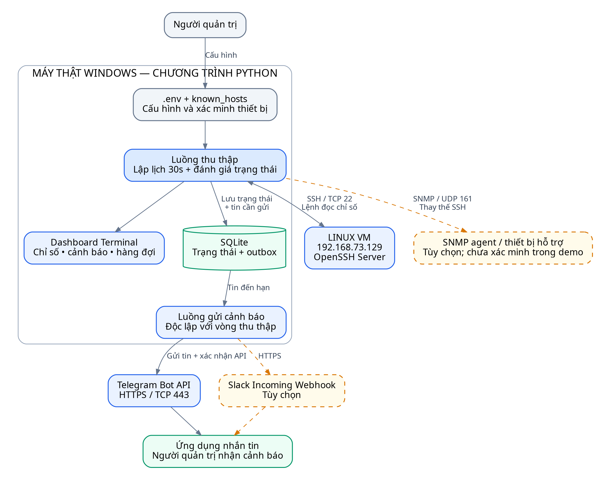

# Bộ mô hình và sơ đồ đề tài

**Đề tài:** Hệ thống giám sát trạng thái thiết bị và gửi cảnh báo qua Telegram/Slack.

Bộ hình được đối chiếu với mã hiện tại: Windows chạy Python, giám sát Linux VM
192.168.73.129 qua SSH và gửi Telegram. SNMP/Slack là phần tùy chọn có mã hỗ trợ;
nhiệt độ đang tắt trong demo VM. Chu kỳ mặc định 30 giây là gần thời gian thực.

## Tệp dùng ngay

- [Bản Word để chỉnh sửa và đưa vào báo cáo](Bo_so_do_giam_sat_thiet_bi.docx).
- [Bản PDF 10 trang để xem hoặc in](Bo_so_do_giam_sat_thiet_bi.pdf).
- Thư mục [PNG](png): ảnh rõ, dễ chèn vào Word/PowerPoint.
- Thư mục [SVG](svg): vector có thể phóng to.
- [Toàn bộ sơ đồ Mermaid](SO_DO_MERMAID.md): GitHub tự hiển thị, có thể sửa mã.
- [Nguồn dựng hình](source): Mermaid cho cả 8 hình, Graphviz cho 7 hình.
  Hình trình tự được dựng bằng Matplotlib trong build.py.

## Danh mục và vị trí dùng trong báo cáo

| Hình | Sơ đồ | Chương gợi ý | Tệp |
|---|---|---|---|
| 1 | Kiến trúc tổng thể hệ thống | Tổng quan / kiến trúc hệ thống | [PNG](png/01-kien-truc-tong-the.png) · [SVG](svg/01-kien-truc-tong-the.svg) · [Mermaid](source/01-kien-truc-tong-the.mmd) |
| 2 | Mô hình triển khai và mạng VMware NAT | Thiết kế triển khai / cấu hình mạng | [PNG](png/02-trien-khai-vmware.png) · [SVG](svg/02-trien-khai-vmware.svg) · [Mermaid](source/02-trien-khai-vmware.mmd) |
| 3 | Biểu đồ ca sử dụng | Phân tích yêu cầu / tác nhân và chức năng | [PNG](png/03-ca-su-dung.png) · [SVG](svg/03-ca-su-dung.svg) · [Mermaid](source/03-ca-su-dung.mmd) |
| 4 | Lưu đồ thu thập và đánh giá trạng thái | Thiết kế thuật toán / vòng giám sát | [PNG](png/04-luong-thu-thap.png) · [SVG](svg/04-luong-thu-thap.svg) · [Mermaid](source/04-luong-thu-thap.mmd) |
| 5 | Lưu đồ hàng đợi, gửi tin và thử lại | Thiết kế thuật toán / độ tin cậy cảnh báo | [PNG](png/05-luong-gui-canh-bao.png) · [SVG](svg/05-luong-gui-canh-bao.svg) · [Mermaid](source/05-luong-gui-canh-bao.mmd) |
| 6 | Biểu đồ trình tự: RAM vượt ngưỡng và phục hồi | Thiết kế tương tác / kịch bản kiểm thử | [PNG](png/06-trinh-tu-ram-telegram.png) · [SVG](svg/06-trinh-tu-ram-telegram.svg) · [Mermaid](source/06-trinh-tu-ram-telegram.mmd) |
| 7 | Biểu đồ trạng thái và hysteresis | Thiết kế logic / chống cảnh báo lặp | [PNG](png/07-trang-thai-chi-so.png) · [SVG](svg/07-trang-thai-chi-so.svg) · [Mermaid](source/07-trang-thai-chi-so.mmd) |
| 8 | Mô hình dữ liệu SQLite thực tế | Thiết kế dữ liệu / lưu trạng thái và hàng đợi | [PNG](png/08-mo-hinh-du-lieu.png) · [SVG](svg/08-mo-hinh-du-lieu.svg) · [Mermaid](source/08-mo-hinh-du-lieu.mmd) |

## Kiến trúc tổng thể

## Những điểm cần trình bày chính xác

1. Windows là máy giám sát; Linux VM là thiết bị đích. IP máy đích là 192.168.73.129,
   không phải IP adapter Windows 192.168.73.1 hoặc gateway NAT 192.168.73.2.
2. Vòng thu thập và luồng gửi độc lập. Một luồng gửi duyệt tuần tự các kênh,
   không phải mỗi kênh là một tiến trình gửi song song.
3. Vượt ngưỡng không tạo tin liên tục mỗi 30 giây. Tin phát khi có chuyển trạng
   thái cần báo; RAM >65% cảnh báo và chỉ phục hồi khi ≤60% với biên mặc định 5.
4. Thiếu dữ liệu là UNKNOWN, không phải 0 hoặc đã bình thường. Giữ last_known
   qua giai đoạn thiếu dữ liệu để tránh mất trạng thái hysteresis.
5. Với chỉ số số học: nếu L=ALERT dùng ranh giới T−H, còn L khác ALERT dùng T.
   Giá trị ≤ ranh giới là OK; lớn hơn là ALERT. Chỉ số chủ động tắt được bỏ qua.
6. Interface: up → OK; down/lowerlayerdown/notpresent → ALERT;
   unknown/testing/dormant hoặc không đọc được → UNKNOWN.
7. states và outbox không có khóa ngoại. Store.observe ghi trạng thái và tin
   mới trong cùng giao dịch. Không có bảng lưu lịch sử số đo theo thời gian.
8. Tin chỉ được xóa sau xác nhận API; mất phản hồi có thể làm xuất hiện tin trùng
   khi thử lại. Không tuyên bố đảm bảo exactly-once.
9. Hình trình tự RAM 70% rồi 50% là kịch bản minh họa. Không coi đây là bằng chứng
   một lần kiểm thử RAM đã thực hiện thành công trên thiết bị của người dùng.
10. Máy Windows tắt/ngủ có thể làm VM dừng. Cần máy giám sát độc lập nếu mục tiêu
    là phát hiện host Windows tắt hoàn toàn.

## Dựng lại hoặc sửa hình

Ảnh và tài liệu đã có sẵn, không cần cài công cụ dựng hình để chạy ứng dụng.
Nếu cần sửa và xuất lại:

1. Cài Graphviz để lệnh dot có trong PATH.
2. Cài thư viện riêng cho tài liệu và chạy:

~~~powershell
python -m pip install -r docs/diagrams/requirements.txt
python docs/diagrams/build.py
~~~

- Chỉnh file .dot để thay 7 hình Graphviz.
- Chỉnh danh sách events trong build.py để thay hình trình tự.
- Chỉnh file .mmd để sửa phiên bản Mermaid hiển thị trên GitHub.
- Chỉnh manifest.json để thay tên hình, chú thích và chương sử dụng.
- Khi sửa nội dung, cập nhật cả Mermaid và bản dựng tương ứng để giữ nhất quán.

Bộ dựng chạy cục bộ bằng Graphviz/Matplotlib, không gọi SSH hay API nhắn tin.
Cần font Unicode có tiếng Việt: DejaVu Sans, Noto Sans hoặc Arial.
Chỉ dựng lại Word/PDF từ ảnh đã có: python docs/diagrams/build.py --reports-only.
