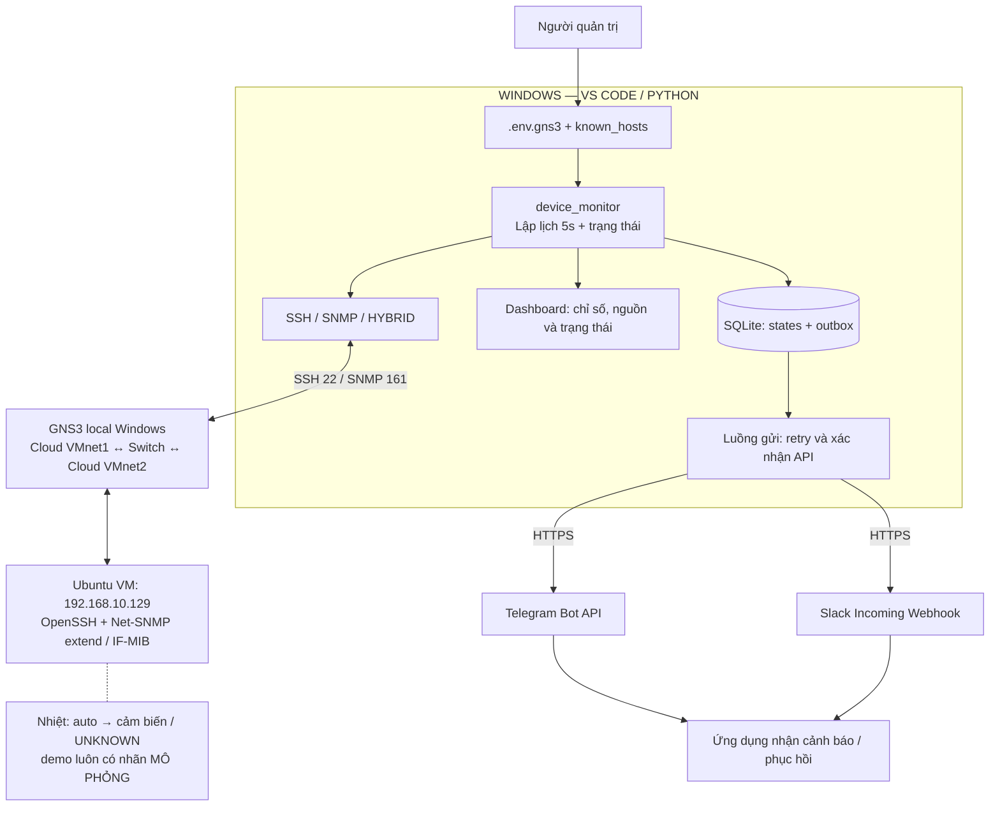
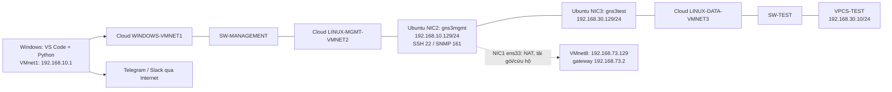
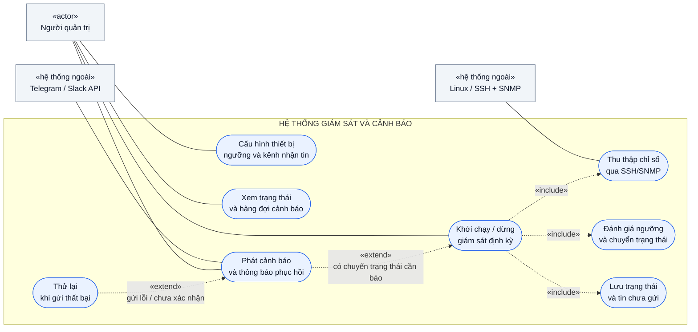
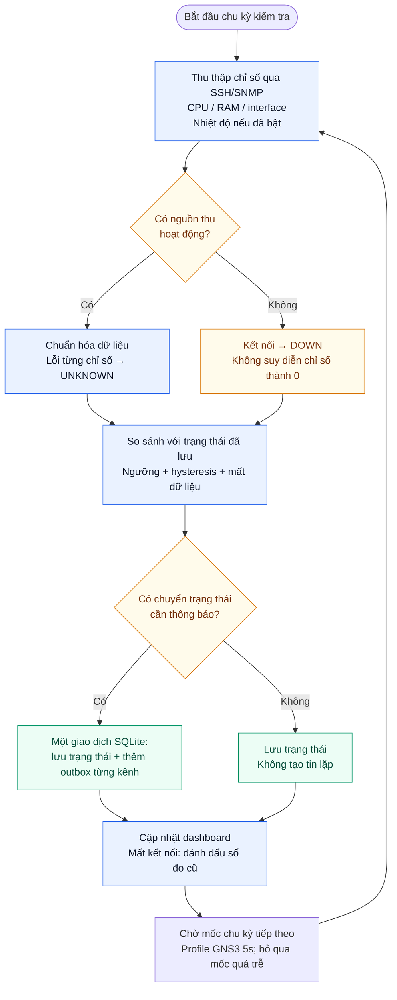
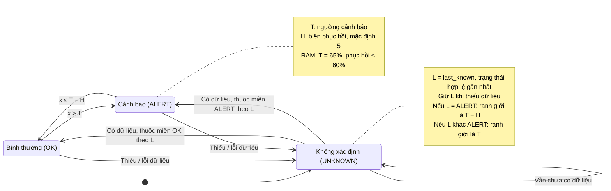
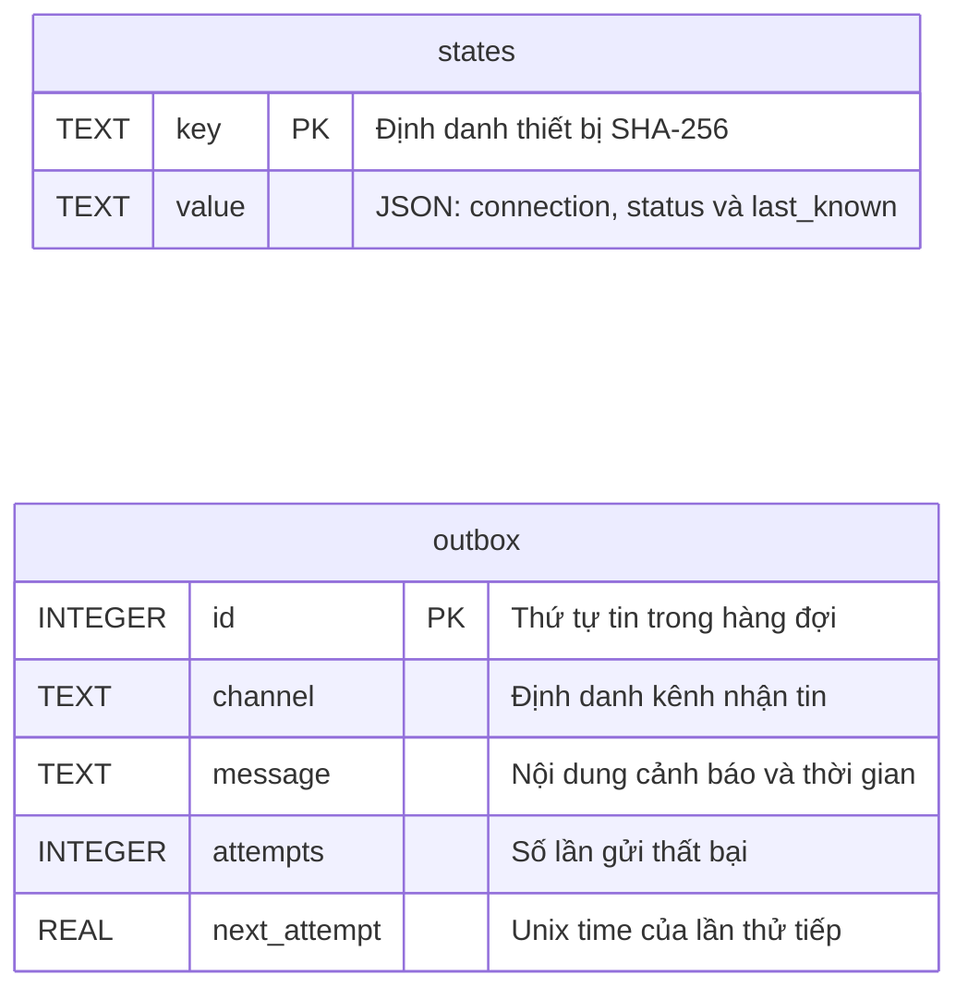

# Bộ sơ đồ Mermaid — GNS3 Device Monitor

## Hình 1. Kiến trúc tổng thể hệ thống

Windows chạy Python, thu chỉ số Linux qua đường GNS3 bằng SSH/SNMP hoặc hybrid, đánh giá trạng thái, lưu SQLite và gửi Telegram/Slack bằng luồng riêng.

Profile GNS3 lấy mẫu mỗi 5 giây. Nhiệt độ VM có thể UNKNOWN; nguồn demo phải ghi MÔ PHỎNG. Các kênh và giao thức được chọn bằng cấu hình.

## Hình 2. Mô hình triển khai GNS3 và VMware ba interface

Quản trị: Windows VMnet1 .10.1 qua hai Cloud và switch tới Linux VMnet2 .10.129. Mạng thử: NIC gns3test .30.129 qua Cloud VMnet3 tới switch và VPCS .30.10.

Windows VMnet2 dùng .20.1 để không có đường .10 trực tiếp. NIC NAT ens33 giữ .73.129/gateway .73.2; hai NIC lab không có gateway. VMware có thể giữ carrier UP khi Cloud mất đường.

## Hình 3. Biểu đồ ca sử dụng

Người quản trị cấu hình, chạy/dừng, xem dashboard và nhận cảnh báo. Linux cung cấp chỉ số qua SSH/SNMP; Telegram/Slack chuyển thông báo tới ứng dụng nhắn tin.

«include» biểu diễn chức năng trong giám sát; «extend» biểu diễn phát cảnh báo khi đổi trạng thái và retry khi gửi lỗi. GNS3 là hạ tầng đường truyền, không phải nguồn số đo.

## Hình 4. Lưu đồ thu thập và đánh giá trạng thái

Mỗi chu kỳ theo profile GNS3 5 giây, hệ thống thu thập chỉ số, phân biệt lỗi kết nối với lỗi dữ liệu, đánh giá ngưỡng và so sánh trạng thái đã lưu.

Tin mới chỉ được tạo khi có chuyển trạng thái cần thông báo. Trạng thái và tin cảnh báo được ghi cùng giao dịch SQLite. Lần đầu mọi chỉ số bình thường không tạo tin thử; chỉ số chủ động tắt không tham gia vòng đánh giá. Hybrid còn báo mất từng dịch vụ dù nguồn dự phòng hoạt động.

## Hình 5. Lưu đồ hàng đợi, gửi tin và thử lại

Một luồng gửi riêng duyệt từng kênh, lấy tin cũ nhất đến hạn, gọi API và chỉ xóa tin khi đã được xác nhận thành công. Mỗi kênh giữ thứ tự tin riêng.

Backoff bắt đầu 2 giây rồi tăng đến tối đa 300 giây; HTTP 429 dùng thời gian chờ máy chủ yêu cầu nếu dài hơn. Đây là at-least-once: mất phản hồi hoặc dừng trước khi ghi nhận thành công có thể tạo tin trùng.

## Hình 6. Biểu đồ trình tự: RAM vượt ngưỡng và phục hồi

Kịch bản minh họa: RAM 70% vượt ngưỡng 65%, lần gửi đầu lỗi kết nối, lần sau nhận HTTP 200 và ok=true. Khi RAM về 50%, hệ thống phát thông báo phục hồi vì đã xuống dưới mức 60%.

Các số đo và thứ tự sự kiện trong hình là kịch bản minh họa, không phải bản ghi một lần thử RAM đã được xác nhận. Luồng thu thập tiếp tục độc lập khi luồng gửi đang chờ thử lại.

## Hình 7. Biểu đồ trạng thái và hysteresis

Áp dụng cho CPU, RAM và nhiệt độ khi đã bật. Vượt T chuyển sang ALERT; chỉ về OK khi xuống mức T−H. Thiếu dữ liệu chuyển UNKNOWN nhưng giữ last_known để đánh giá đúng khi dữ liệu quay lại.

H mặc định bằng 5: CPU cảnh báo >75%, phục hồi ≤70%; RAM >65%, phục hồi ≤60%; nhiệt độ >65°C, phục hồi ≤60°C. Interface dùng ánh xạ UP/DOWN/UNKNOWN riêng, không dùng ngưỡng số.

## Hình 8. Mô hình dữ liệu SQLite thực tế

Hai bảng thực tế là states và outbox. states lưu trạng thái kết nối và trạng thái từng chỉ số dưới dạng JSON; outbox lưu tin chưa gửi cùng số lần thử và thời điểm thử tiếp.

Không có khóa ngoại giữa hai bảng. Tính nhất quán được đảm bảo bởi giao dịch ứng dụng trong Store.observe. Tin gửi thành công bị xóa; hiện chưa có bảng lưu lịch sử CPU/RAM theo thời gian hoặc lịch sử toàn bộ tin đã gửi.
