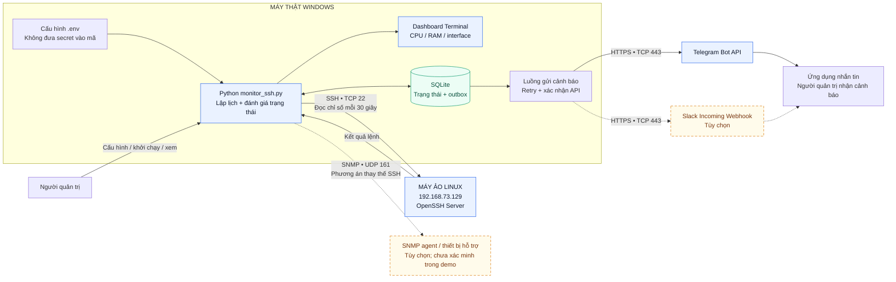
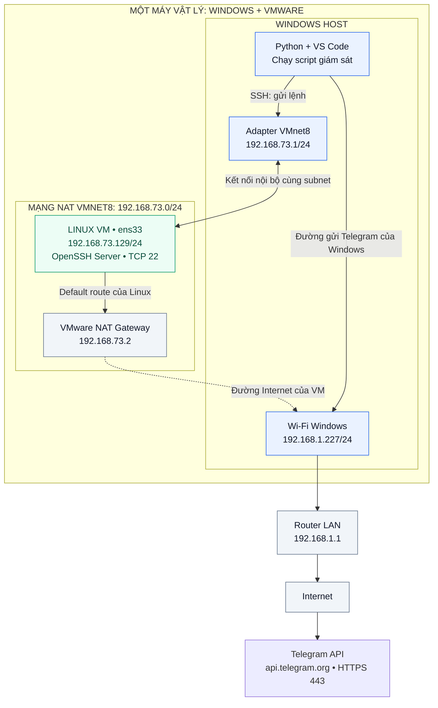
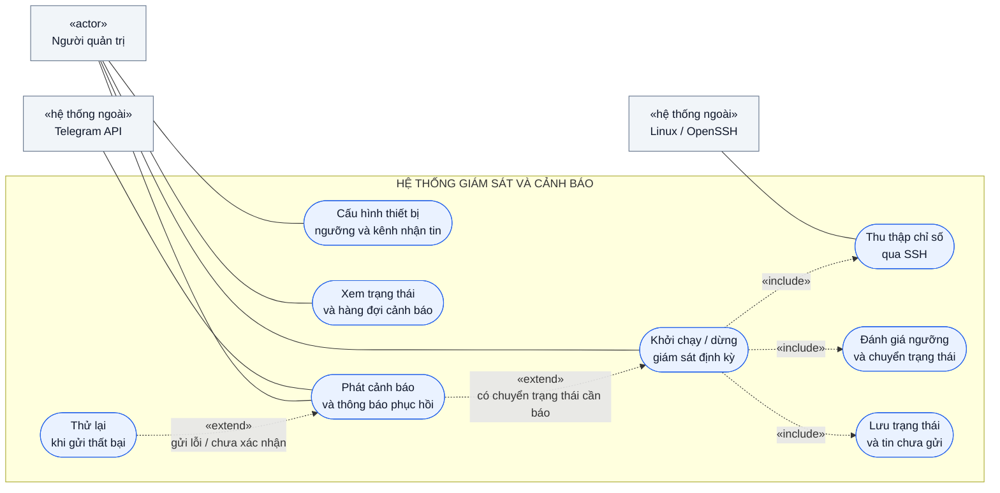
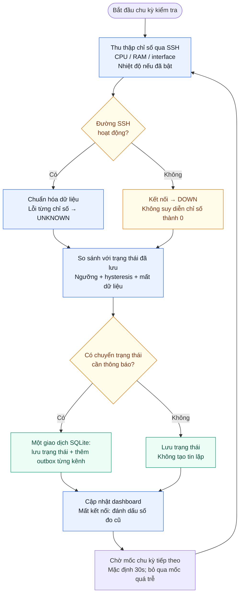
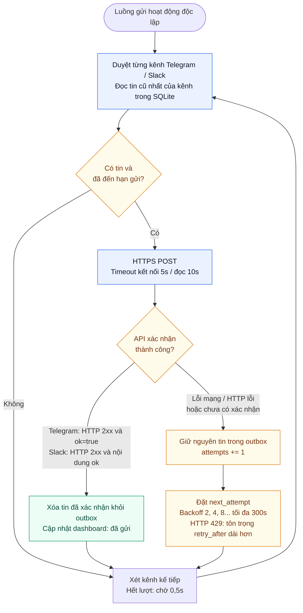
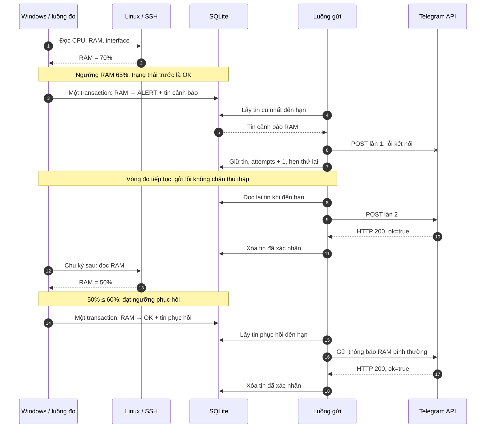
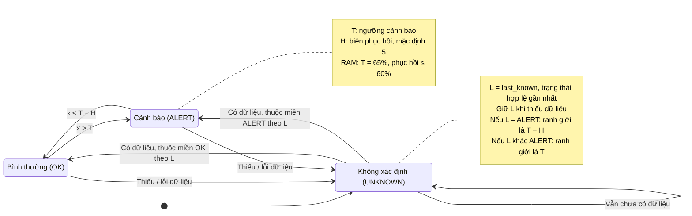
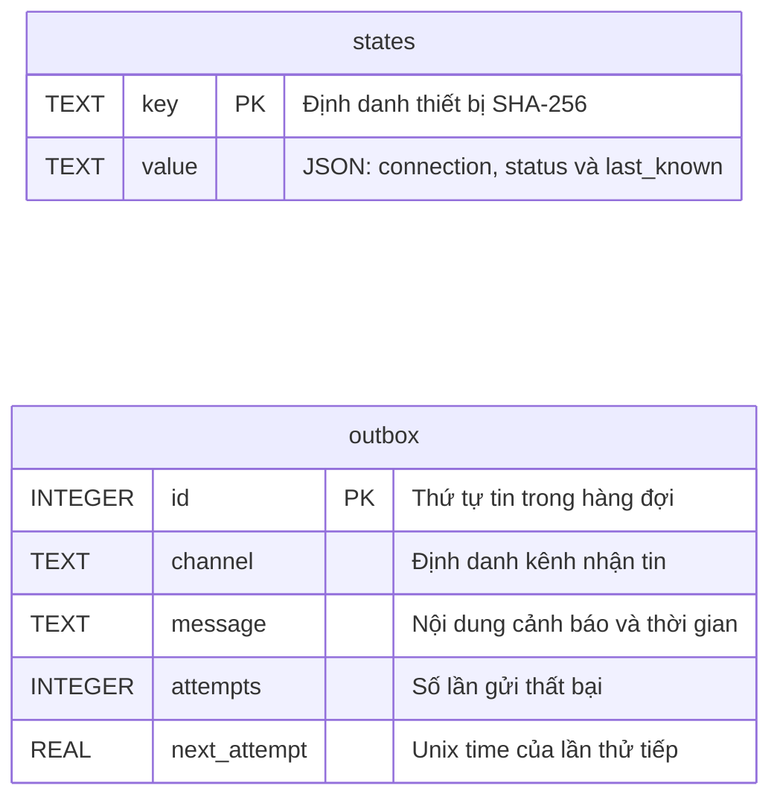

# Sơ đồ Mermaid

Các hình mô tả mô hình Windows giám sát Linux qua SSH. Phần tùy chọn và giới hạn được nêu trong README và chú thích từng hình.

## Hình 1. Kiến trúc tổng thể hệ thống

Windows chạy Python để thu thập từ Linux VM, đánh giá trạng thái, lưu SQLite và gửi cảnh báo bằng luồng riêng. SNMP là phương án thu thập thay thế; Slack là kênh gửi tùy chọn.

Luồng liền mô tả mô hình SSH + Telegram đang triển khai. Nét đứt màu vàng là phần tùy chọn đã có trong mã, chưa được xác minh trên môi trường demo của người dùng.

## Hình 2. Mô hình triển khai và mạng VMware NAT

Linux 192.168.73.129 và adapter Windows VMnet8 192.168.73.1 cùng subnet 192.168.73.0/24. Windows dùng SSH TCP 22 để giám sát Linux, đồng thời gửi Telegram qua kết nối Internet của Windows.

192.168.73.2 là gateway NAT của Linux, không phải IP máy Windows. Windows và Linux VM nằm trên cùng một máy vật lý; host tắt hoặc ngủ có thể làm VM dừng. Các IP theo thông tin đã cung cấp, có thể đổi khi cấu hình mạng thay đổi.

## Hình 3. Biểu đồ ca sử dụng

Người quản trị cấu hình, chạy/dừng, xem dashboard và nhận cảnh báo. Linux cung cấp chỉ số; Telegram API chuyển thông báo ra ứng dụng nhắn tin.

«include» là chức năng được dùng trong giám sát. «extend» biểu diễn nhánh chỉ phát sinh khi điều kiện thỏa: có chuyển trạng thái cần báo hoặc gửi tin thất bại. Hình tập trung vào ca SSH + Telegram hiện tại.

## Hình 4. Lưu đồ thu thập và đánh giá trạng thái

Mỗi chu kỳ mặc định 30 giây, hệ thống thu thập chỉ số, phân biệt lỗi kết nối với lỗi dữ liệu, đánh giá ngưỡng và so sánh trạng thái đã lưu.

Tin mới chỉ được tạo khi có chuyển trạng thái cần thông báo. Trạng thái và tin cảnh báo được ghi cùng giao dịch SQLite. Lần đầu mọi chỉ số bình thường không tạo tin thử; chỉ số chủ động tắt không tham gia vòng đánh giá.

## Hình 5. Lưu đồ hàng đợi, gửi tin và thử lại

Một luồng gửi riêng duyệt từng kênh, lấy tin cũ nhất đến hạn, gọi API và chỉ xóa tin khi đã được xác nhận thành công. Mỗi kênh giữ thứ tự tin riêng.

Backoff bắt đầu 2 giây rồi tăng đến tối đa 300 giây; HTTP 429 dùng thời gian chờ máy chủ yêu cầu nếu dài hơn. Đây là at-least-once: mất phản hồi hoặc dừng trước khi ghi nhận thành công có thể tạo tin trùng.

## Hình 6. Biểu đồ trình tự: RAM vượt ngưỡng và phục hồi

Kịch bản minh họa: RAM 70% vượt ngưỡng 65%, lần gửi đầu lỗi kết nối, lần sau nhận HTTP 200 và ok=true. Khi RAM về 50%, hệ thống phát thông báo phục hồi vì đã xuống dưới mức 60%.

Các số đo và thứ tự sự kiện trong hình là kịch bản minh họa, không phải bản ghi một lần thử RAM đã được xác nhận. Luồng thu thập tiếp tục độc lập khi luồng gửi đang chờ thử lại.

## Hình 7. Biểu đồ trạng thái và hysteresis

Áp dụng cho CPU, RAM và nhiệt độ khi đã bật. Vượt T chuyển sang ALERT; chỉ về OK khi xuống mức T−H. Thiếu dữ liệu chuyển UNKNOWN nhưng giữ last_known để đánh giá đúng khi dữ liệu quay lại.

H mặc định bằng 5: CPU cảnh báo >75%, phục hồi ≤70%; RAM >65%, phục hồi ≤60%; nhiệt độ >65°C, phục hồi ≤60°C. Interface dùng ánh xạ UP/DOWN/UNKNOWN riêng, không dùng ngưỡng số.

## Hình 8. Mô hình dữ liệu SQLite thực tế

Hai bảng thực tế là states và outbox. states lưu trạng thái kết nối và trạng thái từng chỉ số dưới dạng JSON; outbox lưu tin chưa gửi cùng số lần thử và thời điểm thử tiếp.

Không có khóa ngoại giữa hai bảng. Tính nhất quán được đảm bảo bởi giao dịch ứng dụng trong Store.observe. Tin gửi thành công bị xóa; hiện chưa có bảng lưu lịch sử CPU/RAM theo thời gian hoặc lịch sử toàn bộ tin đã gửi.
