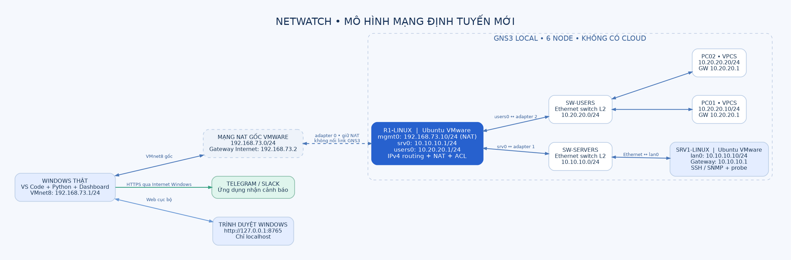
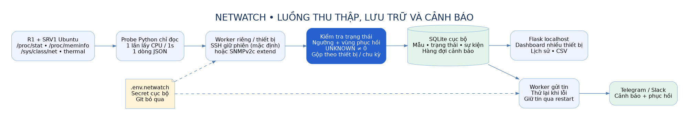
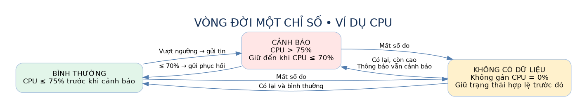
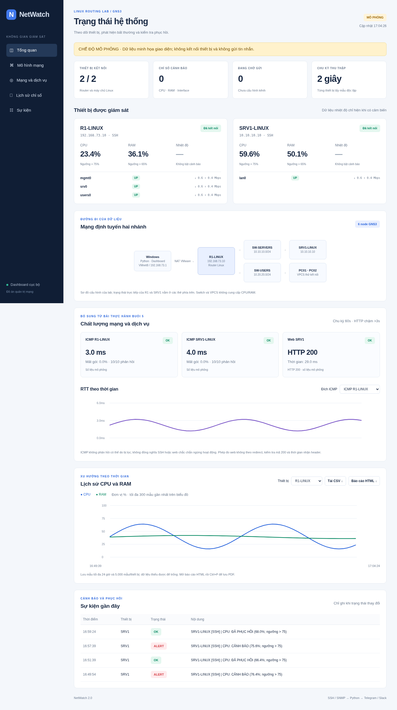

# Hệ thống giám sát và cảnh báo thiết bị

**Đồ án môn Quản trị mạng nâng cao — NetWatch, thiết kế làm lại từ đầu**

Sinh viên: .................................. | Mã số: ..................................

Lớp: ....................................... | Giảng viên: ..............................

Phiên bản thiết kế: 2.0 · Ngày soạn: 05/11/2026.

## Tóm tắt

NetWatch là hệ thống Python chạy trên Windows, định kỳ thu thập CPU, RAM, nhiệt độ khi có cảm biến và trạng thái interface của router Linux R1 và máy chủ Linux SRV1. Dữ liệu được lưu vào SQLite, trình bày trên dashboard cục bộ và phân tích theo ngưỡng để gửi cảnh báo/phục hồi qua Telegram hoặc Slack.

Mô hình mới sử dụng hai full clone Ubuntu VMware, hai switch Ethernet tích hợp GNS3 và hai VPCS. R1 thực hiện định tuyến IPv4 giữa mạng Servers và Users, có NAT ra mạng VMware và luật hạn chế truy cập cổng quản trị từ Users. Windows quản trị qua card NAT gốc của R1; kết nối tới SRV1 đi qua router và switch GNS3. Không sử dụng node Cloud trong topology.

SSH là phương thức mặc định; SNMPv2c qua Net-SNMP extend là tùy chọn trong lab cô lập. Nhiệt độ không tồn tại trên VM được ghi nhận là không có dữ liệu, không giả lập thành nhiệt độ vật lý. Kết quả kiểm thử phần mềm được tách khỏi nghiệm thu thực tế trên Windows/VMware/GNS3.

## 1. Bài toán và mục tiêu

Theo dõi thủ công từng máy dễ bỏ sót quá tải và sự cố kết nối. Các dòng log rời rạc khó so sánh xu hướng; gửi cảnh báo mỗi chu kỳ gây lặp tin, trong khi lỗi mạng Internet có thể làm mất thông báo nếu không có hàng đợi.

Đồ án giải quyết ba mục tiêu: thu thập tập trung có phân biệt số đo thiếu; phát cảnh báo và phục hồi có kiểm soát; trình bày trạng thái/lịch sử cùng bằng chứng đường mạng. Hệ thống phải dễ vận hành trên Windows với VS Code và tận dụng Ubuntu VMware/VPCS đã có.

Phạm vi là hai thiết bị Linux, nhiều interface/thiết bị, hai mạng LAN định tuyến và một mạng quản trị. Không triển khai VPN, SDN controller, AP Wi-Fi, HA hoặc tự sửa lỗi tự động. Những nội dung này chỉ dùng làm nền lý thuyết hoặc hướng phát triển, không được ghi là chức năng đã hoàn thành.

## 2. Cơ sở môn học

Chương 2 phân biệt thiết bị L2/L3 và mô hình quản trị FCAPS [2, trang PDF 5–6, 9–10]. Trong thiết kế, switch chuyển frame trong từng LAN, router Linux nối hai subnet; Fault và Performance là hai chức năng trọng tâm. Không thể dùng VPCS làm đối tượng đo CPU/RAM như một máy chủ Linux.

Chương 5 mô tả chuỗi thu thập–lưu trữ–phân tích–trực quan hóa và chi phí polling [5, trang PDF 2–8]. Hệ thống áp dụng worker riêng cho thiết bị, chu kỳ 15 s, một probe/chu kỳ và lưu dữ liệu lịch sử. Cảnh báo theo thay đổi và hysteresis đáp ứng định hướng hạn chế bão cảnh báo [5, trang PDF 23–26].

Chương 4 cung cấp nền tảng JSON, Paramiko và xử lý lỗi [4, trang PDF 3, 6, 8]. Đồ án sử dụng vòng giám sát–phân tích–thông báo–xác minh; không có bước tự động can thiệp sửa cấu hình [4, trang PDF 28]. Kiểm thử tự động tham chiếu trang PDF 32–33.

Chương 1 liên hệ chỉ số, công cụ quan sát và phân đoạn [1, trang PDF 20–22]. Chương 6 hỗ trợ thiết kế tài khoản ít quyền, xác minh host key, bảo vệ secret, nhật ký và backup/rollback [6, trang PDF 16, 18–19, 27]. Nguyên tắc tách Users/Servers cũng phù hợp định hướng phân đoạn trong Chương 3 [3, trang PDF 23]; đồ án không mô phỏng WLAN. Tài liệu VPN VS CLOUD nhấn mạnh CIDR không trùng [7, trang PDF 55]; vận dụng vào quy hoạch VMnet/LAN mà không dựng VPN.

## 3. Yêu cầu hệ thống

| Nhóm | Yêu cầu |
|---|---|
| Thu thập | CPU%, RAM%, nhiệt độ khi hỗ trợ, operstate và byte/error counters của interface |
| Giao thức | SSH mặc định, SNMPv2c extend tùy chọn; ghi nguồn rõ ràng |
| Phân tích | Ngưỡng, vùng phục hồi 5 đơn vị, UNKNOWN, lỗi kết nối và khôi phục |
| Thông báo | Telegram/Slack, gộp thay đổi theo thiết bị/chu kỳ, retry có lưu hàng đợi |
| Dashboard | Nhiều thiết bị, xu hướng CPU/RAM, Rx/Tx Mbps, sự kiện, CSV, cảnh báo dữ liệu cũ |
| Bảo mật | Secret ngoài Git, host key được xác minh, probe chỉ đọc không sudo, web chỉ localhost |
| Kiểm chứng | Test phần mềm và checklist nghiệm thu tách biệt; không tạo số liệu giả làm kết quả thật |

## 4. Thiết bị và vai trò

| Thành phần | Số lượng | Vai trò |
|---|---|---|
| Windows thật | 1 | Chạy VS Code, Python, SQLite, dashboard; gửi tin qua Internet của Windows |
| Ubuntu R1-LINUX | 1 full clone | Router IPv4, NAT, luật hạn chế quản trị và đối tượng giám sát |
| Ubuntu SRV1-LINUX | 1 full clone | Server được giám sát ở subnet riêng |
| Ethernet switch GNS3 | 2 | Chuyển mạch L2 cho Servers và Users, không có agent CPU/RAM |
| VPCS PC01/PC02 | 2 | Tạo lưu lượng và kiểm tra định tuyến/khả năng tới server |
| Telegram/Slack | Theo kênh cấu hình | Nhận cảnh báo và phục hồi trên ứng dụng nhắn tin |

Hai Ubuntu là clone độc lập, không dùng chung file VMX. Khởi đầu có thể cấp 1 vCPU và 1–2 GB RAM/clone nếu tắt desktop; cần đo lại theo máy thật. GNS3 local server điều khiển VMware Workstation và các link; không phải router thay R1.

## 5. Mô hình mạng và địa chỉ

| Mạng | Thành phần | Địa chỉ |
|---|---|---|
| Quản trị VMware NAT | Windows VMnet8 | 192.168.73.1/24 |
| Quản trị VMware NAT | R1 mgmt0 | 192.168.73.10/24 |
| Quản trị VMware NAT | Gateway NAT VMware | 192.168.73.2 |
| Servers 10.10.10.0/24 | R1 srv0 / SRV1 lan0 | 10.10.10.1 / 10.10.10.10 |
| Users 10.20.20.0/24 | R1 users0 / PC01 / PC02 | 10.20.20.1 / 10.20.20.10 / 10.20.20.20 |

Windows thêm hai route ActiveStore tới 10.10.10.0/24 và 10.20.20.0/24, next hop 192.168.73.10 qua VMnet8. SRV1 có default gateway 10.10.10.1; VPCS có gateway 10.20.20.1; R1 có default gateway 192.168.73.2. Sau reboot Windows cần áp dụng lại hai route lab.

Đường quản trị SRV1: Windows → VMnet8 gốc → R1 mgmt0 → định tuyến sang srv0 → SW-SERVERS → SRV1 lan0. Đường kiểm tra liên LAN: PC01 → SW-USERS → R1 users0/srv0 → SW-SERVERS → SRV1. Hai đường dùng cùng router nhưng khác nguồn và mục đích.

Trong VMware, R1 adapter0 giữ NAT và không nối link GNS3; adapter1/2 là Custom do GNS3 cấp VMnet riêng. SRV1 có một Custom adapter. Các subnet host của VMnet dưới GNS3 khác mạng 10.10.10.0/24 và 10.20.20.0/24 để tránh Windows có đường kết nối trực tiếp ngoài R1.

Generator yêu cầu hai file VMX thật và bảo vệ card NAT bằng use_any_adapter=false. GNS3 tự cấp mạng riêng cho các Custom adapter được đặt tạm VMnet1. Không phát hành file .gns3 chứa VMX giả rồi coi là mở được ngay trên mọi máy.

## 6. Định tuyến, NAT và kiểm soát truy cập

R1 bật net.ipv4.ip_forward=1. Linux kernel thực hiện tra cứu route và chuyển gói giữa các cổng. nftables đặt masquerade cho hai LAN khi ra mgmt0 để các clone có đường Internet qua NAT VMware khi cần cài gói.

Luật forward minh họa chặn kết nối mới từ users0 sang srv0 đến TCP 22 và UDP 161. ICMP vẫn được phép để VPCS kiểm tra reachability. Windows quản trị từ mgmt0 vẫn được phép đi tới server. Các luật chỉ nằm trong bảng inet netwatch_router; không flush toàn bộ ruleset hệ thống.

Đây là luật lab phục vụ phân đoạn, không phải firewall doanh nghiệp đầy đủ. Máy có UFW/ruleset khác cần được kiểm tra trước; script không tự tắt chính sách ngoài phạm vi. Bằng chứng đường đi gồm route Windows, capture handshake TCP trên link server và thử ngừng R1 khiến kết nối server mất.

## 7. Kiến trúc phần mềm

Python trên Windows đọc inventory và secret từ file riêng, tạo worker cho từng thiết bị. Mỗi worker gọi collector theo protocol; kết quả JSON được kiểm tra kiểu dữ liệu, miền giá trị và interface mong đợi. Các metric không hợp lệ không được hiển thị thành số0.

Store xử lý trạng thái và lưu mẫu/sự kiện/hàng đợi trong cùng transaction SQLite. Web chỉ đọc dữ liệu này để hiển thị; worker gửi tin xử lý outbox riêng nên API nhắn tin chậm không trực tiếp chặn vòng lấy mẫu. Thiết bị mất kết nối không làm dừng worker của thiết bị khác.

Các module chính: config.py kiểm tra inventory/probe; collectors.py xử lý SSH/SNMP; storage.py lưu trạng thái và chuyển trạng thái; notifications.py gửi/retry; service.py điều phối worker; web.py cung cấp dashboard localhost. Probe/provision và generator GNS3 nằm riêng trong lab/ và tools/.

## 8. Phương pháp lấy số đo

CPU dùng tổng tám trường đầu trong /proc/stat, lấy hai snapshot cách 1 giây. CPU% = 100×(Δtotal−Δidle)/Δtotal, trong đó idle cộng idle+iowait; không cộng guest/guest_nice lần nữa vì đã nằm trong user/nice. Số đo là toàn VM trên thang 0–100%, không cộng %CPU từng process để so trực tiếp.

RAM% = 100×(MemTotal−MemAvailable)/MemTotal. MemAvailable phản ánh lượng có thể sử dụng thêm, phù hợp hơn việc chỉ nhìn MemFree trong hệ có cache. Nhiệt độ lấy từ thermal_zone sysfs nếu kernel cung cấp; không có cảm biến thì để trống và mặc định không cảnh báo nhiệt độ.

Interface lấy operstate và rx_bytes, tx_bytes, rx_errors, tx_errors. Lưu lượng Mbps=8×Δbytes/Δt/10^6; counter giảm do reset hoặc chưa có mẫu trước thì không tính. Lưu lượng quan sát được không đồng nghĩa tốc độ danh nghĩa của đường truyền.

SSH giữ transport đã xác thực và gọi một lệnh /usr/bin/python3 /opt/netwatch/probe.py mỗi chu kỳ. Probe dùng thư viện chuẩn, đọc proc/sys và không yêu cầu sudo. Cách này giảm số lần handshake và số process phụ; mức overhead thực tế cần đo A/B, không suy ra tự động từ thiết kế.

## 9. SSH và SNMP

SSH sử dụng Paramiko và known_hosts riêng. Fingerprint SHA256 lấy độc lập từ console Ubuntu được so khớp trước khi ghi key; fingerprint không khớp bị từ chối. Mỗi full clone có host key riêng sau provision. Không dùng AutoAddPolicy hoặc tự động chấp nhận key mới khi không có kiểm chứng.

SNMP tùy chọn sử dụng agent Net-SNMP, read-only community giới hạn nguồn192.168.73.1, UDP 161, extend netwatch trả cùng JSON probe. OID extend khác OID tài nguyên tiêu chuẩn và cần cấu hình agent cụ thể. Bản này không hỗ trợ SNMPv3 và không coi SNMPv2c là an toàn cho mạng công cộng.

Mỗi thiết bị chọn một giao thức trong inventory. Có thể R1 qua SSH và SRV1 qua SNMP; không có cơ chế fallback âm thầm giữa hai nguồn. Test-NetConnection -Port chỉ kiểm tra TCP, không chứng minh SNMP UDP 161 hoạt động.

## 10. Logic cảnh báo và phục hồi

Ngưỡng mặc định: CPU > 75%, RAM > 65%, nhiệt độ > 65°C khi bật. Hysteresis 5 giữ CPU ở cảnh báo cho đến khi ≤ 70%; tương tự RAM ≤ 60% và nhiệt độ ≤ 60°C. Đây là tham số thiết kế lab, không phải số liệu thực nghiệm hoặc ngưỡng do bài giảng quy định.

Trạng thái gồm OK, ALERT, UNKNOWN. Chỉ thay đổi trạng thái mới tạo sự kiện. UNKNOWN giữ trạng thái hợp lệ trước đó để sau khi dữ liệu có lại có thể phân biệt “vẫn cảnh báo” với “đã phục hồi”. Khi mất kết nối chung, chỉ gửi lỗi kết nối và đưa metric về thiếu dữ liệu, không phát nhiều lỗi0% riêng lẻ.

Các thay đổi cùng thiết bị/chu kỳ gộp một tin cho mỗi kênh. Khi gửi lỗi, outbox lưu trên đĩa và thử lại 2, 4, 8… tối đa 300 giây; mã 429 dùng thời gian chờ dịch vụ trả về. Restart ứng dụng vẫn còn pending message và trạng thái. Cơ chế at-least-once có thể trùng tin trong trường hợp bên nhận đã nhận nhưng ứng dụng chưa ghi nhận thành công.

Độ trễ phát hiện phụ thuộc chu kỳ 15 s, khoảng lấy mẫu 1 s, timeout/kết nối và Internet/API. Không cam kết thời gian thực cứng; cần đo t0 tác động, t1 dashboard thay đổi, t2 nhận tin trên hệ thực.

## 11. Dashboard và dữ liệu

Dashboard chỉ lắng nghe 127.0.0.1:8765 và không có API sửa cấu hình. Trang tổng quan hiển thị số thiết bị có dữ liệu mới, trạng thái cảnh báo và hàng đợi tin. Hai thẻ thiết bị hiển thị metric/cổng; dữ liệu cũ bị đánh dấu, giá trị thiếu là dấu gạch.

Biểu đồ CPU/RAM cho300 mẫu gần nhất; SQLite giữ tối đa 24 giờ và 5.000 mẫu/thiết bị,1.000sự kiện. CSV ghi nguồn SSH/SNMP và sample_kind=lab hoặc demo để phân biệt dữ liệu thực/mô phỏng. Sơ đồ topology là cấu hình tĩnh, không phải kết quả tự khám phá switch/VPCS.

Chế độ --demo không truy cập thiết bị, không đọc dữ liệu thật vào DB demo và không gửi Telegram/Slack. Ảnh giao diện trong báo cáo được ghi nhãn mô phỏng, chỉ minh họa bố cục, không là bằng chứng nghiệm thu.

## 12. Bảo mật và vận hành

Windows giữ tài khoản/mật khẩu/token trong .env.netwatch bị Git bỏ qua. known_hosts, SQLite và project GNS3 chứa đường dẫn cục bộ cũng nằm ngoài Git. Repo chỉ có template secret trống. Không đưa URL Telegram chứa token hoặc webhook Slack vào log, screenshot hay báo cáo.

Tài khoản monitor trên clone không được cấp sudo. Probe do root cài, chỉ cho người giám sát đọc/chạy. Web giới hạn localhost, kiểm tra Host/Origin, phương thức chỉ đọc và CSP; đây không phải dịch vụ được xác thực để công khai ra LAN/Internet.

Provision có chế độ xem kế hoạch mặc định; --apply --cloned-vm mới thay cấu hình trên clone. Script backup netplan, file bị thay và host key trước lần cài đầu, kèm restore.sh. Ubuntu gốc được giữ nguyên. Thay đổi card/IP cần khớp MAC, không đoán tên ens33/ens37 từ số thứ tự.

## 13. Quy trình triển khai

1. Tạo hai full clone, chuẩn bị gói qua NAT và checkout repo mới trên từng clone.
2. R1 giữ NAT đầu tiên và thêm hai Custom adapter; server chỉ một Custom adapter.
3. Chuẩn bị ba VMnet trống riêng cho GNS3, DHCP tắt và không trùng CIDR lab.
4. Tạo project bằng hai VMX thật, mở GNS3 local và Start node.
5. Đối chiếu MAC, provision router/server, giữ cấu hình netplan và reboot.
6. Cấu hình VPCS, route Windows, kiểm tra TCP và bắt gói link server.
7. Nhập secret, xác minh host key, chạy NetWatch và thực hiện kịch bản cảnh báo/phục hồi.

Hướng dẫn từng lần bấm và khối lệnh phân biệt Windows/Ubuntu nằm ở docs/01_GNS3.md và docs/02_SU_DUNG.md. Không chạy sudo ufw ở PowerShell và không nhập dòng “0.0.0.0:22” như một lệnh; đó là đầu ra listener khi kiểm tra sshd.

## 14. Kiểm thử và kết quả hiện có

Bộ kiểm thử phần mềm gồm 50 test, đã chạy đạt trong môi trường Linux phát triển. Nội dung bao gồm công thức CPU/RAM, giá trị không hợp lệ, hysteresis/UNKNOWN, dedup/gộp tin, lưu trạng thái/queue qua restart, retry429, stale data, CSV, chặn truy cập web không hợp lệ, schema project GNS3 và kiểm tra VMX.

Test giao thức tạo SSH server và SNMPv2c responder loopback cục bộ. SSH thực hiện hai lệnh trên cùng transport được pin host key; SNMP xác minh OID extend và giải mã JSON qua UDP thật. Kiểm thử web trình duyệt dùng dữ liệu mô phỏng, kiểm tra desktop/mobile và tải CSV.

Các kiểm thử bổ sung gồm HTTP 200/503/chậm qua loopback, xử lý ping mất gói một phần, định dạng lệnh Windows .NET Ping, CSV, lưu trạng thái health, báo cáo HTML và schema sơ đồ xem ngay. Chưa thực thi PowerShell trên Windows hoặc đo iperf3 trên hai clone thật.

Không có số liệu nghiệm thu VMware/GNS3/Telegram/Slack thật của người dùng trong lần dựng này. Không tuyên bố độ trễ, overhead CPU, SLA hoặc tỷ lệ thành công thực tế khi chưa đo. Bộ mẫu báo cáo kết quả để trống trạng thái CHUA_CHAY, cần bổ sung ảnh, thời gian và cấu hình máy.

## 15. Kịch bản nghiệm thu trên máy thật

| Nhóm | Thử nghiệm | Bằng chứng cần nộp |
|---|---|---|
| Mạng | PC01 tới SRV1; Windows route qua R1; TCP 22 thành công | Topology, route, ping, handshake capture |
| CPU/RAM | Tạo tải có thời hạn45 s rồi giải phóng | Số đo Ubuntu/dashboard, tin cảnh báo và phục hồi |
| Interface | Tắt/bật users0 tại console R1 | R1 vẫn quản trị được; cổng DOWN/UP và tin nhắn |
| SSH | Dừng/bật ssh trên SRV1 | R1 còn dữ liệu, SRV1 mất và khôi phục kết nối |
| API nhắn tin | Ngắt/khôi phục Internet Windows có kiểm soát | Queue tăng rồi gửi lại; không cần tạo sự kiện mới |
| Persistence | Dừng/chạy lại NetWatch | Lịch sử/queue còn; không phát lại toàn bộ sự kiện cũ |
| Đường định tuyến | Dừng R1 rồi kiểm tra server | Kết nối server fail qua route đã thiết kế, phục hồi khi R1 chạy |
| SNMP tùy chọn | Chuyển một thiết bị sang SNMP | UDP 161/extend và nguồn SNMP trên dashboard |

Đo CPU nền bằng vmstat 1 giây trong30 mẫu khi monitor dừng và chạy, bỏ dòng đầu từ lúc boot; giữ điều kiện giống nhau. Đo ít nhất 3lần độ trễ cho mỗi nhóm cảnh báo. Chỉ so sánh số đo cùng công thức/cửa sổ; không gọi tỷ lệ mẫu online là SLA thời gian [5, trang PDF 28–29].

## 16. Vận dụng bài thực hành buổi 5

Tài liệu Bài tập thực hành buổi 5.docx gồm 10 lab trong 6 tiết [10]. Các Lab 1, 2, 3, 4, 6 và 10 phù hợp trực tiếp với đề tài. Hệ thống vận dụng các mục tiêu này vào mô hình GNS3 hiện tại; không chuyển sang Mininet, không ghi những tính năng bảo mật chưa triển khai là kết quả đã hoàn thành.

| Nội dung | Bổ sung vào NetWatch | Phạm vi |
|---|---|---|
| Lab 1 — Tài nguyên và CSV | Profile chu kỳ 5s, CPU >85%, RAM >90%, tự ghi system_metrics.csv theo từng interface | Profile riêng; cấu hình đồ án mặc định giữ 15s/75%/65% |
| Lab 2 — ICMP | Gửi 10 gói/thiết bị, tính RTT trung bình và tỷ lệ mất gói thực tế, lưu lịch sử/cảnh báo | Worker riêng mỗi 60s; không tự gọi SSH offline khi ICMP bị lọc |
| Lab 3 — iperf3 | Hai phép đo TCP theo hai hướng R1/SRV1, CSV riêng | Theo yêu cầu; 5s/chiều, giới hạn tải 20Mbps; không phải tốc độ Internet hay băng thông tối đa |
| Lab 4 — HTTP | Kiểm tra status 200 và thời gian nhận header không quá 3s; dùng chung outbox Telegram/Slack | Web mẫu tại SRV1:8000, có chế độ 503 và delay 4s để nghiệm thu |
| Lab 6 — Bắt gói | Hướng dẫn thu 50 gói bằng Wireshark trên link server trong GNS3 | Xem IP, protocol, cổng và handshake; không tuyên bố có chương trình scapy |
| Lab 10 — Báo cáo | Dashboard có RTT/loss/HTTP; xuất HTML độc lập với biểu đồ CPU/RAM/RTT và sự kiện | HTML không dùng CDN, in ra PDF từ trình duyệt |

Ngưỡng RTT >100ms và packet loss >20% là tham số thiết kế bổ sung; ngưỡng HTTP >3s, CPU >85%, RAM >90% đến từ tài liệu. Thời gian HTTP đo đến khi nhận header, không phải thời gian tải toàn bộ nội dung. Lỗi công cụ ping cho kết quả UNKNOWN; không phản hồi đủ 10 gói cho loss 100% và RTT trống; phản hồi một phần vẫn giữ đúng bộ đếm và RTT đã đo.

Mã mẫu của tài liệu cần điều chỉnh trước khi áp dụng: IP trong DEVICES không khớp topology; CPU/RAM của namespace Mininet dùng chung tài nguyên máy nền; OID CPU Cisco không dùng chung cho Ubuntu; lỗi SNMP không được trả 0 rồi ghi OK. Sender/Receiver trong một lượt iperf3 không thể diễn giải thành upload/download hai chiều. Hệ thống mới xử lý các điểm này bằng inventory thống nhất, hai VM độc lập, probe được kiểm chứng và reverse test riêng.

Lab 5/7/8/9 về quét toàn dải cổng, phát hiện ARP spoofing, brute-force và tự chặn IP chưa được thêm vào collector. Giữ các mục này làm hướng mở rộng có chính sách riêng, thay vì tự khóa địa chỉ quản trị. Các tình huống HTTP/ICMP và iperf3 thật cần chạy theo docs/05_BUOI_5.md và ghi kết quả nghiệm thu.

Để giảm thao tác tải/mở, repository có task VS Code, sơ đồ GNS3 drawings mở ngay và launcher tạo lab VM thật từ hai VMX. Sơ đồ xem ngay không chứa node đang thực thi; không giả định đã có Ubuntu disk hoặc đường dẫn VMX của máy triển khai.

## 17. Giới hạn và hướng phát triển

R1 là điểm lỗi đơn của hai LAN; dashboard mất nguồn dữ liệu khi Windows tắt. SQLite thích hợp lab nhỏ; chưa có cơ chế HA, phân quyền người dùng web hoặc triển khai qua nhiều máy quản trị. Dữ liệu nhiệt độ thường không hỗ trợ trên VMware, SNMPv2c không mã hóa, mật khẩu SSH vẫn là secret cần bảo vệ cục bộ.

Hướng phát triển theo thứ tự: hoàn tất bằng chứng lab thật; đo overhead/độ trễ và tinh chỉnh chu kỳ/ngưỡng; bổ sung SSH key/SNMPv3; triển khai web có xác thực/TLS nếu cần chia sẻ; sau đó mới xem xét nhiều thiết bị hơn, bộ nhớ dài hạn hoặc VPN/SDN như bài mở rộng độc lập.

## 18. Kết luận

Thiết kế mới đưa router Linux vào vai trò trung tâm định tuyến, có server và mạng người dùng riêng, đáp ứng việc dùng GNS3 để kiểm chứng đường mạng. Hệ thống giám sát giữ đúng trọng tâm CPU/RAM/nhiệt độ/interface, có cảnh báo, phục hồi, dashboard và dữ liệu lịch sử.

Phần mềm và tài liệu đã được dựng, kiểm thử trong môi trường phát triển; mức hoàn thành đồ án cuối cùng phụ thuộc việc triển khai hai clone và bổ sung kết quả nghiệm thu thật. Bài học chính là tách đúng vai trò thiết bị/giao thức, quy hoạch địa chỉ nhất quán, phân biệt mất dữ liệu với tài nguyên thấp và đo thay vì suy đoán hiệu năng.

## Tài liệu tham khảo

[1] Chuong 1. Quang tri mang nang cao (1).pdf —39 trang, do người dùng cung cấp.

[2] Chuong 2. Phan tich cac mo hinh mang (2).pdf —28 trang, do người dùng cung cấp.

[3] Chuong 3-An ninh mang khong day (2).pdf —33 trang, do người dùng cung cấp.

[4] Chương 4. Tự động hóa quản trị hệ thống SDN bằng Python (2).pdf —33 trang, do người dùng cung cấp.

[5] Chuong 5 - Quan ly hieu suat hoat dong (1).pdf —38 trang, do người dùng cung cấp.

[6] Chương 6- Qản lý bảo mật (1).pdf —27 trang, do người dùng cung cấp.

[7] VPN VS CLOUD (1).pdf —67 trang, do người dùng cung cấp.

[8] GNS3/gns3-server v2.2.61, gns3server/compute/vmware/vmware_vm.py và schemas/vmware.py — cơ chế bảo vệ NAT adapter, cấp VMnet và định dạng node. https://github.com/GNS3/gns3-server/tree/v2.2.61

[9] Net-SNMP, NET-SNMP-EXTEND-MIB — cơ chế extend và nsExtendOutputFull. https://www.net-snmp.org/docs/mibs/NET-SNMP-EXTEND-MIB.txt

[10] Bài tập thực hành buổi 5.docx — 6 tiết, 10 lab hiệu suất và bảo mật; nguồn do người dùng cung cấp. Phần vận dụng: Lab 1, 2, 3, 4, 6 và 10.

Danh mục SHA-256 nguồn và bảng liên hệ từng chương nằm ở docs/sources.json và docs/04_LIEN_HE_MON_HOC.md. Không đưa các PDF bài giảng gốc vào gói phát hành.
