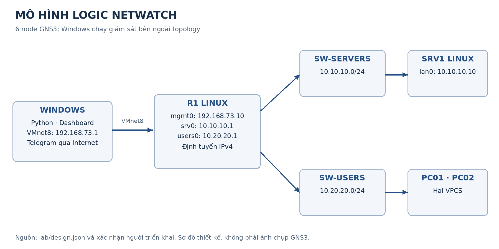
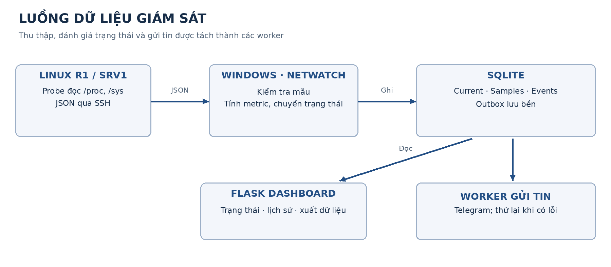
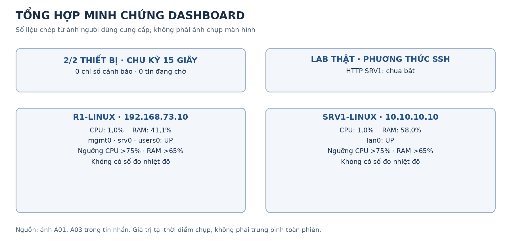
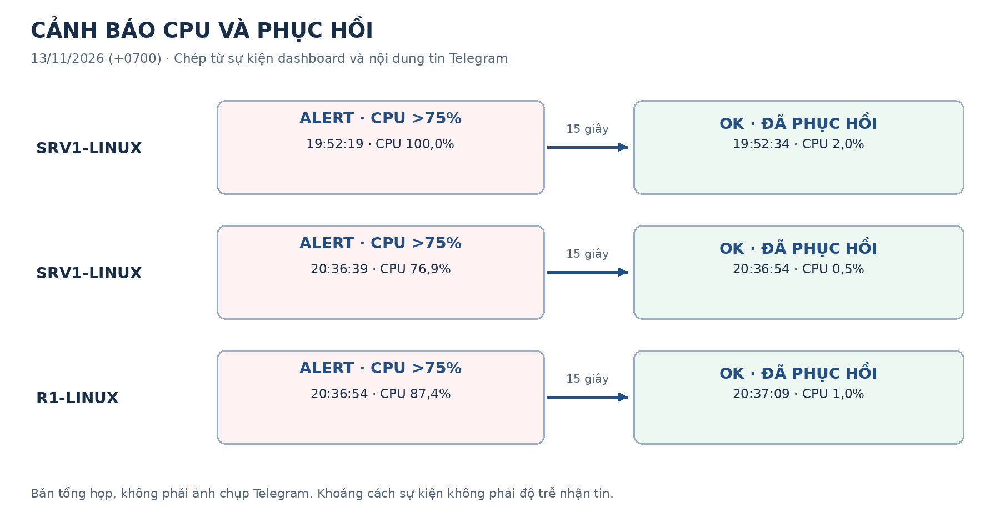

<!-- cover -->
# BÁO CÁO ĐỒ ÁN CHUYÊN NGÀNH

**Trường:** ............................................................

**Khoa:** ...............................................................

**Ngành/Chuyên ngành:** .................................................

**NETWATCH**

**XÂY DỰNG HỆ THỐNG GIÁM SÁT THIẾT BỊ LINUX VÀ CẢNH BÁO QUA TELEGRAM TRONG MÔ HÌNH MẠNG GNS3**

**Giảng viên hướng dẫn:** ...............................................

**Sinh viên thực hiện:** ................................................

**Mã số sinh viên:** ....................................................

**Lớp:** ...............................................................

**Khóa:** ..............................................................

**Địa điểm, tháng, năm nộp:** ............................................

<!-- inner-cover -->
# BÁO CÁO ĐỒ ÁN CHUYÊN NGÀNH

**Trường:** ............................................................

**Khoa:** ...............................................................

**Ngành/Chuyên ngành:** .................................................

**NETWATCH**

**XÂY DỰNG HỆ THỐNG GIÁM SÁT THIẾT BỊ LINUX VÀ CẢNH BÁO QUA TELEGRAM TRONG MÔ HÌNH MẠNG GNS3**

**Giảng viên hướng dẫn:** ...............................................

**Sinh viên thực hiện:** ................................................

**Mã số sinh viên:** ....................................................

**Lớp:** ...............................................................

**Khóa:** ..............................................................

**Địa điểm, tháng, năm nộp:** ............................................

# LỜI CẢM ƠN

Em xin cảm ơn quý thầy cô đã truyền đạt kiến thức về mạng máy tính, hệ điều hành và phát triển phần mềm, tạo nền tảng để em thực hiện đề tài NetWatch. Em xin cảm ơn giảng viên hướng dẫn đã dành thời gian định hướng và góp ý trong quá trình học tập, nghiên cứu.

Quá trình xây dựng mô hình giúp em vận dụng kiến thức vào việc thiết kế mạng định tuyến, thu thập dữ liệu và theo dõi sự cố. Do phạm vi và điều kiện thực nghiệm còn giới hạn, báo cáo khó tránh khỏi thiếu sót. Em mong nhận được nhận xét để hoàn thiện sản phẩm và kỹ năng thực hiện đồ án.

Sinh viên thực hiện

(Ký và ghi rõ họ tên)

............................................................

# LỜI CAM ĐOAN

Bản dự thảo để sinh viên kiểm tra, hoàn thiện và ký xác nhận:

Tôi cam đoan các nội dung trình bày về quá trình thực hiện đề tài, phạm vi đóng góp và kết quả thực nghiệm đã được tôi kiểm tra lại. Các nội dung tham khảo được ghi nguồn. Các kết quả chưa được nghiệm thu thực tế được phân biệt với chức năng hiện diện trong mã nguồn và kết quả kiểm thử phần mềm.

Tôi chịu trách nhiệm về tính trung thực của số liệu, nguồn hình ảnh và nội dung báo cáo sau khi hoàn thiện, xác nhận và nộp bản chính thức.

Sinh viên thực hiện

(Ký và ghi rõ họ tên)

............................................................

# NHẬN XÉT CỦA GIẢNG VIÊN HƯỚNG DẪN

Kết cấu và phương pháp trình bày:

........................................................................................

........................................................................................

Cơ sở lý luận:

........................................................................................

........................................................................................

Tính thực tiễn, khả năng ứng dụng và kết quả thực hiện:

........................................................................................

........................................................................................

Kết luận về việc đồng ý cho sinh viên nộp báo cáo:

........................................................................................

Ngày ........ tháng ........ năm ........

GIẢNG VIÊN HƯỚNG DẪN

(Ký, ghi rõ họ tên, học hàm, học vị)

# NHẬN XÉT CỦA GIẢNG VIÊN PHẢN BIỆN

Nhận xét về nội dung, phương pháp và kết quả:

........................................................................................

........................................................................................

........................................................................................

........................................................................................

........................................................................................

Các vấn đề cần bổ sung, làm rõ:

........................................................................................

........................................................................................

Kết luận về việc đồng ý cho sinh viên nộp báo cáo:

........................................................................................

Ngày ........ tháng ........ năm ........

GIẢNG VIÊN PHẢN BIỆN

(Ký, ghi rõ họ tên, học hàm, học vị)

# LỊCH LÀM VIỆC

Biểu mẫu để bổ sung từ nhật ký thực hiện. Các mốc thời gian và nhận xét dưới đây được để trống vì chưa được cung cấp; không thay bằng lịch thực hiện giả định.

| Tuần | Nội dung thực hiện | Địa điểm | Nhận xét của GVHD | Chữ ký GVHD |
|---|---|---|---|---|
| ........ | ................................ | ........ | ................ | ........ |
| ........ | ................................ | ........ | ................ | ........ |
| ........ | ................................ | ........ | ................ | ........ |
| ........ | ................................ | ........ | ................ | ........ |
| ........ | ................................ | ........ | ................ | ........ |
| ........ | ................................ | ........ | ................ | ........ |
| ........ | ................................ | ........ | ................ | ........ |
| ........ | ................................ | ........ | ................ | ........ |

# TÓM TẮT ĐỒ ÁN

NetWatch giải quyết nhu cầu theo dõi tập trung tài nguyên và trạng thái kết nối của các máy Linux trong mô hình mạng thực hành. Hệ thống Python chạy trên Windows, thu thập qua SSH (Secure Shell), lưu dữ liệu bằng SQLite, hiển thị dashboard Flask và gửi thông báo qua Telegram khi trạng thái thay đổi.

Mô hình gồm router Linux R1, máy chủ Linux SRV1, hai switch Ethernet và hai VPCS. R1 có địa chỉ quản trị 192.168.73.10; SRV1 có địa chỉ 10.10.10.10. Windows tiếp cận SRV1 qua R1 và nhánh mạng Servers. Thuật toán đánh giá ngưỡng sử dụng vùng trễ phục hồi để giảm dao động cảnh báo; hàng đợi lưu bền giúp thử lại khi gửi thông báo gặp lỗi.

Theo xác nhận của người triển khai và nội dung ảnh nghiệm thu được cung cấp, hệ thống đã giám sát thành công hai máy với chu kỳ 15 giây. Telegram đã nhận thông báo CPU vượt ngưỡng và phục hồi của SRV1 và R1. Dashboard hiển thị CPU, RAM, trạng thái interface, lịch sử và sự kiện. Phép đo ICMP cho thấy cả hai thiết bị có phản hồi trong mẫu chụp. Dịch vụ HTTP của SRV1 hiện chưa bật.

Đối chiếu mã nguồn và kiểm thử bổ sung trong môi trường Linux cho kết quả 50/50 kiểm thử đạt. Kết quả này xác minh logic và giao thức trong phạm vi kiểm thử, được tách khỏi nghiệm thu Windows/VMware/GNS3. Đề tài đạt mục tiêu giám sát hai thiết bị và cảnh báo Telegram trong lab; các hướng tiếp theo gồm nghiệm thu HTTP, đánh giá độ trễ đầu cuối, kiểm thử gián đoạn dài hạn và tăng cường bảo mật.

# MỤC LỤC

<!-- toc -->

- [Mở đầu](#mở-đầu)
- [Chương 1. Tổng quan tài liệu](#chương-1-tổng-quan-tài-liệu)
- [Chương 2. Phương pháp thực hiện](#chương-2-phương-pháp-thực-hiện)
- [Chương 3. Cài đặt thử nghiệm, kết quả và đánh giá](#chương-3-cài-đặt-thử-nghiệm-kết-quả-và-đánh-giá)
- [Kết luận và hướng phát triển](#kết-luận-và-hướng-phát-triển)
- [Phụ lục](#phụ-lục)
- [Danh mục tài liệu tham khảo](#danh-mục-tài-liệu-tham-khảo)

<!-- /toc -->

# DANH MỤC SƠ ĐỒ, HÌNH

<!-- figures -->

- Hình 2.1. Sơ đồ logic của mô hình NetWatch
- Hình 2.2. Luồng xử lý dữ liệu của NetWatch
- Hình 3.1. Tổng hợp số liệu từ ảnh nghiệm thu dashboard
- Hình 3.2. Chuỗi cảnh báo và phục hồi CPU được ghi nhận

<!-- /figures -->

# DANH MỤC BẢNG

<!-- tables -->

- Bảng 1.1. So sánh định tính các hướng giám sát
- Bảng 2.1. Yêu cầu kỹ thuật và tiêu chí kiểm tra
- Bảng 2.2. Kế hoạch địa chỉ và vai trò
- Bảng 2.3. Các mô-đun chính và trách nhiệm
- Bảng 2.4. Ví dụ chuyển trạng thái CPU với ngưỡng 75%, biên 5
- Bảng 3.1. Số liệu đọc từ ảnh tổng quan dashboard
- Bảng 3.2. Các cặp sự kiện CPU đọc từ ảnh nghiệm thu
- Bảng 3.3. Kết quả ICMP và trạng thái HTTP trong ảnh
- Bảng 3.4. Nhóm kiểm thử và phạm vi xác minh
- Bảng 3.5. Tổng hợp mức hoàn thành

<!-- /tables -->

# KÝ HIỆU CÁC CỤM TỪ VIẾT TẮT

| Ký hiệu | Diễn giải |
|---|---|
| ACL | Access Control List – danh sách kiểm soát truy cập |
| API | Application Programming Interface – giao diện lập trình ứng dụng |
| CPU | Central Processing Unit – bộ xử lý trung tâm |
| CSV | Comma-Separated Values – định dạng dữ liệu phân tách bằng dấu phẩy |
| GVHD | Giảng viên hướng dẫn |
| HTTP | Hypertext Transfer Protocol – giao thức truyền siêu văn bản |
| ICMP | Internet Control Message Protocol – giao thức thông điệp điều khiển Internet |
| IP | Internet Protocol – giao thức Internet |
| JSON | JavaScript Object Notation – định dạng biểu diễn dữ liệu có cấu trúc |
| NAT | Network Address Translation – chuyển đổi địa chỉ mạng |
| RAM | Random Access Memory – bộ nhớ truy cập ngẫu nhiên |
| RTT | Round-Trip Time – thời gian khứ hồi |
| SNMP | Simple Network Management Protocol – giao thức quản lý mạng đơn giản |
| SSH | Secure Shell – giao thức truy cập từ xa an toàn |
| TCP/UDP | Transmission Control Protocol/User Datagram Protocol |
| VM | Virtual Machine – máy ảo |
| VPCS | Virtual PC Simulator – bộ mô phỏng máy trạm |
| WAL | Write-Ahead Logging – cơ chế nhật ký ghi trước của SQLite |

# MỞ ĐẦU

Trong quản trị mạng, khả năng kết nối không phản ánh đầy đủ tình trạng vận hành của thiết bị. Một máy Linux vẫn có thể trả lời ping trong khi CPU đã quá tải hoặc bộ nhớ đang cạn. Người quản trị cần quan sát nhiều chỉ số theo thời gian, phân biệt lỗi kết nối với thiếu dữ liệu và nhận thông tin phục hồi khi sự cố đã kết thúc. Việc đăng nhập thủ công vào từng máy phù hợp để chẩn đoán tại chỗ nhưng khó duy trì liên tục và khó đối chiếu lịch sử.

Đề tài “Xây dựng hệ thống giám sát thiết bị Linux và cảnh báo qua Telegram trong mô hình mạng GNS3” được thực hiện nhằm xây dựng một quy trình giám sát có thể quan sát, kiểm tra và giải thích được. NetWatch kết hợp thu thập định kỳ, lưu trạng thái, đánh giá ngưỡng và gửi thông báo. Sản phẩm hướng đến môi trường học tập, tận dụng hai máy Ubuntu chạy bằng VMware, các thành phần mạng của GNS3 và máy Windows hiện có.

Mục tiêu cụ thể là giám sát CPU, RAM và interface của R1 và SRV1 qua SSH; cập nhật dashboard theo chu kỳ 15 giây; phát hiện CPU vượt ngưỡng; gửi thông báo cảnh báo và phục hồi qua Telegram; lưu lịch sử phục vụ phân tích. Nhiệt độ chỉ được sử dụng nếu có cảm biến. HTTP, SNMP và Slack được trình bày theo mức hỗ trợ và mức kiểm chứng thực tế, không gộp vào kết quả nghiệm thu Telegram.

Đối tượng nghiên cứu gồm đường đi của dữ liệu giám sát, cách thu thập chỉ số từ Linux, cơ chế chuyển trạng thái và quy trình kiểm chứng một hệ thống giám sát nhỏ. Phạm vi triển khai có hai thiết bị Linux được giám sát, hai switch và hai VPCS trong GNS3. Windows là máy chạy ứng dụng bên ngoài sáu node này. Đề tài là mô hình thực hành tự nghiên cứu; chưa có thông tin về triển khai cho doanh nghiệp hoặc đơn vị cụ thể.

Phương pháp thực hiện gồm đọc tài liệu kỹ thuật, phân tích mã nguồn, đối chiếu cấu hình, tổ chức mô hình định tuyến và đánh giá theo kịch bản. Báo cáo sử dụng ảnh nghiệm thu do người triển khai cung cấp làm cơ sở ghi nhận kết quả lab; đồng thời chạy lại bộ kiểm thử tự động trên Linux để xác minh phần mềm. Hai lớp bằng chứng này có phạm vi khác nhau và được ghi rõ trong chương 3.

Đóng góp của sản phẩm thể hiện ở việc kết nối các bước thu thập, chuẩn hóa dữ liệu, phân loại trạng thái, chống lặp cảnh báo, thử lại thông báo và trình bày lịch sử trong một ứng dụng dễ vận hành. Đây là sự tích hợp các kỹ thuật đã có; báo cáo không đề xuất một giao thức định tuyến hay thuật toán học máy mới.

Báo cáo gồm ba chương. Chương 1 tổng quan các hướng giám sát và cơ sở lý thuyết. Chương 2 phân tích yêu cầu, thiết kế mô hình và phương pháp xử lý dữ liệu. Chương 3 trình bày cài đặt, kết quả nghiệm thu, kiểm thử và đánh giá. Phần cuối nêu kết luận, hướng phát triển, phụ lục vận hành và tài liệu tham khảo. Cấu trúc và thể thức được đối chiếu với hai hướng dẫn trình bày đã cung cấp [4], [5].

# CHƯƠNG 1. TỔNG QUAN TÀI LIỆU

## 1.1. Bài toán giám sát thiết bị trong mạng thực hành

Một hệ thống giám sát cần trả lời được ba câu hỏi: thiết bị đang có dữ liệu hay không, tài nguyên có vượt điều kiện cho phép hay không và trạng thái bất thường đã kết thúc hay chưa. Nếu chỉ lưu số đo mới nhất, người vận hành thiếu căn cứ phân tích diễn biến. Nếu gửi tin ở mọi chu kỳ có giá trị cao, một sự cố kéo dài sẽ tạo nhiều thông báo trùng. Nếu xem số đo thiếu là số không, dashboard có thể đưa ra kết luận sai rằng máy đang nhàn rỗi.

Trong mô hình NetWatch, router và máy chủ có vai trò khác nhau nhưng đều là Linux nên có thể dùng chung probe. R1 còn là nút trung gian để Windows đi tới SRV1. Vì vậy, sự cố đường đi qua R1 có thể ảnh hưởng đồng thời nhiều phép đo; việc đánh giá cần tách trạng thái kết nối khỏi trạng thái tài nguyên [13].

## 1.2. Các hướng giải quyết liên quan

### 1.2.1. Kiểm tra thủ công

Các lệnh như top, free, ip và ping cho phép quan sát trực tiếp từng lớp vấn đề. Ưu điểm là dễ bắt đầu và hữu ích khi chẩn đoán. Hạn chế là phụ thuộc thao tác người vận hành, khó tạo lịch sử đồng nhất và không tự gửi thông báo. NetWatch tự động hóa việc lấy mẫu nhưng vẫn cần các lệnh này để kiểm tra độc lập khi xảy ra lỗi.

### 1.2.2. Nền tảng giám sát tập trung

Zabbix là một nền tảng giám sát có nhiều phương thức thu thập và cơ chế trigger. Prometheus sử dụng mô hình chuỗi thời gian và các thành phần phục vụ thu thập, truy vấn, cảnh báo [9], [15]. Các nền tảng này phù hợp nhu cầu lớn hơn nhưng yêu cầu thêm cấu hình và vận hành. Báo cáo chỉ so sánh theo kiến trúc tài liệu; không thực hiện thử nghiệm hiệu năng đối chứng giữa NetWatch, Zabbix và Prometheus.

NetWatch lựa chọn một ứng dụng nhỏ chạy cục bộ, dùng SSH đã có trên Ubuntu và SQLite không cần dịch vụ cơ sở dữ liệu riêng. Cách tiếp cận này phù hợp mục tiêu giải thích trọn vẹn luồng giám sát trong lab hai máy. Đổi lại, hệ thống chưa có các khả năng quản trị đa người dùng, mở rộng thu thập phân tán hoặc tính sẵn sàng cao như các nền tảng chuyên dụng.

Bảng 1.1. So sánh định tính các hướng giám sát

| Hướng | Thu thập và lưu trữ | Điểm phù hợp | Giới hạn trong phạm vi đề tài |
|---|---|---|---|
| Thủ công | Lệnh trên từng máy | Chẩn đoán trực tiếp | Không tạo giám sát liên tục mặc định |
| Nền tảng tập trung | Agent/exporter/SNMP và kho dữ liệu | Nhiều thiết bị, nhu cầu mở rộng | Thêm thành phần triển khai và cấu hình |
| NetWatch | SSH probe, SQLite, Flask | Lab hai máy, luồng xử lý dễ kiểm tra | Chưa nghiệm thu quy mô lớn hoặc HA |

Nguồn: tổng hợp từ mã nguồn NetWatch [13] và tài liệu kiến trúc [9], [15]; không phải kết quả đo so sánh.

## 1.3. Cơ sở về mô hình mạng

### 1.3.1. Chuyển mạch và định tuyến

Switch kết nối các thiết bị trong từng miền Ethernet; router chuyển tiếp gói giữa các mạng IP. NetWatch dùng hai nhánh: mạng Servers 10.10.10.0/24 và mạng Users 10.20.20.0/24. R1 có cổng nối tới mỗi nhánh và một cổng quản trị trên VMnet8. Tính năng chuyển tiếp IPv4 phải được bật trên R1 để đường đi Windows–SRV1 hoạt động theo thiết kế [1], [13].

Hai switch GNS3 và hai VPCS là thành phần của topology, không phải bốn thiết bị có chỉ số CPU/RAM trong dashboard. Số node GNS3 là sáu nhưng số thiết bị giám sát tài nguyên là hai. Hình mạng trong giao diện cũng là sơ đồ cấu hình cố định, không phải kết quả tự động phát hiện toàn bộ thiết bị.

### 1.3.2. NAT và đường quản trị

NAT (Network Address Translation) cho phép chuyển đổi địa chỉ khi lưu lượng từ các mạng nội bộ đi ra ngoài. Theo cấu hình mã nguồn, R1 áp dụng masquerade cho hai mạng LAN khi đi ra mgmt0; VMware NAT là chặng tiếp theo. Tuyến trên Windows tới 10.10.10.0/24 dùng next hop 192.168.73.10. Truy cập giám sát tới SRV1 đi qua R1 theo đường định tuyến, không yêu cầu chuyển tiếp cổng SSH bằng NAT [13].

Đường gửi Telegram bắt đầu từ chương trình Python trên Windows và đi qua Internet của Windows. Nó khác đường ra Internet của SRV1. Vì vậy, kiểm tra ping hoặc tải gói trên SRV1 không thay thế cho việc kiểm tra Telegram từ máy đang chạy NetWatch.

## 1.4. Thu thập bằng SSH và khả năng SNMP

SSH cung cấp cơ chế truy cập từ xa có xác thực và bảo vệ kênh truyền [3]. Trong NetWatch, thư viện Paramiko thiết lập phiên SSH tới tài khoản monitor, kiểm tra host key và chạy probe đọc dữ liệu Linux. Host key được đối chiếu bằng fingerprint lấy từ console Ubuntu. Khi thu thập, ứng dụng từ chối host key chưa được tin cậy thay vì tự động chấp nhận [8], [13].

Mã nguồn còn hỗ trợ SNMP (Simple Network Management Protocol) v2c bằng Net-SNMP extend để trả JSON của cùng probe. Đây là cơ chế riêng của lab, không phải một tập OID CPU/nhiệt độ chung cho mọi hãng thiết bị. SNMP có kiến trúc quản lý riêng [2]; phiên bản v2c không cung cấp mã hóa community. Nghiệm thu được trình bày trong báo cáo sử dụng SSH; chưa có kết quả triển khai SNMP trên hai clone thật.

## 1.5. Các chỉ số và cách diễn giải

CPU (Central Processing Unit) được đo từ hai ảnh chụp bộ đếm /proc/stat cách nhau khoảng một giây. Với Δtotal là chênh lệch tổng các bộ đếm và Δidle là chênh lệch idle cộng iowait, tỷ lệ sử dụng được tính như sau [6], [13]:

**CPU (%) = 100 × (Δtotal − Δidle) / Δtotal.**

Probe lấy tám trường đầu và không cộng lại guest/guest_nice vốn đã nằm trong user/nice. Giá trị thể hiện mức sử dụng tổng hợp của máy, không diễn giải là tải của một tiến trình cụ thể. Nếu chênh lệch bộ đếm không hợp lệ, kết quả được để thiếu.

RAM (Random Access Memory) được tính từ MemTotal và MemAvailable trong /proc/meminfo. Công thức sử dụng phần khả dụng thay vì chỉ dùng MemFree để tránh xem toàn bộ bộ nhớ cache là bộ nhớ đã bị chiếm không thể thu hồi [6], [13]:

**RAM (%) = 100 × (MemTotal − MemAvailable) / MemTotal.**

Trạng thái interface đọc từ sysfs. Counter byte nhận và gửi được sử dụng để tính lưu lượng giữa hai mẫu: **Mbps = 8 × Δbytes / Δt / 10⁶**. Chưa có mẫu trước hoặc counter giảm thì chưa tính được tốc độ. Nhiệt độ đọc từ thermal sysfs nếu có; máy ảo thiếu cảm biến được biểu diễn bằng giá trị rỗng, không suy ra 0°C.

## 1.6. Cảnh báo theo trạng thái và vùng trễ

Cảnh báo theo ngưỡng có thể dao động khi số đo nằm sát ranh giới. NetWatch dùng hysteresis, tức vùng trễ giữa ngưỡng kích hoạt và ngưỡng phục hồi. Với CPU 75% và biên 5 điểm phần trăm, trạng thái bình thường chuyển sang ALERT khi số đo lớn hơn 75%; trạng thái đang ALERT chỉ trở lại OK khi số đo không quá 70% [13].

Trạng thái UNKNOWN phản ánh thiếu số đo hoặc không đọc được dữ liệu hợp lệ. UNKNOWN không có nghĩa thiết bị đã phục hồi. Hệ thống lưu trạng thái xác định gần nhất để khi dữ liệu xuất hiện lại nhưng CPU vẫn cao, thông báo thể hiện “đã có dữ liệu, vẫn cảnh báo”. Cách xử lý này giúp người vận hành tránh đồng nhất sự trở lại của dữ liệu với sự kết thúc của sự cố.

## 1.7. Công nghệ sử dụng

Python phù hợp cho việc đọc JSON, xử lý luồng và tích hợp thư viện. Flask cung cấp các route phục vụ giao diện và dữ liệu; SQLite lưu mẫu, trạng thái, sự kiện và hàng đợi trong một tệp; Requests thực hiện yêu cầu HTTP tới dịch vụ thông báo [7], [10]–[12]. GNS3 và VMware tạo môi trường mạng để triển khai hai máy Linux [1].

Telegram Bot API cung cấp phương thức sendMessage. Trong mã nguồn, việc gửi thành công yêu cầu HTTP 200 và trường ok bằng true trong phản hồi [12], [13]. Việc hiển thị một sự kiện trên dashboard chỉ chứng minh sự kiện đã được tạo; bằng chứng bot đã nhận cần được xem riêng. Đây là lý do báo cáo đối chiếu cả dashboard và cửa sổ Telegram trong phần nghiệm thu.

# CHƯƠNG 2. PHƯƠNG PHÁP THỰC HIỆN

## 2.1. Yêu cầu kỹ thuật và tiêu chí đánh giá

Hệ thống được thiết kế từ các yêu cầu có thể kiểm tra. Các yêu cầu chính phục vụ luồng SSH–dashboard–Telegram; các khả năng mở rộng được theo dõi riêng để tránh diễn giải một chức năng có mã nguồn thành một kết quả triển khai đã hoàn thành.

Bảng 2.1. Yêu cầu kỹ thuật và tiêu chí kiểm tra

| Mã | Yêu cầu | Tiêu chí |
|---|---|---|
| Y01 | Giám sát R1 và SRV1 qua SSH | Có mẫu và trạng thái kết nối cho cả hai máy |
| Y02 | Chu kỳ tài nguyên 15 giây | Cấu hình, dashboard và chuỗi sự kiện phù hợp |
| Y03 | Theo dõi CPU, RAM, interface | Có giá trị và phân biệt dữ liệu thiếu |
| Y04 | Cảnh báo và phục hồi CPU | Có ALERT và OK tương ứng trên dashboard và Telegram |
| Y05 | Lưu trạng thái và lịch sử | Bộ kiểm thử xác minh SQLite, chống lặp và restart |
| Y06 | Quan sát ICMP | Hiển thị RTT và tỷ lệ mất gói, chu kỳ riêng |
| Y07 | Không đưa secret vào báo cáo | Chỉ nêu tên biến và quy trình nhập cục bộ |
| Y08 | HTTP tùy chọn | Ghi rõ chưa bật trong lab hiện tại |

Nguồn: tổng hợp mục tiêu người triển khai và cấu hình inventory.json [13].

## 2.2. Thiết kế mô hình mạng

### 2.2.1. Thành phần và kết nối

Mô hình có R1 Linux, SRV1 Linux, SW-SERVERS, SW-USERS, PC01 và PC02. Tên VM nhìn thấy trong ảnh GNS3 là Ubuntu64-bit-ck-1 và Ubuntu64-bit-ck-2-1, được đối chiếu theo vị trí và vai trò tương ứng với R1 và SRV1. Windows không được tính là node GNS3. Card quản trị mgmt0 của R1 giữ kết nối NAT gốc của VMware, không nối vào switch GNS3 [13], [14].



Nguồn: dựng từ lab/design.json và mô hình người triển khai xác nhận [13], [14]. Đây là sơ đồ logic, không phải ảnh chụp nghiệm thu GNS3.

R1 nối SW-SERVERS qua srv0; SRV1 nối cùng switch bằng lan0. Nhánh còn lại nối R1 qua users0 tới SW-USERS, sau đó tới PC01 và PC02. Hai switch phục vụ kết nối Ethernet từng nhánh, còn việc chuyển gói giữa các subnet do R1 đảm nhiệm.

Bảng 2.2. Kế hoạch địa chỉ và vai trò

| Thành phần | Interface/địa chỉ | Vai trò, mức xác nhận |
|---|---|---|
| Windows | VMnet8: 192.168.73.1/24 | Chạy Python và dashboard; theo thiết kế |
| R1 | mgmt0: 192.168.73.10/24 | Quản trị và SSH; có trong ảnh nghiệm thu |
| R1 | srv0: 10.10.10.1/24 | Gateway Servers; theo cấu hình thiết kế |
| R1 | users0: 10.20.20.1/24 | Gateway Users; theo cấu hình thiết kế |
| SRV1 | lan0: 10.10.10.10/24 | Máy chủ được giám sát; có trong ảnh |
| PC01 | 10.20.20.10/24 | VPCS; gateway 10.20.20.1 theo thiết kế |
| PC02 | 10.20.20.20/24 | VPCS; gateway 10.20.20.1 theo thiết kế |
| VMware NAT | 192.168.73.2 | Upstream của R1 theo cấu hình thiết kế |

Nguồn: inventory.json, lab/design.json [13] và ảnh do người triển khai cung cấp [14]. Ảnh không thay thế kết quả ip addr/ip route cho toàn bộ địa chỉ của lab.

### 2.2.2. Đường đi của lưu lượng

Đối với R1, Windows kết nối trực tiếp tới 192.168.73.10 trên VMnet8. Đối với SRV1, Windows cần tuyến tới 10.10.10.0/24 qua 192.168.73.10; R1 chuyển tiếp sang srv0 rồi SW-SERVERS tới lan0. SRV1 dùng default gateway 10.10.10.1 để trả lời. Cấu hình tuyến chiều đi và chiều về phải nhất quán.

Các luật nftables trong mã nguồn chặn Users tới Servers ở TCP/22 và UDP/161 nhưng cho phép luồng khác theo policy của chain forward. Đây là luật minh họa phân tách truy cập quản trị, chưa phải một chính sách firewall đóng mặc định cho sản xuất. Việc giám sát thành công không tự xác minh toàn bộ NAT và ACL; các phần đó cần kịch bản độc lập trong phụ lục.

## 2.3. Kiến trúc phần mềm và luồng dữ liệu

Luồng chính bắt đầu từ inventory và cấu hình cục bộ. Mỗi worker thu thập một thiết bị, nhận JSON từ probe, kiểm tra dữ liệu, tính lưu lượng, đánh giá trạng thái và lưu kết quả. Khi có thay đổi trạng thái, ứng dụng thêm sự kiện và bản ghi hàng đợi thông báo trong SQLite. Worker gửi tin xử lý hàng đợi độc lập. Flask đọc dữ liệu đã lưu để phục vụ dashboard [13].



Nguồn: tổng hợp từ netwatch/service.py, storage.py, notifications.py và web.py [13].

Bảng 2.3. Các mô-đun chính và trách nhiệm

| Tệp/thư mục | Trách nhiệm |
|---|---|
| netwatch/__main__.py | Đọc tham số, inventory, biến cục bộ; khởi động dịch vụ và web |
| netwatch/config.py | Kiểm tra cấu trúc inventory và mẫu JSON |
| netwatch/collectors.py | Thu thập SSH/SNMP; pin host key; phân loại lỗi |
| lab/probe.py | Đọc CPU, RAM, nhiệt độ, interface trên Linux |
| netwatch/service.py | Tổ chức worker tài nguyên, ICMP/HTTP và gửi tin |
| netwatch/storage.py | SQLite, chuyển trạng thái, sự kiện, outbox, retention |
| netwatch/notifications.py | Gửi Telegram/Slack; xử lý phản hồi và thử lại |
| netwatch/health.py | Đo ICMP/HTTP và kết luận chất lượng dịch vụ |
| netwatch/web.py; web/ | API, trang dashboard, biểu đồ và chức năng xuất |
| lab/; tools/ | Provision clone, mô hình GNS3 và công cụ hỗ trợ |

Nguồn: đọc mã nguồn tại commit d6a1c3e6cee8da3315441b4983f1b6e7d47ab1c2 [13].

## 2.4. Thuật toán lấy mẫu và chuẩn hóa

SSHCollector tái sử dụng transport còn hoạt động và đã xác thực. Lệnh probe dùng đường dẫn cố định /usr/bin/python3 /opt/netwatch/probe.py; tên interface được kiểm tra và quote trước khi ghép lệnh. Kết quả đọc có giới hạn 65.536 byte, yêu cầu exit status thành công và JSON có schema phù hợp. Kiểm tra giá trị loại bỏ số không hữu hạn, giá trị sai kiểu hoặc ngoài miền hợp lệ [13].

Mỗi thiết bị có vòng lặp riêng. Worker ghi lại thời điểm bắt đầu, thực hiện thu thập rồi chờ tối đa phần thời gian còn lại của chu kỳ, tối thiểu một giây. Cơ chế này giảm việc cộng dồn thời gian probe vào mỗi khoảng nghỉ nhưng không tạo lịch thời gian thực cứng. Khi thu thập kéo dài quá chu kỳ, khoảng cách mẫu thực tế có thể tăng.

Mất transport hoặc lỗi xác thực được phân loại offline; lỗi JSON/probe được phân loại unknown theo các nhánh xử lý trong collector. Khi offline, hệ thống ưu tiên một sự kiện kết nối chung và giữ các chỉ số ở trạng thái thiếu dữ liệu, tránh tạo hàng loạt kết luận CPU/RAM bằng không. Khi transport còn sống nhưng probe lỗi, các metric có thể là UNKNOWN mà không kết luận thiết bị chắc chắn đã mất mạng.

## 2.5. Thuật toán cảnh báo và phục hồi

### 2.5.1. Quy tắc chuyển trạng thái

Ngưỡng cấu hình mặc định là CPU 75%, RAM 65%, nhiệt độ 65°C và hysteresis 5 điểm. Nhiệt độ được tắt trong profile hiện tại. Thuật toán lưu cả trạng thái hiển thị hiện tại và trạng thái xác định gần nhất để đi qua các giai đoạn thiếu dữ liệu mà không mất thông tin cảnh báo [13].

Bảng 2.4. Ví dụ chuyển trạng thái CPU với ngưỡng 75%, biên 5

| Trạng thái trước | Mẫu mới | Trạng thái sau | Ý nghĩa |
|---|---|---|---|
| OK | 76,9% | ALERT | Vượt ngưỡng kích hoạt |
| ALERT | 72,0% | ALERT | Chưa qua ngưỡng phục hồi 70% |
| ALERT | 70,0% | OK | Đủ điều kiện phục hồi |
| ALERT | Thiếu dữ liệu | UNKNOWN | Giữ dấu vết trạng thái ALERT gần nhất |
| UNKNOWN, last=ALERT | 80,0% | ALERT | Đã có dữ liệu, vẫn cảnh báo |

Nguồn: hàm transition trong storage.py và test_threshold_hysteresis_unknown_and_recovery [13]. Đây là ví dụ logic, không phải toàn bộ số đo lab.

### 2.5.2. Gộp sự kiện và gửi tin

Một metric chỉ sinh sự kiện khi trạng thái thay đổi; trạng thái OK ban đầu không bị gọi là phục hồi. Các thay đổi của cùng thiết bị trong cùng chu kỳ được gộp thành một nội dung gửi cho từng kênh đã cấu hình. Cơ chế này giảm lặp cảnh báo trong khi vẫn duy trì ghi mẫu theo chu kỳ.

Outbox được lưu bằng SQLite, vì vậy một lỗi gửi không làm mất ngay nội dung cần thông báo. Khi lỗi, thời gian thử lại cơ sở tăng theo 2, 4, 8 giây và được chặn ở 300 giây. Nếu dịch vụ trả giới hạn tốc độ, ứng dụng còn xét thời gian chờ được cung cấp. Một tin có thể được nhận rồi nhưng chưa kịp đánh dấu đã gửi trước khi ứng dụng dừng; do đó cơ chế mang tính ít nhất một lần, không bảo đảm chính xác một lần [13].

### 2.5.3. Giới hạn của thời gian phản hồi

Chu kỳ 15 giây không đồng nghĩa mọi cảnh báo tới điện thoại trong 15 giây. Thời gian phát hiện phụ thuộc pha phát sinh tải so với lần lấy mẫu, cửa sổ đo CPU, SSH, hàng đợi và Internet. Khoảng cách hai sự kiện cảnh báo–phục hồi phản ánh hai lần quan sát trạng thái, không phải phép đo độc lập độ trễ Telegram. Đánh giá độ trễ đầu cuối cần ghi riêng thời điểm gây tải, tạo sự kiện và nhận tin.

## 2.6. Thiết kế lưu trữ và dashboard

SQLite dùng WAL và khóa RLock trong lớp Store để điều phối các thao tác truy cập dùng chung connection. Các bảng current và health_current lưu trạng thái mới nhất; samples và health_samples lưu lịch sử; events ghi chuyển trạng thái; outbox quản lý thông báo. Kiến trúc một tệp phù hợp lab nhỏ nhưng chưa có cơ chế lưu trữ phân tán [11], [13].

Lịch sử được dọn theo cửa sổ 24 giờ và giới hạn tối đa 5.000 mẫu cho từng thiết bị/phép đo trong các hàm ghi. Sự kiện giữ tối đa 1.000 bản ghi; API sự kiện trả tối đa 100 dòng. Biểu đồ lịch sử mặc định dùng 300 mẫu gần nhất; CSV tải theo thiết bị có thể tới 5.000 mẫu. CSV ghi tự động hiện bị tắt trong inventory, khác với chức năng tải CSV theo yêu cầu vốn vẫn có [13].

Dashboard phân biệt mẫu fresh, stale và waiting. Mẫu stale khi tuổi mẫu lớn hơn max(3 × chu kỳ tài nguyên, 3 × timeout). Với cấu hình 15 giây và timeout 12 giây, mốc này là 45 giây. Giao diện hiển thị số thiết bị có dữ liệu mới, CPU/RAM, interface, lịch sử và sự kiện; sơ đồ cấu hình không thay thế số đo trực tiếp.

## 2.7. ICMP và HTTP tùy chọn

ICMP (Internet Control Message Protocol) được đo riêng mỗi 60 giây, mặc định 10 gói với timeout 1.000 ms/gói. RTT (Round-Trip Time) là thời gian khứ hồi trung bình của những gói có phản hồi; tỷ lệ mất gói tính trên tổng số gói gửi. Không có Echo Reply không đủ để kết luận SSH hoặc HTTP cùng ngừng hoạt động.

HTTP (Hypertext Transfer Protocol) có cơ chế yêu cầu mã trạng thái 200 và thời gian phản hồi không quá ngưỡng 3 giây. Requests được gọi với stream và không theo redirect; thời gian đo ở đây là thời gian tới khi nhận phần header/phản hồi ban đầu, không phải thời gian tải toàn bộ trang [10], [13]. Trong inventory hiện tại, Web SRV1 có enabled=false; kết quả nghiệm thu phải ghi “chưa bật”, không được suy ra đã đạt HTTP 200 từ các test loopback.

## 2.8. Bảo mật và quản lý cấu hình

Thông tin thiết bị, ngưỡng và tên biến được lưu trong inventory; mật khẩu và token nằm trong .env.netwatch bị Git bỏ qua. Báo cáo chỉ mô tả tên biến, không chứa giá trị. Tài khoản monitor được dùng để chạy probe chỉ đọc; quyền quản trị chỉ cần ở giai đoạn provision. Phiên SSH hiện dùng xác thực mật khẩu; chuyển sang khóa SSH có quản lý là hướng cải tiến, không được mô tả là cơ chế xác thực đã triển khai.

Web chỉ bind 127.0.0.1, kiểm tra Host/Origin, chỉ cho GET/HEAD và gắn các header hạn chế nội dung. Những biện pháp này phù hợp dashboard cục bộ. Ứng dụng chưa có cơ chế đăng nhập hoặc phân quyền cho nhiều người dùng, nên việc mở web ra mạng diện rộng cần một thiết kế bảo vệ bổ sung [7], [13].

# CHƯƠNG 3. CÀI ĐẶT THỬ NGHIỆM, KẾT QUẢ VÀ ĐÁNH GIÁ

## 3.1. Môi trường và nguồn bằng chứng

### 3.1.1. Môi trường triển khai lab

Windows chạy ứng dụng Python và dashboard. Hai full clone Ubuntu chạy dưới VMware và được kết nối qua GNS3. R1 thực hiện định tuyến; SRV1 là máy chủ ở mạng Servers. Hai VPCS phục vụ thực hành kết nối nhánh Users. Người triển khai xác nhận đã giám sát thành công hai máy với chu kỳ 15 giây và Telegram đã nhận cảnh báo CPU cùng thông báo phục hồi [14].

Không có dữ liệu xác nhận đầy đủ phiên bản Windows, Ubuntu, VMware, cấu hình CPU/RAM vật lý hay bản xuất project GNS3 đang chạy. Vì vậy báo cáo không tự điền các thông số này. Các phiên bản nêu trong tài liệu hướng dẫn của kho mã là khuyến nghị hoặc bối cảnh tài liệu, không được xem là nhật ký máy nghiệm thu.

### 3.1.2. Ảnh và kiểm thử bổ sung

Năm ảnh trong tin nhắn gồm: dashboard kèm Telegram; topology GNS3; sơ đồ dashboard kèm ICMP/HTTP; biểu đồ RTT và CPU/RAM; danh sách sự kiện. Báo cáo ghi lại các giá trị đọc được từ ảnh và phân tích ở các mục sau. Tệp PNG/JPG gốc của các ảnh này không được cung cấp dưới dạng có thể nhúng vào tài liệu. Các hình tổng hợp trong báo cáo được ghi rõ là dựng từ nội dung ảnh; chúng không phải ảnh chụp màn hình gốc [14].

Kiểm thử phần mềm được chạy lại trên Linux với Python 3.12.14 tại commit d6a1c3e6cee8da3315441b4983f1b6e7d47ab1c2. Đây là môi trường kiểm tra bổ sung, không phải máy Windows vận hành lab. Thời điểm tổng hợp báo cáo là 15/11/2026; các sự kiện lab đọc được trong tin Telegram thuộc ngày 13/11/2026, múi giờ +0700.

## 3.2. Quy trình cài đặt và kết nối

### 3.2.1. Chuẩn bị Linux và mạng

Quy trình được mã nguồn và tài liệu kho mã mô tả gồm tạo hai clone độc lập, đối chiếu MAC của card mạng, đặt tên interface và cấu hình địa chỉ. R1 dùng mgmt0, srv0, users0; SRV1 dùng lan0. Script lab/provision.py mặc định chỉ in kế hoạch; việc áp dụng cần --apply --cloned-vm, quyền sudo và thao tác tại console đúng clone [13].

Trước khi thay cấu hình, công cụ lưu backup. Nó cài probe vào /opt/netwatch/probe.py, tạo tài khoản monitor khi chưa có, cấu hình SSH, bật forwarding trên router và đăng ký luật nftables riêng. Các lệnh triển khai này được mô tả để tái lập; báo cáo không khẳng định đã chạy lại provision trên máy của người triển khai trong phiên soạn tài liệu.

### 3.2.2. Cài ứng dụng trên Windows

Từ thư mục dự án trên Windows, setup.cmd tạo .venv-netwatch và cài requirements.txt. configure.cmd thu nhận tài khoản từng máy và kênh cảnh báo vào tệp cục bộ. Người vận hành xác minh fingerprint từ console Ubuntu rồi dùng start.cmd trust trước khi chạy giám sát thật [13].

```powershell
.\setup.cmd
.\configure.cmd
.\start.cmd trust
.\start.cmd
```

Dashboard được truy cập cục bộ tại 127.0.0.1, cổng 8765. Tùy chọn --demo dành cho mô phỏng và không gửi tin. Các kết quả trong ảnh có nhãn “LAB THẬT”; chúng được phân biệt với lần kiểm tra demo trên môi trường phát triển.

### 3.2.3. Kiểm tra tuyến và truy cập

Windows cần tuyến tới nhánh Servers qua R1. tools/windows_routes.ps1 hỗ trợ xem kế hoạch và áp dụng đúng hai tuyến lab khi chạy với quyền phù hợp. Tuyến do công cụ thêm nằm trong ActiveStore và cần kiểm tra lại sau khi Windows khởi động lại. Trước khi chạy ứng dụng, nên xác minh TCP/22 tới cả hai địa chỉ và chạy probe bằng tài khoản monitor [13].

```powershell
Test-NetConnection 192.168.73.10 -Port 22
Test-NetConnection 10.10.10.10 -Port 22
Get-NetRoute -DestinationPrefix 10.10.10.0/24
```

Đây là các bước kiểm tra tái lập. Không có bản ghi kết quả lệnh gốc cho từng bước trong tài liệu nhận được; kết quả 2/2 thiết bị trên dashboard là bằng chứng ứng dụng đã nhận được mẫu ở thời điểm chụp.

## 3.3. Kết quả giám sát hai máy

Ảnh tổng quan cho thấy hai thiết bị kết nối, không còn chỉ số cảnh báo tại thời điểm chụp, hàng đợi gửi bằng không và chu kỳ thu thập 15 giây. R1-LINUX có địa chỉ 192.168.73.10; SRV1-LINUX có địa chỉ 10.10.10.10; cả hai sử dụng SSH [14].

Bảng 3.1. Số liệu đọc từ ảnh tổng quan dashboard

| Chỉ tiêu | R1-LINUX | SRV1-LINUX |
|---|---|---|
| Địa chỉ | 192.168.73.10 | 10.10.10.10 |
| Trạng thái | Đã kết nối | Đã kết nối |
| CPU | 1,0% | 1,0% |
| RAM | 41,1% | 58,0% |
| Nhiệt độ | Không có số đo; không bật cảnh báo | Không có số đo; không bật cảnh báo |
| Interface | mgmt0, srv0, users0: UP | lan0: UP |
| Ngưỡng CPU/RAM | >75% / >65% | >75% / >65% |

Nguồn: ảnh dashboard kèm Telegram do người triển khai cung cấp [14]; đây là một thời điểm quan sát, không phải giá trị trung bình của cả phiên.



Nguồn: chép lại giá trị nhìn thấy trong ảnh [14]. Hình tổng hợp được tạo phục vụ báo cáo, không phải ảnh chụp màn hình gốc.

Việc các cổng đều UP cho thấy trạng thái operstate trong mẫu được hiển thị bình thường. Các tốc độ Rx/Tx hiển thị xấp xỉ 0,0 Mbps trên ảnh không chứng minh không có lưu lượng, vì giá trị chịu ảnh hưởng làm tròn và tải tại thời điểm chụp. Ảnh cũng không cung cấp căn cứ để kết luận hiệu năng đường truyền hoặc dung lượng tối đa của mạng.

## 3.4. Kết quả cảnh báo CPU và Telegram

### 3.4.1. Đối chiếu chuỗi sự kiện

Ảnh Telegram có thông báo kiểm tra gửi thành công và nhiều cặp cảnh báo–phục hồi. Chuỗi sự kiện ngày 13/11/2026 cho thấy SRV1 vượt ngưỡng 75% hai lần trong phần nhìn thấy; R1 cũng vượt ngưỡng rồi phục hồi. Nội dung tương ứng xuất hiện trong bảng sự kiện dashboard [14].

Bảng 3.2. Các cặp sự kiện CPU đọc từ ảnh nghiệm thu

| Thiết bị | Cảnh báo (+0700) | CPU cảnh báo | Phục hồi (+0700) | CPU phục hồi |
|---|---|---|---|---|
| SRV1 | 13/11/2026 19:52:19 | 100,0% | 13/11/2026 19:52:34 | 2,0% |
| SRV1 | 13/11/2026 20:36:39 | 76,9% | 13/11/2026 20:36:54 | 0,5% |
| R1 | 13/11/2026 20:36:54 | 87,4% | 13/11/2026 20:37:09 | 1,0% |

Nguồn: timestamp và nội dung tin Telegram, đối chiếu bảng sự kiện trong ảnh [14]. Mỗi cặp cách nhau 15 giây theo thời điểm sự kiện.



Nguồn: dựng từ nội dung ảnh dashboard và Telegram [14]; không phải ảnh chụp bot hoặc biểu đồ CPU lấy từ cơ sở dữ liệu.

### 3.4.2. Diễn giải kết quả

Các số đo 76,9%, 87,4% và 100,0% đều vượt ngưỡng 75%. Các giá trị phục hồi 0,5%, 1,0% và 2,0% đều thấp hơn mức phục hồi 70% theo cấu hình hysteresis. Chuỗi sự kiện phù hợp quy tắc trạng thái trong mã nguồn, đồng thời xác nhận đã có cảnh báo và phục hồi được nhận tại Telegram trong các kịch bản này.

Nhãn giờ hiển thị của ứng dụng Telegram và timestamp bên trong nội dung tin không phải cùng một phép đo. Một tin mang thời điểm sự kiện 19:52 có nhãn giao diện nhận/hiển thị 20:36 trong ảnh. Không có log outbox hoặc nhật ký đồng hồ để giải thích đầy đủ khoảng cách này; báo cáo không suy ra rằng mọi tin đã đến tức thì. Kết luận được bảo đảm là bot đã nhận các nội dung nhìn thấy, không phải đã đo được một giới hạn độ trễ đầu cuối.

Các tin cũ ngày 27/10 với IP 192.168.10.129 thuộc phần lịch sử khác, không được dùng làm địa chỉ hoặc bằng chứng lỗi hiện tại của mô hình R1–SRV1. Nhận định cũ trong docs/report/tuna.md rằng chưa có bằng chứng Telegram nhận thành công không còn áp dụng cho bộ ảnh và xác nhận mới này.

### 3.4.3. Hàng đợi và mức chứng minh

Hàng đợi bằng không trên dashboard phù hợp việc không còn tin đang chờ tại thời điểm chụp. Bằng chứng mạnh hơn về việc gửi là các tin hiển thị trong Telegram. Tuy nhiên, một ảnh tĩnh không kiểm chứng được toàn bộ cơ chế thử lại khi mất Internet; cơ chế này được đánh giá thêm qua test lưu trạng thái, retry và restart, còn thử nghiệm gián đoạn thực tế dài hạn vẫn cần thực hiện riêng.

## 3.5. ICMP, HTTP và lịch sử

### 3.5.1. Chất lượng kết nối ICMP

Ảnh phần mạng và dịch vụ hiển thị ICMP R1-LINUX ở trạng thái OK với RTT 0,0 ms; ICMP SRV1-LINUX ở trạng thái OK với RTT 1,1 ms. Cả hai có 10/10 phản hồi và mất gói 0%. Chu kỳ phép đo trên vùng này là 60 giây, khác chu kỳ tài nguyên 15 giây [14].

Bảng 3.3. Kết quả ICMP và trạng thái HTTP trong ảnh

| Phép đo | Giá trị nhìn thấy | Kết luận giới hạn |
|---|---|---|
| ICMP R1 | 10/10; mất gói 0%; RTT 0,0 ms | Thành công trong mẫu; RTT có thể chịu làm tròn |
| ICMP SRV1 | 10/10; mất gói 0%; RTT 1,1 ms | Thành công trong mẫu; không phải số liệu toàn phiên |
| Web SRV1 | Chưa bật | Chưa nghiệm thu HTTP thực tế |

Nguồn: ảnh sơ đồ dashboard kèm thẻ mạng/dịch vụ [14] và inventory.json [13].

RTT 0,0 ms không có nghĩa truyền gói không tốn thời gian. Phép đo Windows dùng .NET Ping với độ phân giải và cách hiển thị cụ thể. Không có dữ liệu gốc nên không thể tính lại trung bình, phân vị hoặc độ lệch chuẩn toàn phiên từ một ảnh.

### 3.5.2. HTTP chưa được kích hoạt

Thẻ Web SRV1 ghi “Chưa bật”, phù hợp enabled=false trong inventory. Vì vậy, báo cáo không ghi nhận kết quả HTTP 200, thời gian phản hồi web hay cảnh báo phục hồi HTTP trên SRV1 thật. Việc kiểm thử HTTP 200/503/chậm qua loopback chỉ xác minh khả năng phần mềm xử lý các tình huống có kiểm soát.

Để nghiệm thu tiếp, cần chạy dịch vụ web mẫu trên đúng SRV1, bật cấu hình và khởi động lại NetWatch. Sau đó ghi nhận mã 200 bình thường, phản hồi chậm vượt 3 giây, lỗi dịch vụ và phục hồi; mỗi bước cần ảnh hoặc log gốc. Các bước đó là công việc tiếp theo, chưa phải kết quả của báo cáo hiện tại.

### 3.5.3. Biểu đồ và sự kiện

Ảnh lịch sử cho thấy biểu đồ RTT và biểu đồ CPU/RAM của R1 có dữ liệu trong khoảng nhãn 19:24:30–20:39:09. CPU có các đỉnh và RAM có thay đổi mức nền. Không có chuỗi số gốc tương ứng nên báo cáo chỉ ghi nhận khả năng hiển thị xu hướng; không nội suy giá trị đỉnh hoặc gán nguyên nhân cho biến động RAM từ hình ảnh.

Ảnh sự kiện hiển thị các dòng ALERT và OK tương ứng với nội dung CPU trên Telegram. Một sự kiện UNKNOWN của ICMP xuất hiện ở phần cuối ảnh, sau đó có dòng phục hồi ICMP SRV1 lúc 19:36:30 với RTT 2,70 ms và mất gói 0,0%. Đây là bằng chứng giao diện phân biệt không có dữ liệu với trạng thái bình thường; chưa đủ để xác định nguyên nhân kỹ thuật của lần UNKNOWN đó.

## 3.6. Kiểm thử phần mềm bổ sung

### 3.6.1. Cách chạy và phạm vi

Trong môi trường phát triển Linux, dependencies được cài theo requirements-dev.txt vào môi trường ảo. Lệnh kiểm tra phụ thuộc không phát hiện xung đột. Bộ kiểm thử được chạy bằng unittest discover; kết quả hiện tại có 50 test thực thi và đạt, không có test bị bỏ qua trong báo cáo runner.

```text
python -m unittest discover -v
Ran 50 tests in 2.320s
OK
```

Nguồn: lần chạy bổ sung khi soạn báo cáo; bản ghi tóm tắt nằm tại validation_report.txt trong cùng thư mục báo cáo. Thời gian 2,320 giây là thời gian runner của lần chạy này, không phải thời gian nghiệm thu lab.

Bảng 3.4. Nhóm kiểm thử và phạm vi xác minh

| Nhóm | Nội dung kiểm tra | Kết quả và giới hạn |
|---|---|---|
| Probe, cấu hình | CPU/RAM, counter, dữ liệu thiếu, kiểm tra đầu vào | Đạt; có dữ liệu kiểm soát |
| Store và cảnh báo | Hysteresis, chống lặp, offline, retry, restart, retention | Đạt; không thay thử gián đoạn dài hạn |
| Web và báo cáo | Route, Host/Origin, CSV/HTML, history | Đạt trong ứng dụng kiểm thử |
| SSH | Host key pin, transport dùng lại, từ chối host lạ | Đạt với server loopback Paramiko |
| SNMP | GET v2c và JSON extend | Đạt qua UDP loopback; chưa nghiệm thu clone |
| ICMP/HTTP | Parser, timeout, 200/503/chậm, chuyển trạng thái | Đạt; không chứng minh HTTP SRV1 đã bật |
| Lab/công cụ | Schema GNS3, VMX, provision plan, iperf parser | Đạt; không boot VMware trong test |

Nguồn: tests/test_core.py, tests/test_buoi5.py, tests/test_protocols.py và kết quả chạy [13].

### 3.6.2. Kiểm tra chức năng dashboard demo

Lần kiểm tra môi trường phát triển đã khởi động demo và gửi yêu cầu cục bộ tới trang chính, tài nguyên JavaScript, /api/state, /api/history, /api/health, /api/report và /api/export. Các yêu cầu trả HTTP 200 với nội dung. API state có demo=true, hai thiết bị có mẫu mới; history có dữ liệu. Demo không tạo kết nối tới hai clone và không gửi Telegram, nên kết quả chỉ xác minh luồng ứng dụng trong môi trường phát triển.

### 3.6.3. Phân biệt các lớp bằng chứng

Các test SSH/SNMP loopback sử dụng giao thức thật trong phạm vi máy thử, nhưng không dùng tài khoản hoặc đường mạng của lab người triển khai. Các test thông báo chủ yếu kiểm soát phản hồi HTTP bằng mock. Ngược lại, ảnh Telegram là bằng chứng người triển khai đã nhận tin thật trong lab. Việc kết hợp hai lớp giúp đánh giá cả logic phần mềm và kết quả triển khai mà không đánh đồng chúng.

## 3.7. Đánh giá theo mục tiêu

Bảng 3.5. Tổng hợp mức hoàn thành

| Nội dung | Mức ghi nhận | Căn cứ |
|---|---|---|
| SSH R1 và SRV1 | Đã nghiệm thu theo ảnh/xác nhận | Dashboard 2/2, địa chỉ đúng, có số đo |
| Chu kỳ tài nguyên 15 giây | Đã ghi nhận | Dashboard, inventory, chuỗi sự kiện |
| CPU, RAM, interface | Đã ghi nhận trong mẫu | Giá trị và trạng thái UP trên ảnh |
| Telegram CPU/phục hồi | Đã nhận thành công trong các lần chụp | Tin bot và sự kiện khớp nội dung |
| ICMP | Có mẫu thành công | 10/10 phản hồi mỗi thiết bị |
| Lịch sử, bảng sự kiện | Có hiển thị | Ảnh biểu đồ và sự kiện |
| HTTP SRV1 | Chưa bật | Thẻ “Chưa bật”, cấu hình false |
| SNMP/Slack trên lab | Chưa nghiệm thu | Có mã nguồn/test; thiếu bằng chứng triển khai |
| NAT, ACL, VPCS định tuyến | Có thiết kế và topology | Chưa có kết quả lệnh kiểm tra độc lập |
| Độ trễ đầu cuối, độ bền dài hạn | Chưa định lượng | Thiếu mốc gây tải, log nhận và log dài hạn |

Nguồn: tổng hợp mã nguồn, kết quả kiểm thử và ảnh/xác nhận người triển khai [13], [14].

Kết quả đạt mục tiêu cốt lõi của một hệ thống giám sát nhỏ: lấy mẫu hai máy, phát hiện CPU cao, lưu chuyển trạng thái và gửi Telegram cả khi bất thường lẫn khi hồi phục. Điểm thực tiễn là dữ liệu vận hành được gắn với topology định tuyến và có giao diện quan sát thay vì chỉ các dòng terminal rời rạc.

Giới hạn lớn nhất của đánh giá hiện tại là bộ ảnh mang tính thời điểm và chưa đi kèm log số liệu gốc. Không thể từ đó khẳng định tỷ lệ gửi thành công 100%, độ sẵn sàng dài hạn, thời gian phát hiện tối đa hoặc mức tiêu thụ tài nguyên của chính NetWatch. Những kết luận đó cần phép đo có thiết kế và điều kiện lặp rõ ràng.

## 3.8. Khó khăn kỹ thuật và cách xử lý

Kết nối Windows tới SRV1 phụ thuộc tuyến Windows, forwarding của R1 và gateway phía SRV1. Khi mất kết nối, nên kiểm tra theo từng chặng, bắt đầu bằng địa chỉ/interface, rồi route, TCP/22, tài khoản, host key và probe. Không nên thay nhiều cấu hình cùng lúc hoặc đưa tất cả card về VMnet8 vì có thể làm sai mô hình định tuyến.

Khi sao chép VM, tên interface và host key có thể không phù hợp giả định trước đó. Quy trình đối chiếu MAC và xác minh fingerprint từ console giúp gắn đúng vai trò và danh tính. Lỗi AuthenticationException cần kiểm tra tài khoản trên đúng clone; không đồng nghĩa mọi lỗi SSH đều do route.

Đối với Telegram, việc có sự kiện trên dashboard nhưng chưa thấy tin đòi hỏi kiểm tra kênh cấu hình, hàng đợi và kết nối Internet của Windows. Ảnh mới đã xác nhận nhận tin thành công; không có nhật ký đầy đủ để kết luận nguyên nhân mọi lỗi token hoặc retry từng được ghi trong tài liệu cũ. Báo cáo giữ kết quả mới nhưng không dựng lại một lịch sử sửa lỗi chưa được chứng minh.

# KẾT LUẬN VÀ HƯỚNG PHÁT TRIỂN

NetWatch đã hiện thực luồng giám sát tài nguyên Linux qua SSH, lưu SQLite, hiển thị dashboard và gửi cảnh báo Telegram trong mô hình R1–SRV1. Theo thông tin và ảnh nghiệm thu được cung cấp, hai máy được theo dõi thành công ở chu kỳ 15 giây; cả R1 và SRV1 đã có thông báo CPU vượt ngưỡng và phục hồi được nhận trên Telegram. ICMP có mẫu phản hồi thành công; HTTP hiện chưa bật.

Về kiến thức, đề tài củng cố sự khác biệt giữa chuyển mạch và định tuyến, đường quản trị và đường Internet, xác thực SSH, cách tính số đo từ bộ đếm và đánh giá dữ liệu thiếu. Về kỹ năng, sản phẩm kết hợp cấu hình mạng, lập trình Python, xử lý đồng thời, lưu trạng thái và thiết kế giao diện quan sát. Kinh nghiệm quan trọng là mỗi kết luận nghiệm thu cần gắn với một nguồn bằng chứng có phạm vi rõ ràng.

Kết quả 50 kiểm thử đạt hỗ trợ độ tin cậy của logic trong các tình huống đã kiểm tra. Tuy nhiên, hai máy trong lab chưa đại diện cho mạng sản xuất; báo cáo chưa xác lập hiệu năng ở quy mô lớn, độ sẵn sàng dài hạn hoặc độ trễ thông báo bảo đảm. Các tính năng SNMP và Slack hiện diện trong phần mềm nhưng chưa được nghiệm thu thực tế trong bộ bằng chứng hiện tại.

Hướng phát triển trước mắt là bổ sung tệp ảnh nghiệm thu gốc và log tương ứng, bật và nghiệm thu HTTP SRV1, đo độ trễ từ lúc gây tải đến lúc nhận tin, thử gián đoạn Internet và restart có kiểm soát. Sau đó có thể mở rộng xác thực khóa SSH, SNMPv3, quản lý quyền truy cập, cấu hình lưu trữ dài hạn và tích hợp nền tảng giám sát tập trung nếu quy mô tăng. Các bước mở rộng cần giữ nguyên nguyên tắc phân biệt dữ liệu thật, dữ liệu mô phỏng và kết quả chưa kiểm chứng.

# PHỤ LỤC

## Phụ lục 1. Quy trình vận hành rút gọn

1. Mở đúng project GNS3 và hai clone; kiểm tra sáu node, đúng liên kết và card quản trị R1.
2. Trên console Linux, kiểm tra interface, địa chỉ, route và dịch vụ SSH; không dùng lệnh provision để chạy lại mù quáng trên máy đang hoạt động.
3. Trên Windows, kiểm tra tuyến qua 192.168.73.10 và TCP/22 tới R1, SRV1.
4. Trong thư mục dự án, chạy setup.cmd nếu chưa cài; nhập thông tin cục bộ bằng configure.cmd.
5. Đối chiếu fingerprint console với start.cmd trust; khởi chạy bằng start.cmd.
6. Kiểm tra dashboard có nhãn LAB THẬT, hai thiết bị có dữ liệu mới và chu kỳ 15 giây.
7. Gây tải CPU có kiểm soát trên đúng clone theo lab/load_test.py; ghi thời điểm bắt đầu/kết thúc. Quan sát ALERT, Telegram và phục hồi sau khi dừng tải.
8. Xuất dữ liệu và lưu ảnh gốc, thời gian, cấu hình dùng trong nghiệm thu. Ctrl+C để dừng NetWatch; không xóa database nếu cần lưu lịch sử.

## Phụ lục 2. Danh sách cấu hình cần kiểm tra

| Tệp/biến | Mục đích | Tình trạng trong báo cáo |
|---|---|---|
| inventory.json | Hai máy, 15 giây, CPU75/RAM65, HTTP false | Đã đọc mã nguồn |
| .env.netwatch | Cấu hình riêng của người vận hành | Không thu thập hoặc công bố giá trị |
| R1_SSH_USER, R1_SSH_PASSWORD | Xác thực R1 | Chỉ ghi tên biến |
| SRV1_SSH_USER, SRV1_SSH_PASSWORD | Xác thực SRV1 | Chỉ ghi tên biến |
| TELEGRAM_TOKEN, TELEGRAM_CHAT_ID | Kênh Telegram | Chỉ ghi tên biến |
| .local/known_hosts | Host key đã xác minh | Tệp cục bộ, không đưa lên Git |
| data/netwatch.sqlite3 | Lịch sử, trạng thái, outbox | Dữ liệu vận hành cục bộ |

Nguồn: .env.example, .gitignore và mã nguồn [13].

## Phụ lục 3. Danh mục ảnh nghiệm thu đã đọc

| Mã | Nội dung ảnh trong tin nhắn | Thông tin sử dụng |
|---|---|---|
| A01 | Dashboard và Telegram đặt cạnh nhau | 2/2, 15 giây, CPU/RAM, bot nhận cảnh báo/phục hồi |
| A02 | Topology GNS3 | Hai Ubuntu, hai switch, hai VPCS; liên kết hai nhánh |
| A03 | Sơ đồ dashboard và ICMP/HTTP | RTT, 10/10, mất gói 0%, Web SRV1 chưa bật |
| A04 | Biểu đồ RTT, CPU/RAM | Có lịch sử và biến động theo thời gian |
| A05 | Danh sách sự kiện | ALERT/OK CPU, thời điểm và số đo tương ứng |

Nguồn: bộ ảnh và xác nhận người triển khai [14]. Các mã A01–A05 định danh nội dung đã đọc, không phải tên của tệp ảnh đã được lưu trong kho. Báo cáo hiện chưa nhúng được năm ảnh gốc vì không có tệp nhị phân ảnh. Hình 3.1 và 3.2 chỉ là bản tổng hợp có ghi nguồn rõ ràng. Khi có ảnh gốc, cần bổ sung vào assets và cập nhật chú thích, danh mục hình.

## Phụ lục 4. Các bước nghiệm thu còn lại

Với HTTP: chạy lab/web_demo.py trên SRV1 theo hướng dẫn Buổi 5; bật đúng dịch vụ trong inventory và restart; kiểm tra 200, chậm, lỗi và phục hồi. Lưu log hoặc ảnh có timestamp; không dùng số liệu demo để điền kết quả.

Với NAT/ACL/VPCS: ghi ip route của hai Linux, sysctl forwarding và bảng nftables; thử đường đi hai chiều từ VPCS; kiểm tra Users không truy cập được TCP/22 và UDP/161 của Servers trong khi luồng được phép vẫn hoạt động. Mỗi phép thử cần nêu nguồn/đích, giao thức, thời điểm và kết quả.

Với độ trễ: ghi t0 lúc bắt đầu gây tải, t1 lúc tạo sự kiện và t2 lúc nhận tin. Lặp lại nhiều lần, giữ đồng bộ đồng hồ và công bố số mẫu, điều kiện mạng cùng phân bố độ trễ. Với độ bền: ngắt Internet Windows có kiểm soát, khởi động lại NetWatch và kiểm tra hàng đợi được xử lý, đồng thời ghi nhận khả năng trùng tin.

# DANH MỤC TÀI LIỆU THAM KHẢO

[1] **GNS3.** *GNS3 Documentation: VMware và thiết lập môi trường mô phỏng*. https://docs.gns3.com/ (tài liệu trực tuyến; đối chiếu cùng hướng dẫn lab trong kho mã).

[2] **Harrington, D.; Presuhn, R.; Wijnen, B.** *An Architecture for Describing Simple Network Management Protocol (SNMP) Management Frameworks*. RFC 3411, IETF, 2002. https://www.rfc-editor.org/rfc/rfc3411

[3] **IETF; Ylonen, T.; Lonvick, C.** *The Secure Shell (SSH) Protocol Architecture*. RFC 4251, 2006. https://www.rfc-editor.org/rfc/rfc4251

[4] **Khoa Công nghệ thông tin.** *Hướng dẫn trình bày đồ án chuyên ngành đại học*. Tài liệu Word “Huong dan trinh bay Báo cáo ĐACN_2026-2027.docx” do người dùng cung cấp. Dùng để đối chiếu thể thức, không dùng thông tin cá nhân trong mẫu làm dữ liệu bìa.

[5] **Khoa Công nghệ thông tin.** *Hướng dẫn trình bày báo cáo đồ án các chuyên ngành*. Tài liệu “HƯỚNG DẪN TRÌNH BÀY BÁO CÁO.pdf” do người dùng cung cấp. Dùng để đối chiếu bố cục và yêu cầu nội dung.

[6] **Linux kernel contributors.** *The /proc Filesystem*. Linux Kernel Documentation, mục /proc/stat và /proc/meminfo. https://docs.kernel.org/filesystems/proc.html

[7] **Pallets Projects.** *Flask Documentation*. https://flask.palletsprojects.com/en/stable/

[8] **Paramiko contributors.** *SSHClient – Client API*. https://docs.paramiko.org/en/stable/api/client.html

[9] **Prometheus Authors.** *Overview*. https://prometheus.io/docs/introduction/overview/

[10] **Requests contributors.** *Requests: Advanced Usage*. https://requests.readthedocs.io/en/latest/user/advanced/

[11] **SQLite contributors.** *Write-Ahead Logging*. https://www.sqlite.org/wal.html

[12] **Telegram.** *Telegram Bot API – sendMessage*. https://core.telegram.org/bots/api#sendmessage

[13] **tunato2807-del.** *qtmnc/NetWatch – mã nguồn và tài liệu triển khai*. Commit d6a1c3e6cee8da3315441b4983f1b6e7d47ab1c2; đọc trực tiếp khi soạn báo cáo. https://github.com/tunato2807-del/qtmnc/tree/d6a1c3e6cee8da3315441b4983f1b6e7d47ab1c2

[14] **Tư liệu người triển khai cung cấp.** *Xác nhận kết quả và năm ảnh nghiệm thu NetWatch*. Tin nhắn kèm ảnh; sự kiện Telegram đọc được ngày 13/11/2026 (+0700). Không có URL công khai và không có tệp ảnh gốc có thể nhúng trong workspace.

[15] **Zabbix SIA.** *Zabbix Documentation*. https://www.zabbix.com/documentation/current/en/manual
