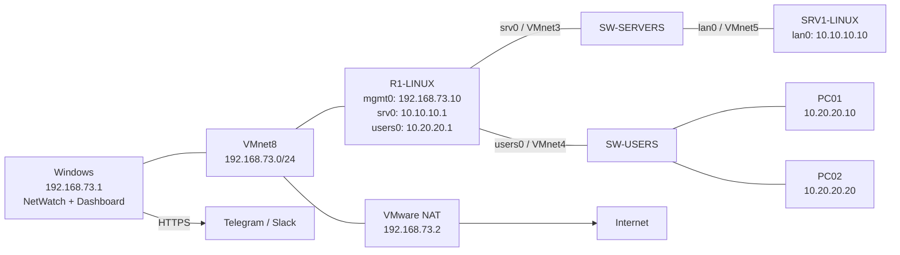
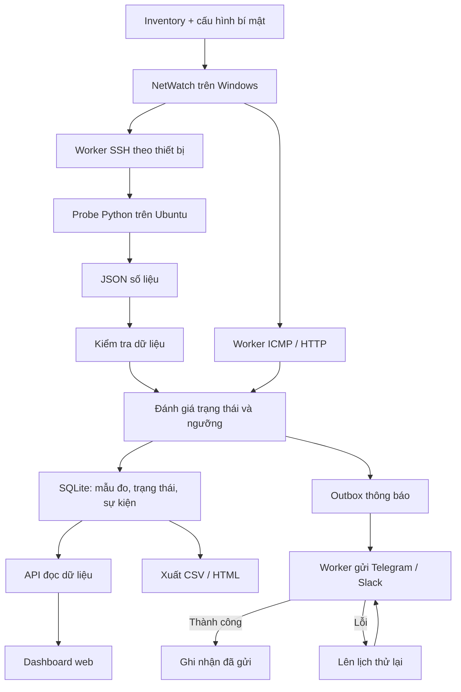

$qtmncReportPath = Join-Path (Get-Location) ("BAO_CAO_DO_AN_NETWATCH_" + (Get-Date -Format 'yyyyMMdd_HHmmss') + ".md")

@'
# BÁO CÁO ĐỒ ÁN CUỐI KỲ

## HỆ THỐNG GIÁM SÁT TRẠNG THÁI THIẾT BỊ VÀ GỬI CẢNH BÁO QUA TELEGRAM/SLACK

**Tên hệ thống:** NetWatch  
**Môn học:** Quản trị mạng nâng cao  
**Sinh viên thực hiện:** [Điền họ và tên]  
**Mã số sinh viên:** [Điền MSSV]  
**Lớp:** [Điền lớp]  
**Giảng viên hướng dẫn:** [Điền tên giảng viên]  
**Trường/Khoa:** [Điền thông tin]  
**Ngày tổng hợp:** 13/11/2026  

---

## LƯU Ý VỀ PHẠM VI VÀ MINH CHỨNG

Báo cáo tổng hợp kiến trúc, mã nguồn, quá trình cấu hình và các kết quả đã được cung cấp trong quá trình triển khai NetWatch.

Báo cáo phân biệt ba mức:

- **Đã xác nhận:** Có kết quả lệnh, ảnh dashboard hoặc thông tin kiểm thử được cung cấp.
- **Có trong thiết kế/mã nguồn:** Chức năng đã được xây dựng nhưng chưa có đủ minh chứng triển khai trên máy thực nghiệm trong phiên làm việc.
- **Cần hoàn thiện:** Chưa đạt điều kiện nghiệm thu hoặc chưa có xác nhận cuối cùng.

Tại thời điểm tổng hợp:

1. Dashboard đã kết nối được **2/2 thiết bị**.
2. CPU, RAM và trạng thái interface đã có dữ liệu thật.
3. Hệ thống đã phát hiện CPU vượt ngưỡng và ghi nhận phục hồi trên dashboard.
4. Kênh Telegram đã được bật nhưng còn thông báo chờ thử lại.
5. Kiểm tra gần nhất báo **token lưu trong cấu hình không đúng định dạng**.
6. Chưa có minh chứng cuối cùng về `SEND_OK: True` hoặc thông báo tự động được nhận thành công trên Telegram.
7. Slack và SNMP là các khả năng được hỗ trợ trong dự án, chưa được nghiệm thu thực tế trong chuỗi kết quả hiện tại.

Báo cáo không chứa mật khẩu SSH, token Telegram, webhook Slack hoặc nội dung file cấu hình bí mật.

---

# MỤC LỤC

1. Tổng quan đề tài.
2. Cơ sở lý thuyết và liên hệ môn học.
3. Phân tích yêu cầu và phạm vi.
4. Thiết kế mô hình mạng.
5. Kiến trúc và tổ chức phần mềm.
6. Triển khai môi trường và cấu hình mạng.
7. Triển khai thu thập số liệu và cảnh báo.
8. Dashboard, lịch sử và báo cáo.
9. Kịch bản kiểm thử và kết quả thực nghiệm.
10. Các sự cố đã gặp và cách xử lý.
11. Bảo mật và quản lý cấu hình.
12. Đánh giá, hạn chế và hướng phát triển.
13. Kết luận.
14. Tài liệu tham khảo.
15. Phụ lục vận hành và nghiệm thu.

---

# 1. TỔNG QUAN ĐỀ TÀI

## 1.1. Bối cảnh

Trong quản trị hệ thống mạng, thiết bị vẫn có thể hoạt động nhưng đã xuất hiện các dấu hiệu bất thường như CPU tăng cao, thiếu RAM, interface mất kết nối hoặc dịch vụ phản hồi chậm.

Nếu chỉ kiểm tra thủ công bằng các lệnh riêng lẻ, người quản trị khó theo dõi liên tục, khó đối chiếu lịch sử và có thể phát hiện sự cố muộn.

Đề tài xây dựng một hệ thống Python định kỳ thu thập trạng thái thiết bị, đánh giá ngưỡng và gửi cảnh báo tới ứng dụng nhắn tin. Dashboard web được bổ sung để người quản trị quan sát tình trạng hiện tại, lịch sử và quá trình phục hồi.

## 1.2. Tên đề tài

**Hệ thống giám sát trạng thái thiết bị và gửi cảnh báo qua Telegram/Slack.**

## 1.3. Mục tiêu

- Thu thập CPU, RAM và trạng thái interface của thiết bị Linux.
- Đọc nhiệt độ khi thiết bị thực sự cung cấp cảm biến.
- Hỗ trợ phương thức thu thập qua SSH và mở rộng qua SNMP.
- Phát hiện vượt ngưỡng, mất dữ liệu và mất kết nối.
- Ghi nhận cảnh báo và phục hồi.
- Hiển thị kết quả trên dashboard web.
- Gửi thông báo qua Telegram hoặc Slack.
- Lưu dữ liệu phục vụ đối chiếu, xuất báo cáo và bảo vệ đồ án.
- Triển khai được bằng tài nguyên sẵn có: Ubuntu VMware, GNS3 và VPCS.

## 1.4. Ý nghĩa thực tiễn

Hệ thống giúp chuyển từ kiểm tra thủ công sang giám sát định kỳ có trạng thái, lịch sử và thông báo.

Mô hình lab đồng thời cho phép kiểm tra định tuyến, phân đoạn mạng, NAT, SSH, giám sát hiệu suất và xử lý sự cố.

## 1.5. Cách hiểu về cảnh báo real-time

Hệ thống sử dụng polling định kỳ, không phải hệ thống thời gian thực cứng.

Với cấu hình mặc định:

- Chu kỳ thu thập tài nguyên: 15 giây.
- Cửa sổ đo CPU của probe: khoảng 1 giây.
- Kiểm tra mạng/dịch vụ có chu kỳ riêng.
- Gửi thông báo được thực hiện bởi worker riêng.

Độ trễ cảnh báo thực tế còn phụ thuộc thời điểm phát sinh sự cố, thời gian thu thập, tải máy và kết nối tới nền tảng nhắn tin. Khi gửi lỗi, cơ chế thử lại có thể kéo dài thời gian nhận thông báo.

---

# 2. CƠ SỞ LÝ THUYẾT VÀ LIÊN HỆ MÔN HỌC

## 2.1. Mô hình FCAPS

| Nhóm | Nội dung áp dụng |
|---|---|
| Fault Management | Phát hiện mất kết nối, mất dữ liệu, interface bất thường và ghi nhận phục hồi |
| Configuration Management | Quản lý inventory, địa chỉ IP, ngưỡng và cấu hình thu thập |
| Accounting Management | Mới dừng ở lưu lịch sử sử dụng tài nguyên, chưa triển khai tính cước hoặc quản lý định mức đầy đủ |
| Performance Management | Thu thập CPU, RAM, lưu lượng, RTT, mất gói và trạng thái dịch vụ |
| Security Management | Xác minh SSH host key, tài khoản giám sát riêng, quản lý bí mật và phân tách truy cập |

## 2.2. Phân biệt Layer 2 và Layer 3

- **Layer 2:** Chuyển frame Ethernet theo MAC trong cùng miền kết nối.
- **Layer 3:** Định tuyến packet IP giữa các mạng khác nhau.
- **Switch GNS3:** Kết nối các cổng trong từng LAN.
- **R1-LINUX:** Thực hiện IPv4 forwarding giữa mạng người dùng, mạng máy chủ và mạng quản trị.

Việc đặt các IP thuộc hai subnet khác nhau trên các card không tự tạo ra sự tách biệt Layer 2 nếu các card vẫn cùng nối vào một VMnet VMware.

## 2.3. SSH

SSH cung cấp kênh mã hóa để đăng nhập và thực thi lệnh từ xa.

Trong NetWatch:

1. Windows kết nối tới thiết bị Linux.
2. Xác minh host key.
3. Xác thực bằng tài khoản giám sát.
4. Thực thi probe Python.
5. Nhận kết quả JSON.
6. Xử lý dữ liệu tại Windows.

SSH không chỉ được dùng để mở terminal thủ công mà còn là phương tiện thu thập số liệu tự động.

## 2.4. SNMP

SNMP phù hợp cho thu thập thông tin quản trị trên thiết bị mạng.

Dự án có hướng hỗ trợ SNMPv2c bằng Net-SNMP extend để đọc kết quả probe trên Ubuntu.

Phân biệt:

- **Polling:** Trình giám sát chủ động hỏi thiết bị định kỳ.
- **Trap:** Thiết bị chủ động gửi thông báo về trình quản lý.

Bản triển khai được xác nhận trong báo cáo sử dụng SSH. Chưa có minh chứng nghiệm thu SNMP hoặc SNMP Trap.

SNMPv3 với xác thực và mã hóa là hướng nâng cấp, chưa được trình bày là chức năng đã triển khai.

## 2.5. NAT

R1 sử dụng masquerade để các địa chỉ trong hai LAN truy cập Internet qua interface quản trị.

Đường ra Internet của SRV1:

```text
SRV1 → SW-SERVERS → R1 → VMnet8 NAT → Internet
```

Đường gửi Telegram của chương trình giám sát:

```text
NetWatch trên Windows → Internet của Windows → Telegram Bot API
```

Hai đường trên khác nhau. SRV1 truy cập Internet được không tự chứng minh Python trên Windows gửi Telegram được.

## 2.6. Liên hệ các tài liệu môn học

| Tài liệu | Nội dung vận dụng |
|---|---|
| Chương 1 – Quản trị mạng nâng cao | Quản trị tập trung, giám sát và quy trình vận hành |
| Chương 2 – Phân tích các mô hình mạng | FCAPS, phân biệt Layer 2/Layer 3, mô hình quản lý |
| Chương 3 – An ninh mạng không dây | Vận dụng nguyên tắc phân đoạn, kiểm soát truy cập; không triển khai WLAN trong lab này |
| Chương 4 – Tự động hóa quản trị hệ thống SDN bằng Python | Python, JSON, SSH, xử lý ngoại lệ và tự động hóa; không triển khai bộ điều khiển SDN |
| Chương 5 – Quản lý hiệu suất hoạt động | Polling, chỉ số, ngưỡng, cảnh báo, dashboard và đánh giá |
| Chương 6 – Quản lý bảo mật | Tài khoản riêng, xác minh danh tính, quản lý bí mật và sao lưu |
| VPN VS CLOUD | Khái niệm địa chỉ, kết nối và phạm vi quản trị; VPN không phải yêu cầu triển khai bắt buộc |
| Bài tập thực hành buổi 5 | CPU/RAM/Network I/O, ICMP, HTTP, đo thông lượng, CSV và báo cáo |

---

# 3. PHÂN TÍCH YÊU CẦU VÀ PHẠM VI

## 3.1. Yêu cầu chức năng

| Mã | Yêu cầu |
|---|---|
| FR01 | Quản lý danh sách thiết bị và giao thức thu thập |
| FR02 | Thu thập CPU và RAM định kỳ |
| FR03 | Thu thập trạng thái, bộ đếm và tốc độ interface |
| FR04 | Đọc nhiệt độ khi có cảm biến |
| FR05 | Phát hiện vượt ngưỡng và phục hồi |
| FR06 | Phân biệt lỗi kết nối với lỗi từng chỉ số |
| FR07 | Lưu mẫu đo và sự kiện |
| FR08 | Hiển thị dashboard web |
| FR09 | Gửi cảnh báo qua Telegram/Slack |
| FR10 | Thử gửi lại khi dịch vụ nhắn tin lỗi |
| FR11 | Kiểm tra ICMP và hỗ trợ kiểm tra HTTP |
| FR12 | Hỗ trợ xuất dữ liệu hoặc báo cáo |
| FR13 | Có chế độ mô phỏng và chế độ lab thật phân biệt rõ |

## 3.2. Yêu cầu phi chức năng

- Một thiết bị lỗi không làm dừng giám sát thiết bị còn lại.
- Dữ liệu không đọc được phải thể hiện là không xác định, không gán thành 0.
- Không gửi lặp cảnh báo ở mọi chu kỳ khi trạng thái không thay đổi.
- Giảm số phiên SSH và số lệnh gọi không cần thiết.
- Giữ bí mật bên ngoài mã nguồn công khai.
- Dashboard cục bộ cung cấp chức năng đọc.
- Có cấu hình và quy trình vận hành lặp lại được.
- Phù hợp với giới hạn tài nguyên máy thực nghiệm.

## 3.3. Phạm vi triển khai hiện tại

- Hai VM Ubuntu riêng biệt: R1 và SRV1.
- Hai switch Ethernet tích hợp trong GNS3.
- Hai VPCS tạo mạng người dùng và lưu lượng kiểm tra.
- Windows chạy trình giám sát, cơ sở dữ liệu và dashboard.
- Thu thập thật bằng SSH.
- Telegram là kênh đang hoàn thiện nghiệm thu.
- Slack là khả năng hỗ trợ, chưa có minh chứng gửi thực tế.

## 3.4. Các nội dung không thuộc bản nghiệm thu hiện tại

- Bộ điều khiển SDN/OpenFlow.
- VPN site-to-site.
- Giám sát WLAN thực tế.
- Tự động phát hiện ARP spoofing.
- Phát hiện brute-force từ log.
- Tự động chặn IP theo hành vi.
- Quét toàn bộ cổng.
- Giám sát phần cứng nhiệt độ của máy Windows thông qua VM.
- Tính sẵn sàng cao hoặc triển khai production nhiều người dùng.

---

# 4. THIẾT KẾ MÔ HÌNH MẠNG

## 4.1. Thành phần

| Thành phần | Vai trò |
|---|---|
| Windows | Chạy VS Code, NetWatch, SQLite, dashboard và gửi thông báo |
| R1-LINUX | Router Linux, IPv4 forwarding, NAT và chính sách chuyển tiếp |
| SRV1-LINUX | Máy chủ được giám sát và chạy tải thử |
| SW-SERVERS | Switch mạng máy chủ |
| SW-USERS | Switch mạng người dùng |
| PC01 | VPCS kiểm tra mạng người dùng |
| PC02 | VPCS kiểm tra cùng LAN và liên LAN |
| VMware Workstation | Chạy hai Ubuntu và cung cấp các VMnet |
| GNS3 | Quản lý topology, các liên kết và phục vụ capture |

Windows là máy quản trị bên ngoài canvas, không cần được biểu diễn bằng node Cloud.

Mô hình cuối không sử dụng cầu nối TAP của thiết kế cũ.

## 4.2. Sơ đồ logic



Sơ đồ Mermaid cần trình xem hỗ trợ Mermaid để hiển thị thành hình. Khi xuất Word/PDF có thể chuyển sơ đồ thành SVG/PNG.

## 4.3. Kế hoạch địa chỉ

| Thiết bị | Interface | IPv4 | Gateway |
|---|---|---|---|
| Windows | VMware VMnet8 | 192.168.73.1/24 | Không đặt thêm gateway cho kết nối quản trị này |
| R1 | mgmt0 | 192.168.73.10/24 | 192.168.73.2 |
| R1 | srv0 | 10.10.10.1/24 | Không có default gateway riêng |
| R1 | users0 | 10.20.20.1/24 | Không có default gateway riêng |
| SRV1 | lan0 | 10.10.10.10/24 | 10.10.10.1 |
| PC01 | Ethernet0 | 10.20.20.10/24 | 10.20.20.1 |
| PC02 | Ethernet0 | 10.20.20.20/24 | 10.20.20.1 |

Địa chỉ của PC01 và PC02 là kế hoạch cấu hình VPCS. Cần lưu kết quả `show ip` và ping sau khi sửa VMnet để hoàn thiện bộ minh chứng cuối.

## 4.4. Năm liên kết trên canvas

| STT | Đầu thứ nhất | Đầu thứ hai |
|---|---|---|
| 1 | R1 Ethernet1 | SW-SERVERS Ethernet0 |
| 2 | SW-SERVERS Ethernet1 | SRV1 Ethernet0 |
| 3 | R1 Ethernet2 | SW-USERS Ethernet0 |
| 4 | SW-USERS Ethernet1 | PC01 Ethernet0 |
| 5 | SW-USERS Ethernet2 | PC02 Ethernet0 |

Ethernet0 của R1 giữ NAT VMware và không được nối vào switch trên canvas.

## 4.5. Ánh xạ VMware đã ghi nhận khi chạy

| VM | Card VMware | MAC | Kết nối |
|---|---|---|---|
| R1 | Ethernet0 | 00:0c:29:cd:69:a5 | NAT, sử dụng VMnet8 |
| R1 | Ethernet1 | 00:0c:29:cd:69:af | Custom VMnet3 |
| R1 | Ethernet2 | 00:0c:29:cd:69:b9 | Custom VMnet4 |
| SRV1 | Ethernet0 | 00:0c:29:a4:00:f1 | Custom VMnet5 |

Đây là ánh xạ thực tế đã được cung cấp sau khi sửa lỗi nối trùng.

Số VMnet cụ thể có thể thay đổi do GNS3 phân bổ. Điều kiện quan trọng là ba card LAN dùng ba VMnet riêng, không trùng nhau và các đầu kết nối của GNS3 được tạo theo đúng ánh xạ đó.

## 4.6. Vì sao cùng LAN vẫn dùng các VMnet khác nhau?

Hai card của R1 và SRV1 cùng thuộc LAN IP 10.10.10.0/24, nhưng cần được nối qua SW-SERVERS của GNS3.

Nếu chúng đã cùng nằm trong một VMnet VMware thì tồn tại đường Layer 2 trực tiếp bên ngoài GNS3. Khi có thêm đường qua switch GNS3, hệ thống có thể hình thành đường nối song song hoặc vòng lặp.

Do đó:

```text
R1 srv0 → VMnet riêng → SW-SERVERS → VMnet riêng → SRV1 lan0
```

Không dùng cách nối:

```text
R1 srv0 và SRV1 lan0 cùng VMnet
đồng thời lại nối cả hai vào switch GNS3
```

## 4.7. Các VMnet phía Windows

Ảnh Virtual Network Editor đã cung cấp cho thấy:

| VMnet | Subnet khai báo | DHCP trong ảnh | Vai trò |
|---|---|---|---|
| VMnet3 | 192.168.30.0/24 | Enabled | Được GNS3 sử dụng cho card phía máy chủ của R1 |
| VMnet4 | 172.30.4.0/24 | Tắt | Card mạng người dùng của R1 |
| VMnet5 | 172.30.5.0/24 | Tắt | Card SRV1 |
| VMnet6 | 172.30.6.0/24 | Tắt | Mạng đã tạo, chưa thuộc ánh xạ chạy cuối được ghi nhận |
| VMnet8 | 192.168.73.0/24 | Enabled | NAT và quản trị |

Các IP 10.10.10.x và 10.20.20.x được đặt trong Ubuntu/VPCS, không phải nhập vào ô Subnet IP của VMware để thay cho địa chỉ thiết bị.

**Việc cần chuẩn hóa trước nghiệm thu:** Tắt DHCP trên các VMnet dành riêng cho liên kết GNS3, bao gồm VMnet3 nếu vẫn nằm trong pool đang dùng. Các VM hiện sử dụng IP tĩnh nên không lấy địa chỉ DHCP này, nhưng cấu hình nên thống nhất để tránh cấp nhầm IP cho thiết bị mới.

---

# 5. KIẾN TRÚC VÀ TỔ CHỨC PHẦN MỀM

## 5.1. Kiến trúc chức năng



## 5.2. Thành phần thu thập

Probe Linux được cài tại:

```text
/opt/netwatch/probe.py
```

Probe đọc trực tiếp thông tin hệ thống Linux và xuất JSON. Probe sử dụng thư viện chuẩn Python cho các chức năng thu thập chính.

Ứng dụng giám sát không cần cài toàn bộ môi trường web trên từng VM.

## 5.3. Thành phần quản lý trên Windows

- Đọc inventory và cấu hình bí mật.
- Quản lý kết nối tới từng thiết bị.
- Thu thập theo chu kỳ.
- Phân tích trạng thái.
- Ghi SQLite.
- Tạo và xử lý hàng đợi thông báo.
- Cung cấp API và dashboard cục bộ.

## 5.4. Tách worker

Việc thu thập theo thiết bị, kiểm tra mạng/dịch vụ và gửi thông báo được tách để hạn chế ảnh hưởng lẫn nhau.

Ví dụ:

- Telegram lỗi không được làm dừng đọc CPU/RAM.
- SRV1 mất SSH không được làm dừng giám sát R1.
- ICMP thất bại không tự đồng nghĩa SSH thất bại.

## 5.5. Tổ chức thư mục chính

```text
NetWatch_Lab_Moi/
├── netwatch/                 Mã nguồn chương trình giám sát
├── lab/
│   ├── probe.py              Probe Linux
│   ├── provision.py          Công cụ cấu hình lab có kiểm soát
│   ├── load_test.py          Tạo tải thử có giới hạn
│   ├── web_demo.py           Dịch vụ HTTP thử nghiệm
│   ├── iperf_test.py          Công cụ hỗ trợ đo thông lượng
│   └── gns3/                 Tài nguyên mô hình
├── web/                      Dashboard HTML/CSS/JavaScript
├── tools/                    Tiện ích Windows, tạo lab và tài liệu
├── tests/                    Kiểm thử phần mềm
├── docs/                     Hướng dẫn, báo cáo và tài liệu
├── inventory.json            Cấu hình giám sát mặc định
├── inventory.buoi5.json       Profile thực hành buổi 5
├── .env.example              Mẫu khai báo bí mật
├── .env.netwatch             Cấu hình bí mật cục bộ
├── .local/                   Host key tin cậy cục bộ
├── data/                     Cơ sở dữ liệu và dữ liệu xuất
├── setup.cmd                 Chuẩn bị môi trường Python Windows
├── configure.cmd             Nhập cấu hình
├── start.cmd                 Chạy NetWatch hoặc xác minh host key
├── start_buoi5.cmd            Chạy profile thực hành
└── export_report.cmd         Xuất báo cáo
```

Thư mục `.env.netwatch`, `.local/` và dữ liệu cục bộ không được đưa lên kho công khai.

## 5.6. Phân biệt mô hình xem trước và lab chạy thật

- File xem trước GNS3 phục vụ mở sơ đồ, không chứng minh VM hoặc dịch vụ đang chạy.
- Lab chạy thật cần liên kết tới đúng file VMX trên máy triển khai.
- Project đang thực hiện thủ công có tên `qtm`.
- Hình mô phỏng dashboard không thay thế minh chứng có nhãn `LAB THẬT`.

---

# 6. TRIỂN KHAI MÔI TRƯỜNG VÀ CẤU HÌNH MẠNG

## 6.1. Môi trường đã ghi nhận

| Thành phần | Thông tin |
|---|---|
| Máy quản trị | Windows, VS Code, PowerShell |
| GNS3 | 2.2.61 theo log giao diện |
| Python kèm GNS3 | 3.13.14 theo log giao diện, không đồng nghĩa phiên bản Python của NetWatch |
| Hypervisor | VMware Workstation; cần bổ sung phiên bản cụ thể khi chốt báo cáo |
| R1 | Ubuntu 22.04 LTS, kernel 6.8.0-138-generic ở lần kiểm tra đã cung cấp |
| SRV1 | Ubuntu 22.04 LTS, kernel 6.8.0-149-generic ở lần kiểm tra đã cung cấp |
| Dashboard | http://127.0.0.1:8765 |
| Chu kỳ mặc định | 15 giây |

Chưa có đủ kết quả cuối để chốt RAM, số vCPU và toàn bộ phiên bản thư viện trên máy thực nghiệm. Các thông số này cần lấy từ VMware Settings, `nproc`, `free -h` và môi trường Python trước khi nộp.

## 6.2. Dung lượng đã quan sát

| VM | Kết quả df -h đã cung cấp |
|---|---|
| R1 | Phân vùng `/` hiển thị 15G, dùng 12G, còn 1.7G, sử dụng 88% |
| SRV1 | Phân vùng `/` hiển thị 16G, dùng 8.5G, còn 6.0G, sử dụng 59% |

Đây là số đo tại các thời điểm kiểm tra, không phải số đo sau mọi lần cài đặt.

Không suy ra trực tiếp dung lượng cấu hình VMDK từ riêng giá trị làm tròn của `df -h`. Cần đối chiếu thêm VMware Settings và `lsblk`.

## 6.3. Chuẩn bị card mạng

R1 có tổng cộng ba card:

1. Card đầu: NAT VMware.
2. Card thứ hai: Custom cho phía máy chủ.
3. Card thứ ba: Custom cho phía người dùng.

SRV1 có một card Custom.

Khi sửa kết nối:

- Dùng đúng VM riêng cho mỗi vai trò.
- Giữ MAC nếu cấu hình Netplan đang match theo MAC.
- Kiểm tra lại VMnet thực tế khi GNS3 đã Start.
- Khởi động các VM của lab từ GNS3 sau khi tích hợp.

## 6.4. Sao lưu trước khi đổi Netplan

Thực hiện tại console đúng VM.

Ví dụ quy trình trên R1:

```bash
qtmnc_backup="/root/netwatch-r1-$(date +%Y%m%d-%H%M%S)"
sudo mkdir -p "$qtmnc_backup/old-yaml"
sudo cp -a /etc/netplan "$qtmnc_backup/"
sudo cp -a /etc/sysctl.d "$qtmnc_backup/"
sudo mv /etc/netplan/*.yaml "$qtmnc_backup/old-yaml/"
```

Mục đích là giữ cấu hình cũ và tránh nhiều file YAML cùng gộp thành cấu hình không mong muốn.

Các cấu hình bên dưới mô tả bộ MAC của máy thực nghiệm. Khi dùng máy khác phải đối chiếu lại MAC trước khi áp dụng.

## 6.5. Netplan R1

File:

```text
/etc/netplan/90-netwatch.yaml
```

Nội dung:

```yaml
network:
  version: 2
  renderer: networkd
  ethernets:
    mgmt0:
      match:
        macaddress: "00:0c:29:cd:69:a5"
      set-name: mgmt0
      dhcp4: false
      dhcp6: false
      optional: true
      addresses:
        - 192.168.73.10/24
      routes:
        - to: default
          via: 192.168.73.2
      nameservers:
        addresses:
          - 192.168.73.2

    srv0:
      match:
        macaddress: "00:0c:29:cd:69:af"
      set-name: srv0
      dhcp4: false
      dhcp6: false
      optional: true
      addresses:
        - 10.10.10.1/24

    users0:
      match:
        macaddress: "00:0c:29:cd:69:b9"
      set-name: users0
      dhcp4: false
      dhcp6: false
      optional: true
      addresses:
        - 10.20.20.1/24
```

Chỉ interface quản trị có default route. Hai interface LAN có các mạng trực tiếp.

## 6.6. Netplan SRV1

```yaml
network:
  version: 2
  renderer: networkd
  ethernets:
    lan0:
      match:
        macaddress: "00:0c:29:a4:00:f1"
      set-name: lan0
      dhcp4: false
      dhcp6: false
      optional: true
      addresses:
        - 10.10.10.10/24
      routes:
        - to: default
          via: 10.10.10.1
      nameservers:
        addresses:
          - 192.168.73.2
```

## 6.7. Áp dụng Netplan

```bash
sudo chmod 600 /etc/netplan/90-netwatch.yaml
sudo netplan generate
sudo systemctl enable --now systemd-networkd
sudo netplan try --timeout 120
```

Kiểm tra thông báo và nhấn Enter để chấp nhận khi cấu hình hợp lệ.

Có thể cần reboot để hoàn tất đổi tên interface theo MAC:

```bash
sudo reboot
```

Kiểm tra sau khởi động:

```bash
ip -br link
ip -br addr
ip route
```

## 6.8. Bật IPv4 forwarding trên R1

File:

```text
/etc/sysctl.d/90-netwatch.conf
```

Nội dung:

```text
net.ipv4.ip_forward=1
```

Áp dụng và kiểm tra:

```bash
sudo sysctl -p /etc/sysctl.d/90-netwatch.conf
sysctl net.ipv4.ip_forward
```

Kết quả yêu cầu sau reboot:

```text
net.ipv4.ip_forward = 1
```

## 6.9. NAT và phân tách quản trị

File:

```text
/etc/netwatch/router.nft
```

Nội dung:

```nft
flush table inet netwatch_router

table inet netwatch_router {
    chain forward {
        type filter hook forward priority 0; policy accept;

        ct state established,related accept

        iifname "users0" oifname "srv0" tcp dport 22 reject
        iifname "users0" oifname "srv0" udp dport 161 reject
    }

    chain postrouting {
        type nat hook postrouting priority srcnat; policy accept;

        ip saddr { 10.10.10.0/24, 10.20.20.0/24 } oifname "mgmt0" masquerade
    }
}
```

Ý nghĩa:

- Mạng người dùng và máy chủ có thể ra ngoài qua mgmt0.
- Người dùng bị chặn truy cập SSH/SNMP của mạng máy chủ.
- Windows quản trị đi vào từ mgmt0.
- Bảng riêng được sử dụng để tránh xóa toàn bộ ruleset của hệ thống.

Các quy tắc này không thay thế toàn bộ cơ chế bảo mật production. Những firewall hoặc chain khác đang có vẫn có thể ảnh hưởng kết quả.

## 6.10. Dịch vụ NAT tự khởi động

File:

```text
/etc/systemd/system/netwatch-router.service
```

```ini
[Unit]
Description=NetWatch lab routing and NAT
Wants=network-online.target
After=network-online.target

[Service]
Type=oneshot
RemainAfterExit=yes
ExecStartPre=-/usr/sbin/nft add table inet netwatch_router
ExecStart=/usr/sbin/nft -f /etc/netwatch/router.nft
ExecStop=-/usr/sbin/nft delete table inet netwatch_router

[Install]
WantedBy=multi-user.target
```

Lệnh quản lý:

```bash
sudo systemctl daemon-reload
sudo systemctl enable netwatch-router
sudo systemctl restart netwatch-router
systemctl is-active netwatch-router
sudo nft list table inet netwatch_router
```

Xem lỗi khi cần:

```bash
sudo journalctl -u netwatch-router -n 30 --no-pager
```

## 6.11. Cấu hình VPCS

PC01:

```text
ip 10.20.20.10/24 10.20.20.1
save
show ip
```

PC02:

```text
ip 10.20.20.20/24 10.20.20.1
save
show ip
```

Các lệnh này chạy trong console VPCS. Chuỗi `PC1>` là dấu nhắc, không phải một phần lệnh.

## 6.12. Khôi phục host adapter VMnet8

Đã có thời điểm Windows chỉ thấy:

```text
VMware Network Adapter VMnet8 — Not Present
```

Do đó Windows chưa có IPv4 để tới R1 dù VM vẫn có thể sử dụng NAT.

Cách xử lý đã được hướng dẫn:

1. Mở Virtual Network Editor với quyền phù hợp.
2. Chọn VMnet8, giữ NAT và subnet 192.168.73.0/24.
3. Bật `Connect a host virtual adapter to this network`.
4. Nếu cấu hình báo Connected nhưng adapter vẫn không hiện diện, thử bỏ tích/Apply rồi tích lại/Apply.
5. Nếu cần, xử lý đúng adapter VMnet8 ẩn trong Device Manager, giữ driver dùng chung cho các VMnet khác.
6. Kiểm tra lại adapter thực tế và IPv4.

Kết quả đã xác nhận:

```text
RemoteAddress    : 192.168.73.10
RemotePort       : 22
InterfaceAlias   : VMware Network Adapter VMnet8
SourceAddress    : 192.168.73.1
TcpTestSucceeded : True
```

`ifIndex` có thể đổi sau khi tạo lại adapter; không cố định theo chỉ số cũ.

## 6.13. Route Windows

Windows cần biết đường đến hai LAN nằm sau R1:

| DestinationPrefix | NextHop |
|---|---|
| 10.10.10.0/24 | 192.168.73.10 |
| 10.20.20.0/24 | 192.168.73.10 |

PowerShell quản trị:

```powershell
$qtmncAdapter = Get-NetAdapter -Name "VMware Network Adapter VMnet8" -ErrorAction Stop

foreach ($qtmncPrefix in @("10.10.10.0/24", "10.20.20.0/24")) {
    $qtmncRoutes = @(Get-NetRoute -AddressFamily IPv4 `
        -DestinationPrefix $qtmncPrefix -PolicyStore ActiveStore `
        -ErrorAction SilentlyContinue)

    if ($qtmncRoutes.Count -eq 0) {
        New-NetRoute -DestinationPrefix $qtmncPrefix `
            -InterfaceIndex $qtmncAdapter.ifIndex `
            -NextHop "192.168.73.10" -PolicyStore ActiveStore `
            -ErrorAction Stop | Out-Null
    }
    elseif (@($qtmncRoutes | Where-Object {
        $_.InterfaceIndex -ne $qtmncAdapter.ifIndex -or
        $_.NextHop -ne "192.168.73.10"
    }).Count -gt 0) {
        $qtmncRoutes | Format-Table InterfaceAlias, DestinationPrefix, NextHop
        throw "Route da co cau hinh khac; can kiem tra truoc khi thay doi."
    }
}
```

Các route ActiveStore cần được thêm lại sau khi Windows khởi động lại.

Kiểm tra:

```powershell
Test-NetConnection 192.168.73.10 -Port 22
Test-NetConnection 10.10.10.10 -Port 22 -InformationLevel Detailed
```

## 6.14. SSH và xác minh host key

Tài khoản Ubuntu dùng trong giai đoạn cài đặt:

| VM | Tài khoản |
|---|---|
| R1 | tuanto |
| SRV1 | tu |

Fingerprint được lấy từ console của đúng VM:

```bash
ssh-keygen -lf /etc/ssh/ssh_host_ed25519_key.pub
```

Trước khi xác nhận kết nối SSH lần đầu, đối chiếu fingerprint phía Windows với giá trị tại console.

Không đồng nhất việc cổng 22 mở với việc xác thực SSH đã thành công. Cần đăng nhập và thực thi được lệnh.

---

# 7. TRIỂN KHAI THU THẬP SỐ LIỆU VÀ CẢNH BÁO

## 7.1. Tài khoản giám sát riêng

Trên mỗi Ubuntu:

```bash
if ! id monitor >/dev/null 2>&1; then
    sudo useradd --create-home --shell /bin/bash monitor
fi
```

Đặt mật khẩu:

```bash
sudo passwd monitor
```

Tài khoản được sử dụng cho thu thập số liệu và không cần quyền sudo.

Mật khẩu trên Ubuntu và mật khẩu lưu cho ứng dụng Windows là hai cấu hình riêng. Việc đặt bằng `passwd` không tự ghi vào `.env.netwatch`.

## 7.2. Chép và cài probe

Từ thư mục dự án trên Windows:

```powershell
scp .\lab\probe.py "tuanto@192.168.73.10:netwatch-probe.py"
scp .\lab\probe.py "tu@10.10.10.10:netwatch-probe.py"
```

Trên từng Ubuntu, bằng tài khoản cài đặt tương ứng:

```bash
sudo install -D -o root -g root -m 0755 "$HOME/netwatch-probe.py" /opt/netwatch/probe.py
```

File cài đặt thuộc root, tài khoản monitor có quyền đọc và chạy.

## 7.3. Gọi probe từ Windows

R1:

```powershell
ssh monitor@192.168.73.10 "/usr/bin/python3 /opt/netwatch/probe.py --interfaces mgmt0 srv0 users0"
```

SRV1:

```powershell
ssh monitor@10.10.10.10 "/usr/bin/python3 /opt/netwatch/probe.py --interfaces lan0"
```

Probe trả JSON, trong đó có:

- `schema`.
- `cpu_pct`.
- `ram_pct`.
- `temperature_c`.
- `interfaces`.

## 7.4. Đo CPU

Probe lấy hai mẫu từ dòng CPU tổng trong `/proc/stat`, cách nhau khoảng một giây.

Tám trường được cộng vào tổng:

```text
user, nice, system, idle, iowait, irq, softirq, steal
```

Công thức:

```text
DeltaTotal = Total(t2) - Total(t1)

DeltaIdle = [idle(t2) + iowait(t2)]
          - [idle(t1) + iowait(t1)]

CPU(%) = 100 × (DeltaTotal - DeltaIdle) / DeltaTotal
```

Điều kiện kiểm tra:

- DeltaTotal phải dương.
- DeltaIdle phải hợp lệ.
- Không cộng lại guest/guest_nice vì đã được tính trong các trường tương ứng.
- Mẫu không hợp lệ trả trạng thái không xác định.

Đây là góc nhìn CPU trong guest Linux. Không diễn giải trực tiếp thành phần trăm CPU vật lý của Windows host.

## 7.5. Đo RAM

Dữ liệu lấy từ `/proc/meminfo`.

```text
RAM(%) = 100 × (MemTotal - MemAvailable) / MemTotal
```

Dùng MemAvailable phù hợp hơn việc chỉ lấy MemFree vì Linux có bộ nhớ cache có thể thu hồi.

## 7.6. Đo nhiệt độ

Probe đọc các thermal zone trong:

```text
/sys/class/thermal/
```

Nếu không có dữ liệu cảm biến hợp lệ, trả `null`.

Trong lab VMware, dashboard hiển thị dấu gạch khi không có cảm biến. Không sử dụng giá trị giả hoặc gán 0°C để thể hiện trạng thái bình thường.

## 7.7. Interface và lưu lượng

Các thông tin chính:

- Operstate.
- Rx bytes.
- Tx bytes.
- Rx errors.
- Tx errors.

Tốc độ được tính từ chênh lệch bộ đếm:

```text
RxMbps = DeltaRxBytes × 8 / (DeltaTime × 1,000,000)
TxMbps = DeltaTxBytes × 8 / (DeltaTime × 1,000,000)
```

Nếu bộ đếm giảm do reset hoặc thời gian không hợp lệ, tốc độ cần được coi là chưa xác định.

Interface UP không tự chứng minh thiết bị phía sau hoặc dịch vụ ứng dụng đang hoạt động; vì vậy có thêm ICMP và HTTP.

## 7.8. Ngưỡng mặc định

| Chỉ số | Ngưỡng cảnh báo | Điều kiện phục hồi mặc định |
|---|---|---|
| CPU | Lớn hơn 75% | Nhỏ hơn hoặc bằng 70% |
| RAM | Lớn hơn 65% | Nhỏ hơn hoặc bằng 60% |
| Nhiệt độ | Có cấu hình hỗ trợ; mặc định không bật trong lab VM | Chỉ áp dụng khi bật và có cảm biến |
| Interface | Theo trạng thái được đọc | Trở lại UP |
| Kết nối | Không kết nối/không thu thập được theo loại lỗi | Thu thập thành công trở lại |

Khoảng chênh 5 điểm phần trăm giúp hạn chế cảnh báo dao động liên tục gần ngưỡng.

## 7.9. Trạng thái và chống gửi lặp

Các trạng thái chính:

- **OK:** Mẫu hợp lệ, trong giới hạn.
- **ALERT:** Vượt ngưỡng hoặc phát hiện tình trạng cần cảnh báo.
- **UNKNOWN:** Không đủ dữ liệu hợp lệ để kết luận.

Hệ thống ghi nhận và tạo thông báo khi trạng thái thay đổi, thay vì gửi lại cùng một cảnh báo ở mọi chu kỳ.

Ví dụ:

```text
OK → ALERT: phát cảnh báo.
ALERT → ALERT: tiếp tục lưu số liệu, không lặp cùng cảnh báo mỗi chu kỳ.
ALERT → OK: phát thông báo phục hồi.
Không đọc được → UNKNOWN: không biến thành số 0.
```

Lỗi SSH được xử lý ở mức kết nối thiết bị để tránh tạo hàng loạt cảnh báo CPU/RAM không liên quan.

## 7.10. Hàng đợi thông báo

Luồng xử lý:

```text
Phát sinh sự kiện
→ Ghi dữ liệu
→ Tạo công việc gửi vào outbox nếu kênh được cấu hình
→ Gọi Telegram/Slack
→ Thành công: đánh dấu đã gửi
→ Thất bại: lưu lỗi và lên lịch thử lại
```

Thiết kế thử lại sử dụng khoảng chờ tăng dần, có giới hạn và xử lý trường hợp API yêu cầu chờ.

Cần phân biệt:

- Sự kiện ALERT trên dashboard.
- Công việc đã được đưa vào hàng đợi.
- API nhắn tin xác nhận thành công.
- Tin nhắn được quan sát tại chat đích.

Bốn điều trên không đồng nghĩa với nhau.

Cơ chế gửi mang tính at-least-once. Nếu chương trình dừng sau khi nền tảng đã nhận tin nhưng trước khi lưu xác nhận, có thể phát sinh thông báo lặp khi phục hồi.

Thông báo lặp do hàng đợi khác với gói ICMP `(DUP!)` do lỗi đường nối Layer 2.

## 7.11. Telegram

Thông tin cần cấu hình:

- Token do BotFather cấp.
- Chat ID của người dùng/nhóm nhận tin.
- Bot đã được Start hoặc được thêm vào nhóm với quyền phù hợp.

Kiểm tra:

- `getMe`: Xác thực token và nhận diện bot.
- `sendMessage`: Kiểm tra quyền gửi và chat đích.

Một kiểm tra định dạng token chỉ xác nhận hình thức chuỗi, không thay thế xác thực `getMe`.

Mã phản hồi thường cần phân tích:

| Mã/trạng thái | Nội dung kiểm tra |
|---|---|
| 200, ok=true | Yêu cầu được API chấp nhận |
| 400 | Nội dung yêu cầu, chat ID hoặc đối tượng nhận |
| 401/404 trong kiểm tra bot | Token hoặc đường gọi API |
| 403 | Bot bị chặn hoặc thiếu quyền |
| 429 | Giới hạn tốc độ và retry_after |
| ConnectionError | Cần đọc nguyên nhân kết nối; chưa được xem là lỗi xác thực |

Nội dung báo cáo không lưu token thật hoặc URL Bot API đã chèn token.

## 7.12. Slack

Dự án hỗ trợ hướng gửi qua Incoming Webhook.

Webhook là thông tin bí mật và cần được quản lý tương tự token.

Chưa có minh chứng gửi thành công tới Slack trong quá trình thực nghiệm hiện tại. Không ghi Slack là hạng mục đã nghiệm thu.

## 7.13. SNMP mở rộng

Mã nguồn có hướng sử dụng Net-SNMP extend với tên `netwatch` để lấy đầu ra probe.

OID tham chiếu của đầu ra mở rộng:

```text
1.3.6.1.4.1.8072.1.3.2.3.1.2.8.110.101.116.119.97.116.99.104
```

Đây là hướng triển khai theo mã nguồn, chưa có log `snmpget` từ lab hiện tại để xác nhận.

Khi triển khai SNMPv2c:

- Chỉ dùng community đọc.
- Giới hạn nguồn truy cập.
- Giữ community ngoài Git.
- Sử dụng trong lab được kiểm soát.

---

# 8. DASHBOARD, LỊCH SỬ VÀ BÁO CÁO

## 8.1. Giao diện

Các khu vực chính:

- Tổng quan.
- Mô hình mạng.
- Mạng và dịch vụ.
- Lịch sử chỉ số.
- Sự kiện.

Các thẻ tổng quan:

- Số thiết bị kết nối.
- Số chỉ số cảnh báo.
- Số thông báo đang chờ gửi.
- Chu kỳ thu thập.

## 8.2. Địa chỉ và chế độ chạy

```text
http://127.0.0.1:8765
```

Phân biệt:

- **LAB THẬT:** Thu thập từ thiết bị.
- **Mô phỏng/demo:** Dữ liệu tổng hợp phục vụ xem giao diện.

Minh chứng thực nghiệm trong báo cáo sử dụng ảnh có nhãn LAB THẬT.

## 8.3. API dữ liệu

Các endpoint được xây dựng trong dự án gồm:

```text
/api/state
/api/history
/api/events
/api/export
/api/health
/api/health/history
/api/report
```

Dashboard phục vụ đọc dữ liệu. Việc mở rộng truy cập qua LAN/Internet cần bổ sung xác thực và cấu hình bảo vệ phù hợp.

## 8.4. Lưu trữ

SQLite phục vụ:

- Mẫu đo.
- Trạng thái hiện tại.
- Sự kiện cảnh báo/phục hồi.
- Hàng đợi gửi thông báo.
- Kết quả kiểm tra mạng/dịch vụ.

Các worker không nên xem cơ sở dữ liệu chỉ là nơi ghi log; đây còn là nơi duy trì trạng thái giữa các chu kỳ và hỗ trợ thử lại.

## 8.5. CSV và HTML

Dự án có chức năng:

- Xuất dữ liệu CSV.
- Tạo báo cáo HTML.
- Hiển thị đồ thị phục vụ đánh giá.
- Dùng chức năng in của trình duyệt để tạo bản PDF khi cần.

Cần xuất dữ liệu thực tế trên máy lab và lưu kèm bộ minh chứng cuối. Chưa có tệp xuất cuối được cung cấp để chốt kết quả trong báo cáo này.

## 8.6. Tính độc lập của các phép kiểm tra

| Kết quả | Không được suy diễn thành |
|---|---|
| Ping thành công | SSH xác thực thành công |
| Cổng 22 mở | Probe đã chạy đúng |
| SSH thủ công thành công | NetWatch đã có mật khẩu và host key riêng |
| CPU có số liệu | Telegram đã nhận cảnh báo |
| API Telegram root trả 302 | Token bot hợp lệ |
| Interface UP | Dịch vụ HTTP đang hoạt động |
| Hàng đợi bằng 0 | Mọi cảnh báo lịch sử đều đã được gửi |

---

# 9. KỊCH BẢN KIỂM THỬ VÀ KẾT QUẢ THỰC NGHIỆM

## 9.1. Nguyên tắc ghi nhận

- Chỉ ghi PASS khi có đủ minh chứng.
- Tách kết quả phần mềm khỏi kết quả tích hợp VMware/GNS3.
- Ghi rõ điểm đầu và điểm cuối phép đo.
- Không dùng số liệu demo làm số liệu thực nghiệm.
- Không tính SLA hoặc tỷ lệ sẵn sàng từ một vài mẫu ping.
- Không suy diễn rằng gửi Telegram thành công chỉ từ việc dashboard có sự kiện.

## 9.2. Kết nối và lỗi duplicate trước khi sửa

Một lần ping từ Ubuntu tới SRV1 đã ghi nhận:

```text
14 packets transmitted, 14 received, +526 duplicates
0% packet loss
rtt min/avg/max/mdev = 0.706/3990.767/13435.060/3661.998 ms
```

Mặc dù bộ đếm mất gói là 0%, mạng không khỏe do có rất nhiều bản trả lời trùng và độ trễ lớn.

Ánh xạ lúc đó:

```text
R1 Ethernet1 → VMnet1
R1 Ethernet2 → VMnet1
SRV1 Ethernet0 → VMnet1
```

Đây là lỗi cấu hình tạo đường Layer 2 trực tiếp giữa các card đồng thời tồn tại đường qua GNS3.

## 9.3. Kết quả sau khi tách VMnet

Ánh xạ được cung cấp sau sửa:

```text
R1 Ethernet1 → VMnet3
R1 Ethernet2 → VMnet4
SRV1 Ethernet0 → VMnet5
```

Ping có giới hạn:

```bash
ping -I srv0 -c 5 -W 1 10.10.10.10
```

Kết quả:

```text
5 packets transmitted, 5 received
0% packet loss
rtt min/avg/max/mdev = 1.326/1.590/1.964/0.216 ms
```

Trong mẫu này không xuất hiện `(DUP!)`.

Đánh giá:

- Đã loại bỏ triệu chứng nhân bản gói trong phép đo được cung cấp.
- Độ trễ cục bộ của mẫu giảm về khoảng 1–2 ms.
- Mẫu chỉ có 5 gói, chưa đủ để khẳng định độ ổn định dài hạn hoặc mức SLA.

## 9.4. Kiểm tra đường đi qua GNS3

Phép thử được hướng dẫn:

1. Ping R1 tới SRV1.
2. Suspend đúng dây SW-SERVERS–SRV1.
3. Ping phải mất phản hồi.
4. Resume, ping phục hồi.

Trước khi sửa VMnet, ping vẫn có thể phản hồi qua đường trực tiếp VMware.

Sau khi sửa, cần lưu ảnh/log trước và sau Suspend để hoàn thiện minh chứng độc lập rằng đường đi phụ thuộc liên kết GNS3. Người triển khai đã xác nhận các bước tiếp theo đạt, nhưng báo cáo nên bổ sung bản ghi riêng của phép thử này.

## 9.5. Windows tới R1

Đã cung cấp kết quả:

```text
RemoteAddress    : 192.168.73.10
RemotePort       : 22
InterfaceAlias   : VMware Network Adapter VMnet8
SourceAddress    : 192.168.73.1
TcpTestSucceeded : True
```

Kết quả xác nhận host adapter quản trị đã hoạt động và Windows truy cập được cổng SSH R1.

## 9.6. Windows SSH tới SRV1

Đã đăng nhập bằng:

```text
ssh tu@10.10.10.10
```

Trong phiên SSH đã quan sát:

```text
lan0 UP 10.10.10.10/24
```

Sau khi thoát:

```text
Connection to 10.10.10.10 closed.
```

Đây là minh chứng xác thực và thực thi lệnh từ Windows tới SRV1.

## 9.7. Dashboard có dữ liệu thật

Ảnh dashboard đã cung cấp:

| Thông tin | Giá trị tại thời điểm ảnh |
|---|---|
| Chế độ | LAB THẬT |
| Thiết bị kết nối | 2/2 |
| Chu kỳ thu thập | 15 giây |
| CPU R1 | 0.5% |
| RAM R1 | 39.8% |
| CPU SRV1 | 0.0% |
| RAM SRV1 | 62.3% |
| Interface R1 | mgmt0, srv0, users0: UP |
| Interface SRV1 | lan0: UP |
| Nhiệt độ | Không có số đo cảm biến |
| Thông báo chờ gửi | 2, Telegram đang thử lại |

Đây là các ảnh chụp tại một thời điểm, không phải giá trị trung bình toàn bộ quá trình.

## 9.8. Cảnh báo CPU và phục hồi

Các sự kiện được ghi nhận trên dashboard:

| Thời điểm hiển thị | Thiết bị | Trạng thái | Nội dung |
|---|---|---|---|
| 19:35:32 | SRV1 | ALERT | CPU 87.0%, ngưỡng lớn hơn 75 |
| 19:35:44 | SRV1 | OK | CPU đã phục hồi, giá trị 3.0% |

Kết quả xác nhận:

- Đọc được số liệu CPU thật.
- So sánh ngưỡng hoạt động.
- Ghi nhận cả cảnh báo và phục hồi.

Khoảng 12 giây giữa hai sự kiện không được sử dụng như độ trễ phát hiện sự cố, vì chưa có mốc bắt đầu tải được đồng bộ để tính chính xác.

## 9.9. ICMP

Dashboard đã ghi nhận sự kiện phục hồi ICMP SRV1:

```text
RTT 2.70 ms
Mất gói 0.0%
```

Trước đó có trạng thái UNKNOWN về chưa đo được ICMP. Điều này cho thấy cần phân biệt lỗi công cụ/đo lường với mất kết nối SSH.

## 9.10. Telegram: trạng thái chưa hoàn tất

Đã ghi nhận:

1. Dashboard có sự kiện cảnh báo.
2. Kênh Telegram được bật.
3. Có 2 thông báo chờ gửi, đang thử lại.
4. Một phép gọi kiểm tra báo ConnectionError.
5. Kiểm tra chung trên Windows:
   - Cổng 443 của api.telegram.org kết nối được.
   - Python nhận HTTP 302 từ Microsoft.
   - Python nhận HTTP 302 từ root api.telegram.org.
   - Không phát hiện proxy HTTP/HTTPS/ALL trong kết quả kiểm tra đó.
6. Kiểm tra cấu hình đã lưu sau đó báo:

```text
Token da luu sai dinh dang. Kiem tra lai bang configure.cmd.
```

Kết luận đúng tại thời điểm tổng hợp:

- Phần giám sát và phát hiện sự kiện đã hoạt động.
- Kết nối HTTPS chung đã có phản hồi.
- Giá trị token lưu trong cấu hình cần được sửa.
- Chưa có kết quả `getMe` thành công bằng token đã sửa.
- Chưa có kết quả `sendMessage` thành công được xác nhận.
- Chưa đủ căn cứ kết luận Chat ID sai hoặc toàn bộ Telegram bị chặn.
- Chưa được đánh dấu hoàn tất gửi cảnh báo end-to-end.

## 9.11. Ma trận nghiệm thu

| Mã | Hạng mục | Trạng thái |
|---|---|---|
| T01 | Mô hình 2 VM, 2 switch, 2 VPCS | Đã có sơ đồ triển khai |
| T02 | Ba IP R1 và IPv4 forwarding | Đã được xác nhận |
| T03 | SRV1 lan0 10.10.10.10/24 | Đã có minh chứng |
| T04 | Ba card LAN dùng VMnet khác nhau | Đã có kết quả VMX |
| T05 | Ping R1–SRV1 không DUP trong mẫu 5 gói | Đạt |
| T06 | VPCS liên LAN sau sửa VMnet | Cần bổ sung kết quả cuối |
| T07 | Suspend/Resume chứng minh đường qua GNS3 | Cần lưu minh chứng riêng |
| T08 | NAT và cài gói trên SRV1 | Người triển khai xác nhận đạt |
| T09 | Windows tới SSH R1 | Đạt kiểm tra TCP |
| T10 | Windows đăng nhập SSH SRV1 | Đạt |
| T11 | Dashboard nhận số liệu 2/2 | Đạt |
| T12 | CPU vượt ngưỡng và phục hồi | Đạt trên dashboard |
| T13 | RAM vượt ngưỡng và phục hồi | Chưa có minh chứng |
| T14 | Interface/SSH down và phục hồi sau khi monitor chạy | Cần kiểm thử riêng |
| T15 | ICMP phục hồi, RTT và mất gói | Đã có sự kiện |
| T16 | Telegram gửi và nhận thực tế | Chưa đạt nghiệm thu |
| T17 | Slack gửi và nhận thực tế | Chưa kiểm thử |
| T18 | SNMP trên lab hiện tại | Chưa kiểm thử |
| T19 | HTTP 200/503/chậm | Có công cụ, chưa có bộ kết quả hiện tại |
| T20 | iperf3 | Có công cụ hỗ trợ, chưa có số đo thực nghiệm |
| T21 | Xuất CSV/HTML từ dữ liệu thật | Có chức năng, cần bổ sung tệp minh chứng |
| T22 | Thu hồi token đã chia sẻ và cấu hình lại | Đã hướng dẫn, chưa xác nhận hoàn tất |

## 9.12. Kiểm thử phần mềm trong giai đoạn phát triển

Theo bản ghi phát triển của dự án, bộ kiểm thử đã có 50 test đi qua, bao gồm các nhóm:

- Tính CPU/RAM và dữ liệu lỗi.
- Ngưỡng, hysteresis và chuyển trạng thái.
- Lưu trữ, sự kiện và thử gửi lại.
- Cấu hình và kiểm tra dữ liệu đầu vào.
- CSV, báo cáo và API đọc.
- Kết nối SSH trong môi trường kiểm thử có kiểm soát.
- SNMP loopback.
- HTTP bình thường, lỗi và phản hồi chậm.
- Tiện ích tạo/mở mô hình và bảo toàn cấu hình.

Các kiểm thử phát triển không thay thế nghiệm thu VMware/GNS3 trên máy Windows của người triển khai.

Cần lưu lại log chạy test của đúng phiên bản mã nguồn dùng khi nộp báo cáo. Báo cáo này không khẳng định đã chạy lại toàn bộ test tại thời điểm tổng hợp.

---

# 10. CÁC SỰ CỐ ĐÃ GẶP VÀ CÁCH XỬ LÝ

## 10.1. Thiếu cổng Ethernet

**Triệu chứng:** R1 chỉ có Ethernet0.

**Nguyên nhân cần kiểm tra:** Số adapter trong node/template GNS3 chưa đủ hoặc VM thực tế chưa có ba card.

**Xử lý:**

- Tắt VM.
- Cấu hình R1 có ba adapter.
- Kiểm tra cả template và node đã kéo vào canvas.
- Tạo lại node từ template nếu node cũ chưa nhận thay đổi.
- Giữ card đầu NAT, hai card còn lại Custom.

## 10.2. Không nối được card NAT vào dây GNS3

**Triệu chứng:** Attachment nat is configured on network adapter 0.

**Giải thích:**

- R1 Ethernet0 được giữ làm NAT quản trị.
- SRV1 cần card Custom để nối switch GNS3.

**Xử lý:** Sửa đúng card của đúng VM. Không bật tùy chọn override một cách chung để vô tình đổi card NAT R1.

## 10.3. VM already running in VMware

**Nguyên nhân:** VM đã được bật bên ngoài trước khi GNS3 quản lý khởi động và thiết lập mạng.

**Xử lý:**

- Tắt guest hẳn, không chỉ Suspend.
- Khởi động từ GNS3.
- Nếu máy thứ hai vẫn báo đang chạy, kiểm tra hai node có cùng trỏ một VMX hay không.

## 10.4. Permission denied khi ghi VMX

**Triệu chứng:** Errno 13 khi GNS3 ghi file VMX.

**Nguyên nhân có thể có:**

- File Read-only.
- Quyền NTFS không cho tài khoản chạy GNS3 sửa.
- File đang được sử dụng trong tình trạng không phù hợp.

**Xử lý đã hướng dẫn:**

- Tắt VM trước.
- Bỏ Read-only đúng file VMX.
- Cấp Modify cho tài khoản Windows trên đúng thư mục VM và file.
- Thử từng VM riêng.

Việc sửa quyền R1 không tự áp dụng cho SRV1 vì chúng có hai thư mục riêng.

Không cấp quyền rộng cho toàn bộ ổ đĩa chỉ để giải quyết một thư mục lab.

## 10.5. Kernel panic, không mount được root filesystem

**Triệu chứng:**

```text
VFS: Unable to mount root fs on unknown-block(0,0)
```

Đã quan sát một VM có kernel mới nhưng thiếu initramfs tương ứng, đồng thời phân vùng root gần đầy.

**Xử lý được hướng dẫn:**

- Vào Advanced options của GRUB.
- Dùng kernel cũ còn khởi động được.
- Kiểm tra `/boot`, dung lượng và các module kernel.
- Giải phóng hoặc bổ sung dung lượng trước khi hoàn tất cập nhật.
- Tạo/cập nhật initramfs phù hợp và cập nhật GRUB khi đủ điều kiện.

Về sau SRV1 đã khởi động được kernel 6.8.0-149-generic với 6G trống trong kết quả được cung cấp. Chưa có đầy đủ log từng lệnh sửa để mô tả một quy trình phục hồi đã được nghiệm thu hoàn toàn.

## 10.6. Hai VM có IP nhưng ping chậm, nhiều DUP

**Nguyên nhân được xác định:** Ba card LAN cùng nằm trên VMnet1.

**Xử lý:**

- Tách card LAN vào các VMnet riêng.
- Cấu hình đúng phạm vi quản lý của GNS3.
- Tạo lại các đầu liên kết khi cần.
- Đọc VMX lúc VM đang chạy để xác nhận ánh xạ.
- Ping giới hạn số gói và thử Suspend/Resume.

Kết quả sau sửa đã có mẫu 5 gói không DUP với RTT trung bình 1.590 ms.

## 10.7. Cannot connect to GNS3 server

Đây là kết nối giữa GUI GNS3 và tiến trình server trên Windows.

Đã xuất hiện trường hợp GUI cố kết nối tới:

```text
0.0.0.0:3080
```

Windows báo WinError 10049.

**Xử lý:** Đặt địa chỉ kết nối cục bộ thích hợp là `127.0.0.1:3080`.

Cần phân biệt địa chỉ lắng nghe trên mọi interface với địa chỉ đích để client kết nối.

## 10.8. Another GNS3 GUI is already running

**Xử lý:**

- Đóng phiên vừa mở.
- Tìm và lưu công việc ở phiên cũ.
- Thoát hẳn ứng dụng.
- Chỉ kết thúc các tiến trình GNS3 còn sót sau khi đã lưu và tắt VM phù hợp.
- Mở lại một phiên.

## 10.9. VMnet8 Not Present trên Windows

**Triệu chứng:** Không có IPv4 trên host adapter VMnet8; chỉ thấy bản ghi cũ với trạng thái Not Present.

**Xử lý:** Tạo lại host virtual adapter cho VMnet8 qua Virtual Network Editor và kiểm tra adapter/IP thực tế.

Sau tạo lại, `ifIndex` có thể đổi.

## 10.10. Dashboard báo thiếu mật khẩu

**Triệu chứng:** Thiết bị mất kết nối với thông báo thiếu mật khẩu trong `.env.netwatch`.

**Nguyên nhân:** Đã đặt mật khẩu trên Ubuntu nhưng chưa nhập đúng vào cấu hình ứng dụng Windows.

**Xử lý:**

- Cấu hình tài khoản monitor trên từng VM.
- Kiểm tra remote command bằng monitor.
- Chạy configure.cmd trong đúng thư mục.
- Restart NetWatch để đọc cấu hình mới.

Chỉ refresh trang web không làm tiến trình Python tự đọc lại toàn bộ bí mật.

## 10.11. Có ALERT trên web nhưng chưa có tin Telegram

**Các tầng phải kiểm tra:**

1. Kênh có được cấu hình không.
2. Có công việc gửi trong outbox không.
3. Có lỗi API hoặc lỗi mạng không.
4. Token hợp lệ không.
5. Chat ID và quyền gửi có đúng không.
6. Tiến trình đang chạy có đọc đúng file cấu hình không.

Trong trường hợp hiện tại đã phát hiện lỗi định dạng token lưu trên Windows.

## 10.12. Dán dấu nhắc hoặc kết quả thành lệnh

Ví dụ đã gặp:

```text
PC1> PC1> ping ...
Bad command
```

Dấu nhắc như `PC1>`, `PS ...>` hoặc `tu@...$` không nằm trong lệnh cần nhập.

Cần chạy từng lệnh, chờ hoàn thành rồi thực hiện lệnh tiếp theo.

---

# 11. BẢO MẬT VÀ QUẢN LÝ CẤU HÌNH

## 11.1. Tách tài khoản

- Tài khoản cài đặt có quyền sudo phục vụ cấu hình.
- Tài khoản monitor phục vụ đọc số liệu.
- Chương trình Windows không cần dùng tài khoản root để thu thập.

## 11.2. SSH host key

- Lấy fingerprint tại console tin cậy.
- Đối chiếu trước khi xác nhận.
- NetWatch có danh sách host key riêng trong `.local`.
- Không tự chấp nhận mọi host key khi lỗi.

## 11.3. Bí mật

Các thông tin phải giữ riêng:

- Mật khẩu SSH.
- Community SNMP.
- Token Telegram.
- Webhook Slack.

Không đưa chúng vào:

- Inventory công khai.
- Git.
- Slide.
- Báo cáo.
- Ảnh minh chứng.
- URL chụp màn hình.

## 11.4. Sự cố chia sẻ token

Trong quá trình hỗ trợ, đã có ảnh chứa token bot. Biện pháp được yêu cầu là:

1. Thu hồi token qua BotFather.
2. Cấp lại token cho bot.
3. Cập nhật cấu hình riêng trên Windows.
4. Kiểm tra getMe và sendMessage.
5. Không đưa token cũ hoặc mới vào báo cáo.

Chưa có xác nhận cuối về việc thu hồi/cấp lại hoàn tất. Đây là hạng mục cần đóng trước nghiệm thu.

## 11.5. Dashboard

- Chạy tại loopback `127.0.0.1`.
- Các chức năng web phục vụ đọc.
- Có kiểm soát Host/Origin và chính sách nội dung theo thiết kế.
- Mở rộng truy cập ra ngoài máy quản trị cần được thiết kế thêm xác thực và TLS.

## 11.6. Bảo vệ cấu hình trên Windows

Việc đặt quyền kiểu Unix không thay thế hoàn toàn kiểm soát NTFS trên Windows.

Cần kiểm tra quyền đọc các file bí mật cho tài khoản sử dụng phù hợp và giữ các file đó ngoài bản nộp công khai.

## 11.7. Sao lưu

Cần sao lưu:

- Project GNS3.
- Inventory.
- Cấu hình Netplan và router.
- Dữ liệu SQLite khi cần bảo toàn lịch sử.
- Mã nguồn phiên bản nộp.

Bản sao chứa cấu hình bí mật phải được quản lý riêng với gói tài liệu nộp.

---

# 12. ĐÁNH GIÁ, HẠN CHẾ VÀ HƯỚNG PHÁT TRIỂN

## 12.1. Kết quả đạt được

- Xây dựng được mô hình định tuyến bằng Linux với hai LAN.
- Dùng Ubuntu VMware và VPCS, phù hợp tài nguyên sẵn có.
- Tách được các kết nối VMware để tránh đường nối trùng với GNS3.
- Khắc phục được triệu chứng DUP trong mẫu đo sau sửa.
- Windows truy cập được R1 và đăng nhập SSH vào SRV1.
- Dashboard chạy ở chế độ thật và nhận 2/2 thiết bị.
- Thu thập được CPU, RAM và trạng thái interface.
- Phát hiện CPU vượt ngưỡng và phục hồi.
- Có cơ chế lưu lịch sử, sự kiện và hàng đợi thông báo.
- Có cấu trúc mở rộng cho ICMP, HTTP, SNMP, CSV và báo cáo.

## 12.2. Hạn chế hiện tại

- Gửi Telegram end-to-end chưa được nghiệm thu.
- Slack chưa có minh chứng.
- SNMP chưa được kiểm thử trong lab hiện tại.
- Nhiệt độ phụ thuộc cảm biến được guest cung cấp.
- Chưa có số liệu tải dài hạn và SLA.
- Chưa có bộ capture cuối của mô hình mới.
- Chưa có kiểm thử đầy đủ RAM/interface/SSH down và phục hồi khi monitor đang chạy.
- Chưa chốt log cấu hình tài nguyên cuối cùng.
- Cần chuẩn hóa DHCP trên toàn bộ VMnet thuộc liên kết GNS3.
- Dashboard chưa được mô tả như hệ thống production đa người dùng.

## 12.3. Bài học rút ra

1. Có IP không đồng nghĩa mô hình Layer 2 đúng.
2. Ping có phản hồi nhưng nhiều DUP vẫn là lỗi nghiêm trọng.
3. Cần xác nhận VMnet thực tế sau khi GNS3 khởi động.
4. NAT VMware hoạt động không đồng nghĩa host adapter Windows đã hoạt động.
5. TCP 22 mở không thay thế kiểm tra đăng nhập và chạy probe.
6. Đặt mật khẩu trong Ubuntu không tự cấu hình ứng dụng Windows.
7. Sự kiện trên dashboard khác với xác nhận gửi tin của Telegram.
8. Một HTTP 302 từ root Telegram không xác nhận token bot.
9. Bí mật trong ảnh chụp cũng cần được thu hồi khi đã chia sẻ.
10. Cần ghi kết quả thực nghiệm theo đúng mức bằng chứng.

## 12.4. Công việc ưu tiên trước khi nộp

### Ưu tiên 1: Hoàn tất Telegram

- Thu hồi token đã chia sẻ.
- Sửa token đúng định dạng trong cấu hình.
- getMe trả ok=true, đúng bot.
- sendMessage trả ok=true.
- Tạo cảnh báo mới khi NetWatch đang chạy.
- Chụp tin cảnh báo và phục hồi tại chat đích.
- Kiểm tra hàng đợi được xử lý.

### Ưu tiên 2: Bổ sung minh chứng mạng

- VMX runtime cho ba VMnet riêng.
- Ping PC01/PC02 sau sửa.
- Suspend/Resume và capture mới.
- Route Windows sau reboot.
- Trạng thái NAT, forwarding và SSH.

### Ưu tiên 3: Bổ sung số liệu và tài liệu

- Xuất CSV/HTML từ dữ liệu thật.
- Chạy lại test phần mềm và lưu log.
- Ghi phiên bản VMware, Python và thư viện.
- Ghi RAM/vCPU của từng VM.
- Cập nhật phần kết luận sau khi Telegram đạt.

## 12.5. Hướng phát triển

- SNMPv3 authPriv.
- Thu thập bằng SSH key thay cho mật khẩu khi phù hợp.
- Xác thực người dùng dashboard.
- TLS khi truy cập dashboard qua mạng.
- Chính sách duy trì và lưu trữ dữ liệu dài hạn.
- Phân cấp ngưỡng theo từng thiết bị.
- Kiểm thử độ trễ cảnh báo và tải nhiều thiết bị.
- Bổ sung cơ chế nhận biết phụ thuộc thiết bị để tránh cảnh báo dây chuyền.
- Hoàn thiện thông tin lỗi gửi trực tiếp trên dashboard với việc che bí mật.
- Thiết kế quản lý cấu hình an toàn và dễ thao tác hơn cho người mới.

---

# 13. KẾT LUẬN

Đồ án đã xây dựng được nền tảng giám sát mạng bằng Python trên mô hình GNS3 sử dụng Linux làm router, hai LAN tách biệt và máy quản trị Windows.

Kết quả thực nghiệm đã chứng minh:

- Đường kết nối và thu thập SSH có thể hoạt động trong mô hình.
- Dashboard nhận dữ liệu thật từ hai thiết bị.
- CPU, RAM và interface được hiển thị.
- Cảnh báo CPU và phục hồi được phát hiện, lưu thành sự kiện.
- Các lỗi thực tế về VMX, kernel, VMnet, host adapter và cấu hình bí mật đã được phân tích theo từng lớp.

Tại thời điểm báo cáo, việc gửi Telegram vẫn cần hoàn thiện do token lưu chưa đúng định dạng và chưa có xác nhận gửi thành công. Vì vậy, kết luận nghiệm thu hiện tại là:

**Đã đạt nền tảng mạng, thu thập và phát hiện sự kiện; chưa hoàn tất nghiệm thu kênh cảnh báo nhắn tin.**

Sau khi bổ sung minh chứng Telegram, các phép thử còn thiếu và tệp báo cáo dữ liệu thật, dự án có thể được chốt thành bộ hồ sơ bảo vệ đồ án.

---

# 14. TÀI LIỆU THAM KHẢO

## 14.1. Tài liệu môn học đã được cung cấp

| Mã | Tài liệu | Quy mô theo bản đã được tổng hợp trong dự án |
|---|---|---|
| TL01 | Chương 1. Quản trị mạng nâng cao | 39 trang |
| TL02 | Chương 2. Phân tích các mô hình mạng | 28 trang |
| TL03 | Chương 3. An ninh mạng không dây | 33 trang |
| TL04 | Chương 4. Tự động hóa quản trị hệ thống SDN bằng Python | 33 trang |
| TL05 | Chương 5. Quản lý hiệu suất hoạt động | 38 trang |
| TL06 | Chương 6. Quản lý bảo mật | 27 trang |
| TL07 | VPN VS CLOUD | 67 trang |
| TL08 | Bài tập thực hành buổi 5 | 10 bài thực hành trong tài liệu DOCX |

Tổng quy mô bảy tài liệu PDF: 265 trang.

Các tài liệu được dùng để tham khảo kiến thức liên quan. Không có nghĩa toàn bộ nội dung VPN, SDN, WLAN hoặc tấn công/phòng thủ đã được triển khai trong đồ án.

## 14.2. Tài liệu kỹ thuật

- Mã nguồn dự án: https://github.com/tunato2807-del/qtmnc
- GNS3 Documentation: https://docs.gns3.com/
- Netplan Documentation: https://netplan.readthedocs.io/
- nftables Wiki: https://wiki.nftables.org/
- Paramiko Documentation: https://docs.paramiko.org/en/stable/
- Python Documentation: https://docs.python.org/3/
- Flask Documentation: https://flask.palletsprojects.com/
- Telegram Bot API: https://core.telegram.org/bots/api
- Telegram BotFather: https://core.telegram.org/bots/features#botfather
- Slack Incoming Webhooks: https://docs.slack.dev/messaging/sending-messages-using-incoming-webhooks/

Khi hoàn thiện bản nộp, bổ sung ngày truy cập và định dạng trích dẫn theo yêu cầu của giảng viên.

---

# PHỤ LỤC A. QUY TRÌNH CHẠY HẰNG NGÀY

## A.1. Khởi động

1. Mở GNS3 và project qtm.
2. Start R1 từ GNS3.
3. Start SRV1 từ GNS3.
4. Start các VPCS cần kiểm thử.
5. Kiểm tra IP và trạng thái NAT.
6. Thêm lại route ActiveStore trên Windows nếu vừa reboot.
7. Mở Terminal tại thư mục dự án NetWatch.
8. Chạy chương trình:

```powershell
.\start.cmd
```

9. Mở dashboard:

```text
http://127.0.0.1:8765
```

10. Xác nhận LAB THẬT, 2/2 thiết bị và mẫu mới.

## A.2. Kết thúc

1. Dừng tải thử nếu có.
2. Dừng NetWatch bằng Ctrl+C.
3. Tắt Ubuntu bằng shutdown.
4. Dừng node còn lại và lưu project GNS3.
5. Sao lưu dữ liệu hoặc xuất báo cáo khi cần.

---

# PHỤ LỤC B. CÁC LỆNH ĐỐI CHIẾU

## B.1. Ubuntu R1

```bash
uname -r
df -h /
ip -br link
ip -br addr
ip route
sysctl net.ipv4.ip_forward
systemctl is-active netwatch-router
sudo nft list table inet netwatch_router
sudo ss -lntp '( sport = :22 )'
```

Kiểm tra SRV1:

```bash
ping -I srv0 -c 5 -W 1 10.10.10.10
```

Kiểm tra probe:

```bash
sudo -u monitor /usr/bin/python3 /opt/netwatch/probe.py --interfaces mgmt0 srv0 users0
```

## B.2. Ubuntu SRV1

```bash
uname -r
df -h /
ip -br addr
ip route
systemctl is-active ssh
sudo ss -lntp '( sport = :22 )'
```

Kiểm tra gateway:

```bash
ping -c 4 10.10.10.1
```

Kiểm tra probe:

```bash
sudo -u monitor /usr/bin/python3 /opt/netwatch/probe.py --interfaces lan0
```

## B.3. Windows

```powershell
Get-NetAdapter -IncludeHidden |
    Where-Object {
        $_.Name -match "VMnet" -or
        $_.InterfaceDescription -match "VMware"
    } |
    Format-Table Name, ifIndex, Status, InterfaceDescription -Wrap -AutoSize
```

```powershell
Get-NetIPAddress -AddressFamily IPv4 |
    Format-Table InterfaceAlias, InterfaceIndex, IPAddress, PrefixLength, AddressState -AutoSize
```

```powershell
Find-NetRoute -RemoteIPAddress 10.10.10.10 |
    Format-List InterfaceAlias, IPAddress, DestinationPrefix, NextHop
```

```powershell
Test-NetConnection 192.168.73.10 -Port 22
Test-NetConnection 10.10.10.10 -Port 22 -InformationLevel Detailed
Test-NetConnection api.telegram.org -Port 443
```

## B.4. Chạy chương trình

Trong thư mục dự án Windows:

```powershell
.\setup.cmd
.\configure.cmd
.\start.cmd trust
.\start.cmd
```

Chạy từng lệnh, chờ hoàn tất và xử lý lỗi trước khi tiếp tục.

Khi nhập fingerprint, dùng chuỗi SHA256 của đúng thiết bị lấy từ console. Khi nhập mật khẩu/token, nhập tại máy cục bộ.

## B.5. Tạo tải CPU thử nghiệm

Chép công cụ từ Windows:

```powershell
scp .\lab\load_test.py "tu@10.10.10.10:netwatch-load-test.py"
```

Trên SRV1:

```bash
python3 ~/netwatch-load-test.py cpu --seconds 45 --workers "$(nproc)"
```

Tải được giới hạn thời gian. Chỉ kiểm thử khi monitor đang nhận dữ liệu và kênh gửi đã được cấu hình.

---

# PHỤ LỤC C. LIÊN HỆ BÀI THỰC HÀNH BUỔI 5

| Bài | Nội dung tài liệu | Áp dụng trong NetWatch |
|---|---|---|
| 1 | CPU, RAM, Network I/O và CSV | Có thu thập tài nguyên; profile 5 giây và CSV được chuẩn bị |
| 2 | Ping, RTT và mất gói | Có kiểm tra ICMP độc lập |
| 3 | Thông lượng mạng | Có công cụ iperf3 hỗ trợ, chưa có kết quả đo hiện tại |
| 4 | HTTP và cảnh báo | Có HTTP demo và kiểm tra trạng thái/thời gian phản hồi |
| 5 | Quét cổng | Không triển khai quét diện rộng; kiểm tra cổng 22 chỉ phục vụ nghiệm thu SSH |
| 6 | Bắt gói | Dùng capture GNS3/Wireshark; cần capture mới cho mô hình hiện tại |
| 7 | ARP spoofing | Chưa xây dựng bộ phát hiện tự động |
| 8 | Brute-force SSH | Chưa xây dựng bộ phân tích log tự động |
| 9 | Chặn IP tự động | Chưa triển khai; nftables hiện là chính sách tĩnh |
| 10 | Dashboard và báo cáo | Có dashboard, lịch sử và khả năng xuất dữ liệu/báo cáo |

Profile mặc định và profile buổi 5 khác nhau:

| Thuộc tính | Mặc định | Profile buổi 5 đã chuẩn bị |
|---|---|---|
| Chu kỳ tài nguyên | 15 giây | 5 giây |
| CPU | 75% | 85% |
| RAM | 65% | 90% |
| CSV tự động | Không bật mặc định | Bật |
| HTTP demo | Không bật mặc định | Bật theo profile |

Các kết quả 87%/3% trong báo cáo được đối chiếu với ngưỡng 75% hiển thị trên dashboard, không gán sang profile CPU 85% khi chưa có chứng cứ đã chuyển profile.

---

# PHỤ LỤC D. DANH MỤC MINH CHỨNG CẦN LƯU

| Mã | Nội dung | Tên tệp đề xuất |
|---|---|---|
| MC01 | Sơ đồ GNS3 sáu node, năm dây | MC01_topology.png |
| MC02 | Ánh xạ VMX runtime ba VMnet riêng | MC02_vmx_mapping.txt |
| MC03 | IP, route và forwarding R1 | MC03_r1_network.txt |
| MC04 | IP, route SRV1 | MC04_srv1_network.txt |
| MC05 | Ping lỗi có nhiều DUP trước sửa | MC05_ping_before.txt |
| MC06 | Ping không DUP sau sửa | MC06_ping_after.txt |
| MC07 | Suspend/Resume | MC07_path_verification.png |
| MC08 | Windows tới SSH | MC08_windows_ssh.txt |
| MC09 | Dashboard LAB THẬT 2/2 | MC09_dashboard_real.png |
| MC10 | CPU cảnh báo và phục hồi | MC10_cpu_events.png |
| MC11 | RAM cảnh báo và phục hồi | MC11_ram_events.png |
| MC12 | Mất SSH/interface và phục hồi | MC12_connection_events.png |
| MC13 | Tin Telegram cảnh báo và phục hồi | MC13_telegram_received.png |
| MC14 | CSV dữ liệu thật | MC14_metrics.csv |
| MC15 | Báo cáo HTML từ dữ liệu thật | MC15_report.html |
| MC16 | Capture mới trên link server | MC16_current_model.pcapng |
| MC17 | Log kiểm thử phần mềm | MC17_tests.txt |
| MC18 | Phiên bản và cấu hình tài nguyên | MC18_environment.txt |

Các tên trên là quy ước đề xuất, không phải khẳng định tất cả tệp đã được tạo.

Không dùng ảnh BotFather chứa token làm minh chứng nộp bài.

---

# PHỤ LỤC E. CHECKLIST CHỐT BÁO CÁO

## E.1. Thông tin hành chính

- [ ] Điền họ tên, MSSV, lớp.
- [ ] Điền giảng viên và đơn vị.
- [ ] Ghi phiên bản mã nguồn nộp.
- [ ] Bổ sung ngày truy cập tài liệu tham khảo.

## E.2. Mạng

- [x] Có mô hình router Linux và hai LAN.
- [x] Đã sửa ba card LAN dùng chung VMnet.
- [x] Có kết quả ping R1–SRV1 không DUP trong mẫu cung cấp.
- [x] Có kết quả Windows tới cổng SSH R1.
- [x] Có phiên SSH Windows tới SRV1.
- [ ] Lưu kết quả VPCS cuối.
- [ ] Lưu phép thử Suspend/Resume.
- [ ] Chuẩn hóa DHCP trên các VMnet GNS3 đang dùng.
- [ ] Lưu capture của mô hình mới.

## E.3. Ứng dụng

- [x] Dashboard LAB THẬT.
- [x] Kết nối 2/2 thiết bị.
- [x] Có CPU, RAM và interface.
- [x] Có CPU ALERT và phục hồi.
- [ ] Thử RAM.
- [ ] Thử mất SSH/interface và phục hồi.
- [ ] Xuất CSV/HTML dữ liệu thật.
- [ ] Lưu log test của bản nộp.

## E.4. Thông báo

- [ ] Thu hồi token đã chia sẻ.
- [ ] Token lưu đúng định dạng.
- [ ] getMe trả ok=true.
- [ ] sendMessage trả ok=true.
- [ ] Tin cảnh báo mới tới đúng chat.
- [ ] Tin phục hồi tới đúng chat.
- [ ] Hàng đợi được xử lý.
- [ ] Kiểm thử Slack nếu đưa vào phạm vi nghiệm thu.

## E.5. Bảo mật

- [ ] Không có mật khẩu/token/webhook trong bản nộp.
- [ ] Không đính kèm `.env.netwatch`.
- [ ] Kiểm tra quyền tài khoản monitor.
- [ ] Đã đối chiếu SSH host key.
- [ ] Ảnh minh chứng đã được kiểm tra thông tin bí mật.

---

# PHỤ LỤC F. GỢI Ý MẠCH BẢO VỆ ĐỒ ÁN

1. Trình bày bài toán giám sát và hạn chế của kiểm tra thủ công.
2. Giới thiệu sáu node và vai trò Windows.
3. Giải thích IP, routing, NAT và các VMnet riêng.
4. Chứng minh đường qua GNS3 bằng Suspend/Resume.
5. Mở dashboard LAB THẬT.
6. Trình bày probe, công thức CPU/RAM và trạng thái interface.
7. Tạo tải CPU có giới hạn.
8. Đối chiếu số đo, sự kiện ALERT và phục hồi.
9. Trình bày tin nhận tại Telegram sau khi hoàn tất phần gửi.
10. Xuất lịch sử/báo cáo.
11. Phân tích lỗi VMnet gây DUP và bài học.
12. Nêu rõ hạn chế, các phần chưa nghiệm thu và hướng phát triển.

Không trình bày demo giả hoặc kết quả chưa có như một thử nghiệm đã thành công.

---

**Kết thúc bản tổng hợp.**

**Trạng thái hiện tại cần cập nhật sau khi xử lý Telegram:** Chưa hoàn tất nghiệm thu gửi thông báo end-to-end.
'@ | Set-Content -LiteralPath $qtmncReportPath -Encoding UTF8

Write-Host ("Da tao bao cao: " + $qtmncReportPath)