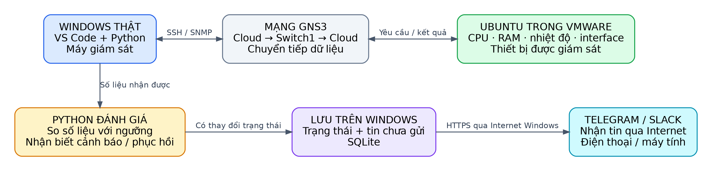
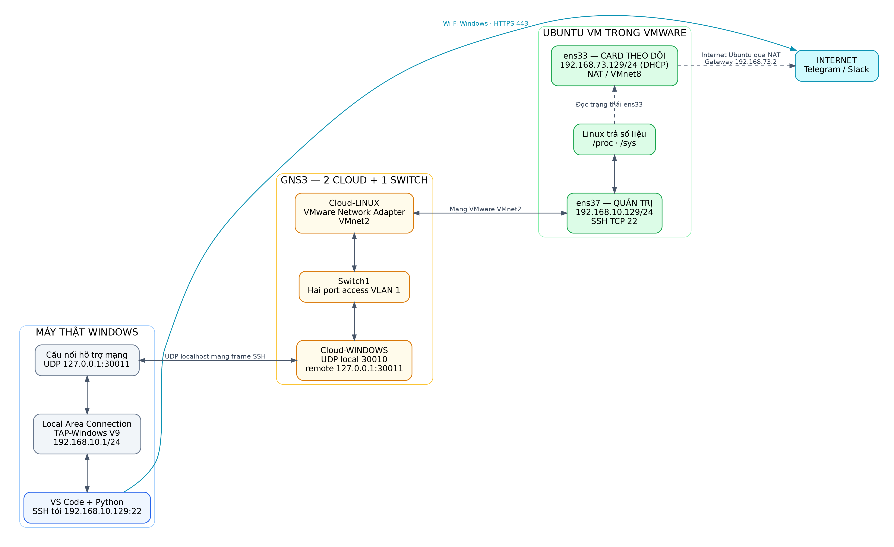
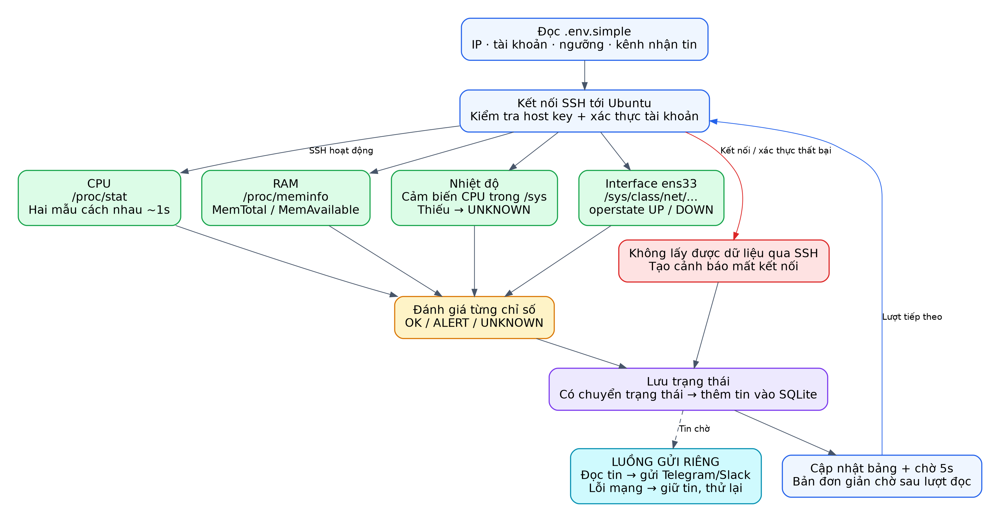
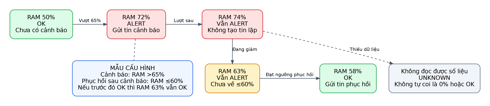
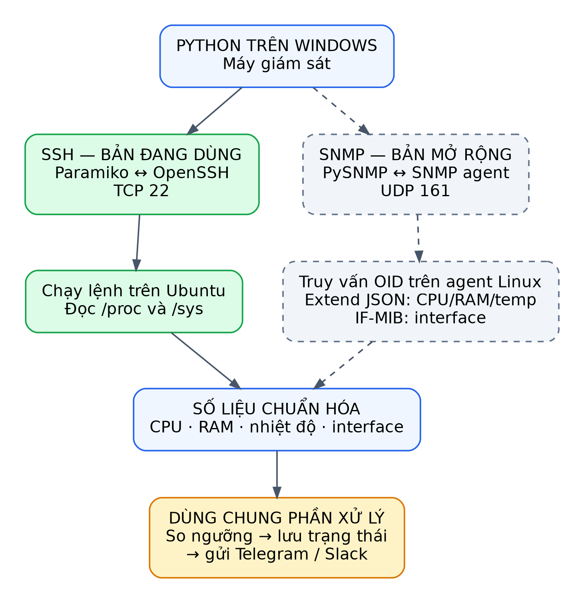
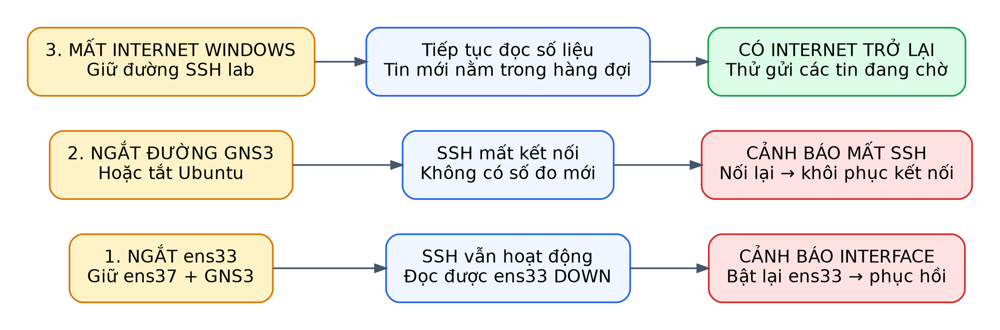

# Hiểu đề tài giám sát thiết bị từ đầu đến cuối

Windows chạy Python · Ubuntu là thiết bị đích · GNS3 là mạng thử nghiệm · Telegram/Slack nhận cảnh báo

Mở **index.html** bằng Chrome/Edge để xem 6 sơ đồ và thử mô phỏng tương tác. File HTML chứa sẵn hình, CSS và JavaScript, chạy không cần Internet hay cài thư viện.

Trang HTML là tài liệu học, không phải dashboard lấy dữ liệu thiết bị thật. Các nút không điều khiển Linux và không gửi tin nhắn thật.

[Tải PDF minh họa](Huong_dan_truc_quan.pdf). PNG/SVG nằm trong thư mục tương ứng; source chứa Graphviz để chỉnh sửa. Dựng lại bằng python build.py; cần Graphviz, Pillow và ReportLab.

## Ai làm gì trong hệ thống?

Hãy hình dung Windows là người kiểm tra, Ubuntu là đối tượng được kiểm tra, còn Telegram/Slack là nơi báo cho người quản trị biết kết quả.

**Một máy thật có thể chứa cả phòng thí nghiệm.** Windows chạy VS Code, Python, VMware và GNS3. VMware tạo ra Ubuntu với CPU, RAM, ổ đĩa và card mạng ảo. Vì vậy bạn không cần mua thêm một máy Linux vật lý. Số CPU/RAM mà chương trình đang đọc thuộc Ubuntu; đó không phải phép đo trực tiếp toàn bộ tài nguyên Windows.

**VS Code, VMware và GNS3 có ba nhiệm vụ khác nhau.** VS Code là nơi xem và chạy code. VMware vận hành máy ảo Ubuntu. GNS3 tạo mạng thử nghiệm để lưu lượng giám sát đi qua. Hai Cloud là cổng nối GNS3 với mạng bên ngoài; tên Cloud không có nghĩa là bạn đang thuê máy chủ đám mây. Switch1 tích hợp chỉ chuyển tiếp frame, không phải thiết bị đang được đọc CPU/RAM.

**Windows chủ động hỏi, Ubuntu trả lời.** Ở bản SSH, Python trên Windows kết nối dịch vụ OpenSSH của Ubuntu rồi thực thi các lệnh đọc số liệu. Linux trả kết quả về cùng kết nối. Python phân tích dữ liệu, so ngưỡng và tạo cảnh báo. Linux không cần tự gửi Telegram trong phương án này.

**Gửi cảnh báo sử dụng một đường khác.** Windows gửi HTTPS qua Internet tới Telegram Bot API hoặc Slack Incoming Webhook. Điện thoại hay ứng dụng máy tính nhận tin từ dịch vụ đó. Mạng giám sát trong GNS3 vẫn có thể hoạt động khi Internet Windows mất; lúc ấy chương trình giữ cảnh báo để gửi lại.

Điểm cần nhớ:

- Máy giám sát: Windows. Thiết bị đích: Ubuntu VM.
- GNS3 tạo đường mạng; Python mới thực hiện giám sát và đánh giá.
- Cảnh báo do Windows gửi qua Internet tới Telegram/Slack.

## Theo dấu đường SSH trên mô hình hiện tại

Sơ đồ này dùng tên card và địa chỉ bạn đã gửi. IP DHCP có thể đổi. TAP chỉ xuất hiện ở sơ đồ triển khai vì nó là cách hỗ trợ kết nối đã dùng trên máy bạn, không phải chức năng bắt buộc của đề tài.

**IP chỉ máy, cổng chỉ dịch vụ.** 192.168.10.129 là địa chỉ Ubuntu trên mạng giám sát. TCP 22 là cổng của dịch vụ SSH. Windows dùng địa chỉ 192.168.10.1 trên card TAP tên Local Area Connection để liên lạc. /24 tương đương subnet mask 255.255.255.0: hai địa chỉ thuộc mạng 192.168.10.0/24.

**Đường đi của một yêu cầu SSH.** Python → TCP/IP Windows → card TAP → công cụ cầu nối UDP → Cloud-WINDOWS → Switch1 → Cloud-LINUX gắn VMware VMnet2 → ens37 của Ubuntu. Kết quả đi theo chiều ngược lại. UDP 30011 và 30010 chỉ dùng giữa cầu nối và GNS3 trên cùng Windows; dữ liệu giám sát vẫn được truyền bên trong phiên SSH.

**Tại sao Ubuntu có hai card?.** ens37 giữ IP 192.168.10.129/24 cho kết nối giám sát. ens33 đang có IP NAT 192.168.73.129/24, gateway 192.168.73.2, để Ubuntu ra Internet; đây cũng là interface được theo dõi trong bản đơn giản. Tách hai vai trò giúp thử ens33 DOWN mà SSH qua ens37 vẫn hoạt động. Không suy ra ens37 DOWN chỉ vì tháo dây GNS3: card VMware có thể vẫn báo UP dù đường truyền đã mất.

**TAP không thay thế SSH hoặc SNMP.** Công cụ TAP/UDP chỉ chuyển frame mạng để khắc phục vấn đề kết nối của lab hiện tại. Nó không đọc số liệu, không so ngưỡng và không gửi cảnh báo. Về chức năng, ứng dụng chỉ cần một đường IP tới Linux. Vì bạn yêu cầu đi xuyên GNS3, thay cách nối mạng phải vẫn giữ điều kiện đó; xóa cầu nối đang dùng mà chưa có đường thay thế sẽ làm mất kết nối.

**Chứng minh đường truyền bằng phép thử.** Khi GNS3 nối đủ dây và cầu nối đang chạy, Test-NetConnection tới 192.168.10.129 cổng 22 cần thành công. Tháo một dây switch thì phải thất bại; nối lại thì phải phục hồi. Kết quả True chứng minh cổng TCP truy cập được, chưa chứng minh đúng mật khẩu, đọc được mọi cảm biến hay nhận được Telegram.

Điểm cần nhớ:

- ens37 là đường quản trị SSH; ens33 là interface được theo dõi.
- Cloud-WINDOWS dùng UDP 30010 → 127.0.0.1:30011; helper dùng chiều ngược lại.
- Windows dùng Internet riêng để gửi cảnh báo, không nhờ Internet của ens33.

## Python làm gì trong một lần kiểm tra?

Chương trình thực hiện cùng một vòng lặp nhiều lần: đọc cấu hình, kết nối, lấy số liệu, đánh giá, lưu trạng thái và cập nhật bảng. Luồng gửi cảnh báo chạy riêng khi giám sát liên tục.

**Cấu hình và xác thực trước khi đọc dữ liệu.** setup_windows.cmd tạo môi trường Python và file .env.simple cục bộ. monitor.py đọc IP, tài khoản, interface, ngưỡng và thông tin nhắn tin từ file này. SSH kiểm tra host key để nhận diện máy chủ, rồi xác thực tài khoản bằng mật khẩu hoặc phương thức được cấu hình. Mật khẩu đăng nhập và fingerprint máy chủ có hai mục đích khác nhau.

**CPU là phần thời gian bận.** SSH đọc /proc/stat hai lần cách nhau khoảng một giây. Python tính phần tăng của các bộ đếm: CPU% = 100 × (1 − thời gian idle tăng / tổng thời gian tăng). Đây là mức sử dụng tổng hợp của các CPU ảo Ubuntu. Một tiến trình dùng hết một core không nhất thiết làm tổng CPU vượt 75% nếu VM có nhiều core.

**RAM, nhiệt độ và interface.** RAM% = 100 × (MemTotal − MemAvailable) / MemTotal, lấy từ /proc/meminfo. Nhiệt độ lấy từ cảm biến CPU phù hợp trong /sys/class/hwmon hoặc /sys/class/thermal. Trạng thái ens33 lấy từ /sys/class/net/ens33/operstate. Thiếu dữ liệu phải hiện UNKNOWN; không được tự đổi thành 0 hoặc OK.

**Phân biệt mất thiết bị và thiếu một chỉ số.** Nếu không kết nối hoặc xác thực SSH được, chương trình tạo cảnh báo mất kết nối SSH. Nếu SSH vẫn hoạt động nhưng không có cảm biến nhiệt độ, CPU/RAM/interface vẫn có thể cập nhật, riêng nhiệt độ là UNKNOWN. Không có cảm biến trên máy ảo là một giới hạn của môi trường, không phải nhiệt độ đang bằng 0°C.

**Kiểm tra định kỳ là gần thời gian thực.** Bản đơn giản mặc định chờ 5 giây sau mỗi lượt đọc. Khoảng cách giữa hai lượt còn có thời gian SSH và lấy mẫu. Sự cố xảy ra ngay sau một lượt đọc phải đợi lượt sau mới được phát hiện; gửi tin còn phụ thuộc mạng và dịch vụ nhắn tin. Vì vậy không hứa mọi cảnh báo đều tới trong đúng 5 giây.

Điểm cần nhớ:

- CPU/RAM/nhiệt độ/interface được đọc từ Ubuntu.
- Mất SSH khác với thiếu dữ liệu của một cảm biến.
- Luồng gửi tin riêng giúp lỗi Internet không chặn vòng đọc số liệu.

## Khi nào gửi cảnh báo, khi nào báo phục hồi?

Ví dụ RAM: cảnh báo khi lớn hơn 65%, phục hồi khi giảm xuống 60% hoặc thấp hơn. Giữa hai ngưỡng, trạng thái cảnh báo đã có được giữ lại để tránh gửi tin liên tục.

**Một ví dụ có đầy đủ trước và sau.** RAM 50%: bình thường. Tăng lên 72%: chuyển sang ALERT và gửi cảnh báo. Vẫn 74%: tiếp tục ALERT nhưng không tạo cùng một tin mỗi vòng. Giảm về 63%: chưa đạt ngưỡng phục hồi nên vẫn ALERT. Giảm về 58%: chuyển sang OK và gửi tin phục hồi. Nếu trước đó chưa cảnh báo, RAM 63% vẫn là bình thường.

**Ngưỡng trong mẫu cấu hình.** CPU: cảnh báo >75%, phục hồi ≤70%. RAM: cảnh báo >65%, phục hồi ≤60%. Nhiệt độ: cảnh báo >65°C, phục hồi ≤60°C. Interface DOWN tạo cảnh báo, UP tạo phục hồi. Những giá trị này là mặc định trong examples/simple.env; cấu hình cục bộ của bạn có thể thay đổi.

**UNKNOWN là một trạng thái riêng.** Không đọc được số liệu không có nghĩa thiết bị bình thường. Chương trình báo UNKNOWN khi thiếu dữ liệu và ghi nhớ trạng thái hợp lệ trước đó. Khi dữ liệu trở lại, chương trình đánh giá lại theo ngưỡng và trạng thái đã biết; nhờ vậy dữ liệu bị gián đoạn không làm mất một cảnh báo còn hiệu lực.

**Tin được lưu rồi mới gửi.** SQLite lưu trạng thái và những tin chưa gửi. Khi API xác nhận thành công, tin đó được gỡ khỏi hàng đợi. Nếu có lỗi kết nối hoặc giới hạn tần suất, tin được giữ để thử lại. Hàng đợi giảm nguy cơ mất tin nhưng không đảm bảo người dùng chắc chắn chỉ nhìn thấy đúng một bản trong mọi lỗi mạng: API có thể đã nhận tin trong khi phía gửi chưa nhận được xác nhận.

**Telegram và Slack nhận tin như thế nào?.** Telegram cần bot token để xác thực và chat ID để xác định cuộc trò chuyện. Slack dùng Incoming Webhook URL. Python gửi HTTPS tới dịch vụ; dịch vụ chuyển tin cho người nhận. Nếu cấu hình cả hai kênh, mỗi kênh có hàng đợi riêng: một kênh lỗi không ngăn kênh kia gửi thành công.

Điểm cần nhớ:

- Ví dụ RAM: 50 → 72 → 74 → 63 → 58, có một cảnh báo và một tin phục hồi.
- Không gửi lặp theo mỗi chu kỳ khi trạng thái vẫn giữ nguyên.
- Internet mất: lưu tin; Internet trở lại: thử gửi theo hàng đợi.

## Hai cách thu thập cùng phục vụ một mục tiêu

SSH thực thi lệnh trên máy đích. SNMP truy vấn một agent bằng OID. Phần so ngưỡng, lưu trạng thái và gửi Telegram/Slack có thể dùng chung sau khi số liệu đã được chuẩn hóa.

**Bản bạn đang chạy là SSH.** run_windows.cmd gọi monitor.py và dùng .env.simple. Python sử dụng Paramiko kết nối OpenSSH của Ubuntu qua TCP 22. Linux đã có /proc và /sys để đọc chỉ số; bản này không cần cài SNMP agent. Ping hoặc Test-NetConnection không tự thực hiện công việc giám sát CPU/RAM.

**SNMP cần thêm agent ở thiết bị đích.** Bản SNMP sử dụng thư viện PySNMP và agent như Net-SNMP trên Linux, mặc định UDP 161. OID là mã định danh một chỉ số. Trong profile Linux của dự án, phần extend cung cấp CPU/RAM/nhiệt độ dưới dạng JSON; IF-MIB cung cấp tên và trạng thái interface. Thiết bị khác có thể có MIB/OID khác; không thể mặc định mọi router đều dùng cùng OID hoặc lệnh Linux.

**Hybrid là bản mở rộng kết hợp hai nguồn.** Trong code hiện tại, hybrid ưu tiên SSH cho CPU/RAM/nhiệt độ và ưu tiên SNMP cho interface. Nếu giá trị ưu tiên không có mà nguồn kia có dữ liệu thì dùng nguồn còn lại. Chương trình vẫn báo tình trạng từng giao thức để không che việc SSH hoặc SNMP bị lỗi. Bản đơn giản không tự bật hybrid.

**Phân biệt các kết nối và cổng.** TCP 22: SSH Windows ↔ Linux. UDP 161: SNMP Windows ↔ agent nếu được cấu hình. HTTPS thường dùng TCP 443: Windows ↔ Telegram/Slack qua Internet. UDP 30010/30011 trong mô hình hiện tại chỉ là cầu nối mạng localhost; đó không phải cổng SNMP và không phải API cảnh báo.

**Giữ đúng phạm vi khi báo cáo.** Nếu bạn trình diễn bản SSH, hãy ghi rõ kết quả đã kiểm tra là SSH. Muốn chứng minh cả SNMP thì phải cấu hình agent, chạy bản SNMP/hybrid và ghi nhận số liệu thật. Việc code có lớp SNMPCollector chưa chứng minh agent SNMP đang chạy trên máy của bạn. SNMPv3 hỗ trợ xác thực và mã hóa; SNMPv2c dùng community và cần giới hạn trong mạng lab phù hợp.

Điểm cần nhớ:

- SSH: TCP 22, chạy lệnh Linux. SNMP: UDP 161, hỏi agent bằng OID.
- monitor.py là bản SSH dễ học; device_monitor có bản SNMP/hybrid.
- Cả hai trả dữ liệu về chung phần đánh giá và gửi cảnh báo.

## Ba kiểu sự cố tạo ba kết quả khác nhau

Để trình diễn có ý nghĩa, cần biết bạn đang tác động vào phần nào: interface được đo, đường quản trị hay đường Internet gửi cảnh báo. Tắt mỗi phần tạo ra một phép thử khác nhau.

**Thử interface DOWN.** Giữ ens37 và đường GNS3 hoạt động. Trong VMware, ngắt Connected của đúng card NAT tương ứng ens33, rồi bật lại. Windows vẫn SSH qua ens37, đọc được ens33 DOWN và tạo cảnh báo interface. Khi ens33 UP trở lại thì tạo tin phục hồi. Xác định đúng card theo cấu hình hoặc MAC trước khi thao tác, vì thứ tự hiển thị adapter không luôn trùng số interface.

**Thử mất đường quản trị.** Tháo một dây của đường Cloud–Switch–Cloud trong GNS3, hoặc tắt Ubuntu. SSH không lấy được số liệu mới. Chương trình cảnh báo mất kết nối SSH; không được trình bày các số đo cũ như số vừa đọc được. Nếu Windows vẫn có Internet thì cảnh báo mất kết nối vẫn gửi được. Nối lại phải có thông báo khôi phục.

**Thử mất Internet gửi cảnh báo.** Giữ mạng lab và SSH hoạt động, ngắt Internet Windows rồi làm phát sinh một trạng thái mới. Chương trình tiếp tục đọc Ubuntu nhưng tin nằm trong hàng đợi. Bật Internet lại thì chương trình thử gửi. Nếu chỉ mất Internet mà không có trạng thái thay đổi hay tin chờ, không nhất thiết có tin mới được tạo.

**Thử vượt ngưỡng CPU/RAM.** Tạo tải trên Ubuntu, theo dõi số thực tế vượt ngưỡng, nhận tin cảnh báo rồi dừng tải và đợi đạt ngưỡng phục hồi. Tải một core trong VM nhiều core có thể chưa đủ vượt ngưỡng CPU tổng. Với RAM, tăng có giới hạn rồi giải phóng; ghi lại số đo và thời điểm nhận tin thay vì mặc định mọi lần tạo tải đều chắc chắn đạt ngưỡng.

**Những bằng chứng cần có.** Ảnh mô hình GNS3, bảng CPU/RAM/interface, tin cảnh báo, tin phục hồi và kết quả mất/kết nối lại đường SSH. Nhiệt độ thiếu cảm biến phải ghi UNKNOWN hoặc mô phỏng có nhãn. SSH thành công qua TAP đã được bạn cung cấp; chưa suy rộng thành mọi chức năng hay SNMP đều đã nghiệm thu. Khi Windows thật tắt/ngủ, chương trình giám sát và có thể cả VM dừng, nên mô hình một máy thật không thể tự phát tin lúc chính máy đó đã tắt.

Điểm cần nhớ:

- Ngắt ens33: kiểm tra interface; ngắt đường GNS3: kiểm tra mất SSH.
- Ngắt Internet Windows: kiểm tra hàng đợi và gửi lại.
- Các nút bên dưới chỉ mô phỏng logic; không gửi tin thật hoặc điều khiển máy của bạn.

## Liên hệ với code

| Phần | File |
|---|---|
| Vòng giám sát SSH | monitor.py |
| Thu thập | device_monitor/collectors/ssh.py, snmp.py, hybrid.py |
| So ngưỡng | device_monitor/engine.py |
| SQLite và hàng đợi | device_monitor/storage.py |
| Gửi cảnh báo | device_monitor/notifications.py |
| Hiển thị | device_monitor/ui.py |

Mật khẩu/token ở .env.simple cục bộ. Không đưa file cấu hình thật vào báo cáo hoặc GitHub.

Nguồn đối chiếu: code của kho qtmnc và cấu hình người dùng cung cấp. Địa chỉ DHCP có thể thay đổi. Các phép thử thực tế cần ghi nhận kết quả thay vì suy ra từ sơ đồ.
